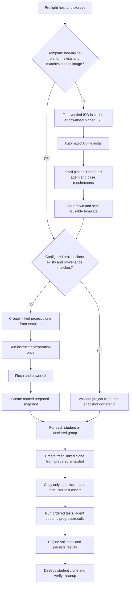

# KVM Alpine platform POC

Status: **not yet runnable**. The current branch contains an incomplete implementation attempt, but it does not compile and must not be described as an operational provider. The example project at [examples/kvm-alpine-poc](../examples/kvm-alpine-poc/) remains a synthetic fixture; its configuration is not currently executable by Thot. A build and host readiness check performed on 2026-11-22 found the implementation blocked before VM creation. See [Implementation test record](#implementation-test-record).

## Purpose

The POC asks whether a very small Alpine Linux guest can safely host Thot's test agent and execute one short student script from a clean per-student linked clone. It tests the complete lifecycle, not just whether QEMU starts: ISO verification, automated installation, reusable template creation, project preparation, snapshotting, per-student cloning, bounded transfer/execution/result collection, and cleanup.

The platform is named `kvm-alpine`, distinct from the planned `kvm-debian`. Both use KVM and the same provider-level task/result contract, but must keep separate base images, package managers, init assumptions, agent builds, and preparation. `kvm-alpine` is the low-resource experiment; it is not a replacement for Debian compatibility or a claim of stronger isolation than KVM itself.

## Frozen POC contract (phase 0)

Phase 0 decisions are recorded in [ADR-0008](decisions/0008-kvm-alpine-poc-contract.md). The canonical project file is `configuration.thot.yaml` with `schema_version: thot.dev/v2`; this is the schema represented by the example fixture. Legacy VM activity YAML and `/api/v1` remain unchanged. The Rust v2 project and protocol types belong in `thot-core`; the single async `SandboxProvider` lifecycle interface belongs in `thot-runner`; the engine consumes typed opaque template, baseline, and student-environment handles and remains the only assessment authority.

For this local POC, the guest initiates a per-environment VSOCK connection to a host listener. Frames use a four-byte big-endian length followed by UTF-8 JSON, capped at 1 MiB; blobs are chunked and hashed. A per-clone one-use secret and the expected peer CID scope the session. This authenticates the active VM session, not guest integrity. Execution status (`completed`, `timed_out`, `resource_exceeded`, `platform_error`, `cancelled`, `interrupted`) is separate from engine assessment (`passed`, `failed`, `skipped`, `pending`) and cleanup (`clean`, `pending`, `failed`). Results persist bounded raw streams and artifacts by content hash alongside configuration, input, image, baseline, task, timing, process, diagnostic, assessment, and cleanup provenance. Secrets and VM disks are not ordinary result artifacts.

These are accepted contracts, **not implemented capabilities**. Phase 1 of the closure plan must make the code and fixture conform before host-side VM lifecycle work proceeds.

## Lifecycle to implement after this design is accepted

### Reusable template

The platform provider first checks for a VM with the reserved name `thot-alpine-platform` in its own ownership registry. A same-named unrelated libvirt domain must never be adopted or deleted. If absent, it checks the configured ISO cache; if missing, it downloads a version-pinned ISO from an allowlisted official mirror, verifies the detached checksum/signature against a pinned trusted key, and atomically publishes the verified file. `latest-stable` is convenient for discovery but must not be the identity used for reproducible runs.

Install Alpine unattended using a versioned answer file and `setup-alpine`/`setup-disk` flow, or a purpose-built image build if unattended installation proves fragile. The exact Alpine answer-file and disk-install commands are a POC question: boot-media environment, device naming, root account/SSH policy, networking and init choices must be verified on the target libvirt configuration. Install only the base packages needed to boot, accept engine tasks, and return results. A static musl guest agent is a likely fit; its build, signature, update path, and protocol compatibility must be pinned. The agent starts as an unprivileged account where possible; privileged test operations are explicitly granted inside this disposable guest only.

Power off cleanly after installation. Store template metadata beside the VM, including Alpine release, architecture, ISO URL and SHA-256, answer-file hash, package repository and package inventory, agent version/hash, virtual hardware, disk format, libvirt version, and template UUID. Any change to those inputs invalidates the template. The template is immutable/read-only after sealing and is never assigned student data.

### Project preparation baseline

The instructor configures a unique project VM name, such as `thot-alpine-poc-sum-project`. The provider verifies ownership metadata and provenance before reuse. If no valid prepared baseline exists, it creates a linked project clone from the reusable template, installs project-common dependencies (for this fixture, full Bash because Alpine's default shell is BusyBox `ash`), and executes instructor preparation scripts once under separate limits. The project preparation result is infrastructure provenance, not a student mark.

After preparation, flush writes and power off the VM before taking a disk snapshot. The snapshot identity is derived from project config, template identity, preparation script hashes, package inventory and provider version. A stale or mismatched snapshot must be rebuilt or explicitly selected for reuse; a same-named snapshot alone is not proof it matches. Preparation requires package/network access only if declared, constrained to a configured mirror. Preparation failure blocks this platform's student runs.

### Per-student execution

For each student or explicitly assigned group, create a linked clone from the prepared snapshot with a generated unique name and a fresh writable overlay. Transfer only that student's selected deliverable and declared instructor tests into a bounded, non-shared guest workspace. Inputs are read-only to the agent unless a test explicitly needs a working copy. Execute steps sequentially; syntax check runs first, functional check requires syntax success. The agent captures process exit code (nullable when no process started), stdout, stderr, elapsed time, timeout/resource status and bounded artifacts. It reports observations only; the engine owns check evaluation, rubric calculation, and the student expedient.

After results and artifacts have been acknowledged and persisted, shut down and delete the linked clone and overlay. Cleanup must work after timeout, agent loss and host/engine restart. Preserve only bounded diagnostics needed to explain a failure. A cleanup error remains visible and blocks unsafe reuse; never delete the base template or another project's VM while reconciling a student clone.

## Synthetic fast test project

The activity asks each student to submit `sum.sh`, a Bash program that accepts exactly two signed decimal integers and prints their sum followed by one newline. The POC test uses inputs 17 and 25 and expects exactly `42\n`. This small workload gives three useful cases without a compiler or long installation.

| Fixture | Behavior | Expected test outcome |
|---|---|---|
| `student1/sum.sh` | Valid Bash and adds the two integers | Syntax passes; functional output is 42; 10/10 |
| `student2/sum.sh` | Valid Bash but multiplies instead | Syntax passes; output is 425; syntax criterion earns 2/10, functional criterion fails |
| `student3/sum.sh` | Contains a missing closing parenthesis | Syntax fails; functional step is skipped; 0/10 |

Project assets are under [examples/kvm-alpine-poc](../examples/kvm-alpine-poc/): `configuration.thot.yaml` defines platform settings, preparation, resource limits, independent tests, and grading; `students.yaml` and `assignments.yaml` define synthetic identities/mapping; `students/studentN/sum.sh` contains the three deliverables; `extern/tests/` contains instructor-owned test scripts. All test code and deliverables are illustrative fixtures, not production sandbox implementations.

The configuration explicitly selects only `kvm-alpine`. It declares no other platform and no cross-platform dependencies. Student tests run with network denied. ISO/template acquisition is host-side privileged platform setup, not a test action and never controlled by submission content. The platform's guest-initiated result channel should be scoped to a run and clone; do not expose a general inbound guest port on the professor host.

## Host limitations observed for this POC

The repository development host was inspected on 2026-11-21. The separately authorized test host `192.168.1.35` was inspected on 2026-11-22 and has KVM available; these are different machines:

| Resource | Observed | Consequence |
|---|---|---|
| Host type | Linux kernel `7.0.14-23-pve`; environment is itself a Proxmox VE virtual machine | This is a nested-virtualization setup, not bare metal |
| CPU | Intel Core i7-6700K; VT-x flag is visible; 8 vCPUs listed but only 4 online | Nested acceleration is not established by CPU flags alone |
| KVM device | `/dev/kvm` is absent | KVM/QEMU acceleration cannot run here; POC cannot be exercised in this environment |
| Memory | 4.0 GiB total, about 1.6 GiB available at inspection, no swap | Too little headroom for reliable guest startup plus engine and host services; even a 512 MiB guest may pressure the host |
| Disk | Root filesystem 25 GiB total, 11 GiB free | One small ISO may fit, but base image, project snapshot, three overlays, logs and normal workspace growth leave unsafe margin |
| Tools | `qemu-system-x86_64`, `virsh`, `virt-install`, Docker and `apk` are absent from PATH | No local VM/provider toolchain is installed; guest package manager is naturally not a host tool |

**Recommendation:** do not attempt this POC on the current workspace host. Use a dedicated Linux KVM host, or have the Proxmox administrator expose nested VT-x/KVM to this VM, create `/dev/kvm` with correct access, and allocate substantially more capacity. For a three-student sequential smoke test, start with at least 2–4 vCPUs, 4 GiB RAM allocated to this environment with at least 1 GiB reserved for the host/engine, and 12–20 GiB free working disk. These are prototype planning values, not certified minimums; measure and revise them. A dedicated KVM-capable host avoids nested virtualization uncertainty.

Before implementation, check `lscpu`, `/dev/kvm`, libvirt capabilities, actual online CPU count, memory headroom, free disk, snapshot/linked-clone support for the chosen storage pool, network firewalling, and permissions for the service identity. Fail preflight with a plain-language explanation if acceleration, storage, or cleanup prerequisites are missing; never fall back to running student code on the host.

## Open questions and proposed answers

| Issue | Risk / question | Proposal for the POC |
|---|---|---|
| ISO selection | Alpine `virt` media is much smaller than `standard`, but exact hardware/driver and setup behavior must be tested | Pin one x86_64 `alpine-virt` ISO version and its official checksum; do not download a moving alias during a run |
| Alpine release cadence | A release update changes packages and guest behavior | Keep template version explicit; update only by creating and validating a new template generation |
| Automated installation | Answer-file and disk installation flow may differ from assumptions | Prototype the exact unattended boot/install path and test reboot without ISO; document console/recovery path |
| Bash availability | Base Alpine uses BusyBox tools; shell behavior differs | Install Alpine `bash` package during project preparation; invoke Bash explicitly, never `/bin/sh` |
| Guest agent artifact | Alpine uses musl; existing Thot Rust binaries may target glibc | Decide static musl build versus a small compatible runtime package; pin hash/version and test protocol before snapshot |
| Template ownership | Name collisions could cause destructive cleanup | Store provider ownership UUID/metadata outside guest; refuse to adopt or remove unknown same-name domains |
| Clone semantics | Linked disk children depend on immutable parent/snapshot | Validate clone operation and backing chain; reserve quota and keep template read-only |
| Snapshot consistency | Running `apk` or services may leave writes in flight | Stop all preparation, sync, power off, then snapshot disks; no memory snapshot in POC |
| Network/credentials | `apk` mirror access can leak or allow guest egress | Mirror-only during template/preparation phases; deny during student tests; no private tokens in guest |
| Resource exhaustion | Student can fork processes, fill disk, or flood output | Enforce host-level cgroup/VM CPU, memory, disk and process limits; guest limits alone do not protect host |
| Evaluation semantics | Syntax error must not look like missing infrastructure evidence | Keep syntax failure as student evidence; boot/agent/transport/cleanup failure leaves grade pending |
| Rebuild/reuse | A project snapshot can go stale after config/scripts/packages change | Content-address preparation inputs and show “reuse” versus “rebuild”; never silently trust name-only matches |
| Result trust | Student root could alter or kill the in-guest agent | POC scope is workflow viability and accidental containment, not tamper-proof grading; document this limit in each run |

## Implementation audit: missing and incorrect behavior

This audit compares the implementation present in the repository with the lifecycle and success criteria above. It is a source inspection, not a successful runtime test. `cargo check --workspace` was attempted on 2026-11-22 after fixing malformed manifests and invalid core re-exports; it still fails in `thot-runner` with 91 compiler errors and 58 warnings. The items below are closure blockers, not optional cleanup.

### Critical blockers

| Area | Current defect or missing behavior | Required correction |
|---|---|---|
| Build integrity | The workspace does not compile. The runner contains references to absent modules/types (`crate::error`, `crate::kvm`, `crate::manifest`, `crate::provenance`, `crate::vm`, `Settings`, `PlatformConfig`, and `KvmAlpineConfig` in the wrong crate), invalid imports, and sync/async API mismatches. | Select one module/API design and make `cargo check --workspace` pass before attempting VM operations. Remove dead placeholder paths rather than adding shims for abstractions that will not be used. |
| Competing provider contracts | `thot-engine/src/sandbox_provider.rs` defines an async generic provider, while `kvm_alpine_provider.rs` implements a separate synchronous interface with undefined `TestInvocation`/`TestOutcome` types. `thot-runner/src/kvm_alpine/provider.rs` imports nonexistent `modules`, `settings`, and `error` modules. | Define one provider contract, assign host lifecycle to `thot-runner`, assign evaluation/persistence to `thot-engine`, and use typed handles carrying resource identities and ownership metadata. |
| False passing results | `thot-engine/src/provider.rs::run_task` unconditionally returns `Passed`, exit code 0, empty output, and zero duration. `ensure_template`, `prepare_baseline`, `create_environment`, and `destroy_environment` are empty success stubs. | Remove fabricated success. Every operation must either execute and return observed evidence or return an infrastructure error that leaves assessment pending. |
| No executable VM lifecycle | The runner's `image.rs`, `template.rs`, `baseline.rs`, and `student_environment.rs` do not create a working Alpine VM lifecycle. They contain placeholders, nonexistent types/methods, a demo `main`, and nonfunctional path/config handling. | Implement and exercise preflight, image acquisition, unattended install, template sealing, project preparation, snapshot, student clone, file staging, guest execution, shutdown, deletion, and reconciliation as real operations. |
| Guest agent does not build or communicate | `apps/thot-alpine-agent/src/main.rs` has malformed syntax and uses undeclared protocol names/types; it calls async execution synchronously. The agent's `vsock.rs` API does not match `main.rs`. The runner imports an absent `crate::agent_protocol`, and the VSOCK dependency/API is not configured consistently. | Implement one shared, versioned protocol in `thot-core`, use length-delimited bounded frames, compile the guest agent for the selected Alpine ABI, and prove bidirectional task/result exchange in an actual guest. |
| No end-to-end test route | `thotd/src/main.rs` wires configuration fields absent from `KvmAlpineConfig`, passes config where an `Arc<KvmAlpineSettings>` is expected, calls a runner `SandboxRunService` that is not provided, and constructs engine services with mismatched interfaces. API and engine sandbox run types also disagree. | Wire one daemon configuration and one service/API lifecycle; test run creation, status, cancellation, result retrieval, and restart recovery through the supported interface. |
| Example project is not executable configuration | `configuration.thot.yaml` declares a proposed `thot.dev/v2` schema. The current `sandbox_config.rs` parses a different `VMActivityProject` schema and does not define these `sandbox_platforms`, `lifecycle`, `inputs`, `tests`, or evaluation fields. The example also describes `install_from: pinned-static-binary`, while the runner expects a different invented `binary_data` shape. | Choose and version a real schema, implement strict parsing and validation for it, and add a fixture test proving this exact example loads and has the expected semantics. |

### Incorrect implementation details by subsystem

| Subsystem | Observed problems |
|---|---|
| Preflight | `preflight.rs` invokes `lscpu --cpu` and treats output lines as CPU count; tries to read `stderr` and call `.lines()` on an `io::Error`/byte vector; sums existing file sizes rather than measuring free space; does not verify the configured libvirt URI, domain storage pool, linked-clone support, firewall rules, service-account permissions, or actual resource headroom. Configuration paths and defaults are inconsistent across daemon and runner. |
| ISO acquisition | `image.rs` constructs the release path/name incorrectly (`v3.24-releases` and `...-v3.24.4.x86_64.iso`); contains a fabricated digest; references an out-of-scope `client`; compares cached ISO byte length with digest text length; has no atomic download, HTTP status/size limit, signature trust chain, or cleanup of partial files. The documented URL and fixture use another filename. |
| Template | `template.rs` never invokes `virt-install` or installs Alpine; manifest validity always returns true; ownership is only an in-memory map; operations panic through `unwrap`; it hashes an ISO URL as if it were a local file; writes a fixed `/tmp/answer-file.cfg`; uses undefined values and config fields; does not detach boot media, verify reboot, seal storage, or make the parent immutable. Its `main` is a hard-coded demo and must not be part of a library module. |
| Preparation baseline | `baseline.rs` imports nonexistent VM abstractions, refers to absent configuration fields, uses incompatible hashes/types, and does not implement package installation or script execution. It does not actually create a project VM/snapshot, compare provenance, reuse a valid baseline, or reject stale state safely. |
| Student environment | `student_environment.rs` declares nested modules that do not exist. Its path predicate requires an absolute path and simultaneously rejects paths starting with `/`, so valid paths are rejected; it tests a source path rather than canonicalized paths beneath an allowed root; calls nonexistent `file_size` and lacks the Unix permissions trait import. It starts a VM before staging files, never sends staged bytes into the guest, and duplicates cleanup through undefined channel methods and local VM functions. Names are collision-prone and not tied to durable run IDs. |
| Host command execution | `command.rs` mixes `std::process` with Tokio process APIs. Its output reader reads one buffer only, reports truncation incorrectly at the exact limit, and stops draining output; timeout/process-group termination and child reaping are not reliable as written. Output should be bounded while the pipes continue to drain, and timeout must include descendants and cleanup. |
| Agent execution | `executor.rs` also mixes standard and Tokio `Command` types and has async/sync mismatches. It does not validate argv against the task schema, enforce an unprivileged identity, sanitize environment, enforce CPU/memory/process/disk limits, or constrain writable paths robustly. It reports elapsed time as the configured timeout for every run. Output capture, timeout status, exit status, and infrastructure diagnostics are not consistently represented. |
| Guest transport | `agent_channel.rs` contains placeholder VSOCK constants, a nonfunctional token implementation, unrelated socket imports, and compares incompatible values. The guest expects a token argument but does not use it. Neither side has correct framing for partial reads/writes, frame-size enforcement, handshake authentication, replay/run scoping, version negotiation, reconnect policy, or channel timeout behavior. |
| Test semantics | The sample YAML's tests are not parsed/executed. The inline YAML says `argv: [sh, ...]`; the wrapper does call `bash`, but the agent contract does not define whether test wrappers are trusted instructor code or shell commands. Dependency handling (`requires`), skip semantics, exact stdout comparison, and rubric criteria are not implemented in the engine. The engine must distinguish student failure from missing infrastructure evidence. |
| Results and expedients | Current service code contains incompatible imports/types and incomplete storage. `RunStore` is in-memory, methods are marked async without persistence, and recovery/reconciliation are stubs. The service does not preserve per-test observations, platform diagnostics, timeout/truncation flags, artifact references, or project/config/template provenance. It does not reliably destroy the student clone on all error/cancellation paths. |
| Resource/network security | YAML declares network denial for student tests and mirror-only setup access, but no implementation enforces either policy. Resource settings in the project file are not bounded against host policy. There is no implemented host-level CPU/memory/disk/process/output/network enforcement, guest isolation profile, or validation that the host service cannot access student-controlled paths. `firewall_confirmation` is a boolean assertion, not evidence of enforced rules. |
| Ownership and recovery | Names and in-memory metadata are not sufficient ownership records. There is no atomic resource registry, lock around duplicate runs, crash-safe state transition model, or safe reconciliation after daemon restart. Cleanup could target the wrong domain/disk if implemented by name alone. |
| Documentation and fixture consistency | The general lifecycle is written as future tense, while the implementation-test section describes a later implementation attempt. The final sentence says the “current environment” fails because `/dev/kvm` is absent, but that refers only to the development workspace host; the separately authorized Debian test host has `/dev/kvm`. `examples/kvm-alpine-poc/README.md` and this document therefore need to distinguish those hosts and the fact that no guest run occurred. The fixture's `extern/tests/README.md` says tests are inline while also linking script files, and the project test assets are not actually copied/executed by current code. |

The individual defects above are examples of the broader blockers found by source inspection, not an exhaustive enumeration of every compiler diagnostic. The compile log should be regenerated as implementation progresses; resolving one diagnostic may expose others.

## Plan to close the POC

Work in order. Each phase has a gate; do not move a guest test to “passed” based on mocked output or host execution. Keep student tests sequential for this POC so that resource use and cross-student contamination are easy to reason about.

```mermaid
flowchart LR
  A[0 Scope and contracts] --> B[1 Compiling core and runner]
  B --> C[2 Config and fixture validation]
  C --> D[3 Host preflight and ownership]
  D --> E[4 Alpine template install]
  E --> F[5 Project preparation and snapshot]
  F --> G[6 Student clone and agent execution]
  G --> H[7 Engine evaluation and durable records]
  H --> I[8 End-to-end host run and evidence]
```

| Phase | Ordered work and dependencies | Exit gate |
|---|---|---|
| 0. Freeze the POC contract — complete | ADR-0008 decides the `thot.dev/v2` project shape, Rust model names, single provider lifecycle and opaque handles, guest-initiated VSOCK framing/authentication, execution versus assessment statuses, and durable evidence. Legacy VM activity YAML and `/api/v1` are explicitly unchanged. | Decision recorded in [ADR-0008](decisions/0008-kvm-alpine-poc-contract.md) and summarized above. Implementation must conform; this gate does not claim code is implemented or compiling. |
| 1. Restore build integrity | Repair Cargo manifests and dependency declarations; delete accidental demo `main` and stale/duplicate modules; make runner, agent, engine, API, daemon compile against the selected contracts. Keep host commands behind testable adapters. | `cargo check --workspace` succeeds, then `cargo test --workspace` succeeds. Add focused contract/unit tests as the implementation requires. No warning is used to mask an unimplemented operation. |
| 2. Make the fixture authoritative | Implement YAML deserialize/validation, strict unknown-field handling or documented extension handling, path containment, test dependency order, timeout/output/VM limits, and rubric schema. Align `configuration.thot.yaml`, students, assignments, tests, and README. Fix expected scoring to 10/2/0 and infrastructure failures to pending. | A configuration test loads the real example and validates all student mappings, file paths, dependency semantics, limits, and rubric. Invalid paths, unsupported platform fields, and invalid limits fail before any VM is touched. |
| 3. Host preflight and ownership registry | Measure actual CPU availability, RAM and filesystem free bytes; verify `/dev/kvm`, QEMU/libvirt tools and URI, storage pool/capacity, snapshot/linked-clone capability, firewall/network policy, service user access, and configured ceilings. Add a durable Thot-owned UUID/metadata registry, per-project locks, and safe name collision behavior. | Preflight gives actionable failures for deliberately missing prerequisites. An unrelated same-name VM is neither adopted nor deleted. Duplicate starts are rejected and ownership metadata survives process restart. |
| 4. Build and verify the Alpine template | Select a pinned ISO and verify the official checksum/signature using a trusted source; correct filename/URL and cache behavior; implement bounded atomic download. Implement documented unattended Alpine install, configure networking/SSH or VSOCK, install minimal runtime and the pinned static/musl guest agent, detach ISO, reboot, verify agent handshake, power off, and seal metadata/disk. | From an empty cache and empty registry, a fresh host setup creates `thot-alpine-platform` noninteractively. A second run verifies and reuses it. Corrupt ISO, changed digest, failed install, and same-name foreign domain are rejected without damaging other resources. |
| 5. Build prepared project baseline | Create the configured unique project clone from the sealed template; install Bash and declared common resources; execute preparation scripts in deterministic order under limits and declared network policy; record output/status and content hashes; sync and power off; create/verify a disk snapshot and provenance. Implement stale-baseline rebuild policy. | First preparation creates and snapshots a baseline; identical rerun reuses it; changed package/script/config/template hash rebuilds it. Failure prevents student execution and is reported as infrastructure failure. |
| 6. Execute one student safely | Create a unique linked clone per student from the prepared snapshot; transfer only validated, bounded deliverable and instructor assets; verify guest paths and hashes; run one task at a time through authenticated framed protocol; collect progress and complete results. Enforce host-level resource/network restrictions, output caps with full pipe draining, timeout/descendant termination, and unconditional cleanup. | A deliberately instrumented test proves student writes/processes/network do not survive into the next clone; timeout, oversized output, malformed request, guest crash, and agent disconnect have bounded outcomes and safe cleanup. |
| 7. Integrate engine assessment and records | Make the engine generate each declared test task and dependency; validate agent protocol/task IDs; evaluate only received observations; preserve student failure separately from infrastructure failure; calculate fixture rubric; write durable run/test/result/expedient records and artifacts; support run status/cancel/restart reconciliation through the API/CLI path selected for the POC. | No path can synthesize `Passed`. The three fixture results are exactly 10/10, 2/10, and 0/10, while infrastructure failures remain pending. Results survive a daemon restart and can be exported/read by the professor. |
| 8. Run on the authorized KVM host and close | Confirm host capacity and systemd/service identity; use a dedicated test data root and preserve the existing service until a separately verified daemon is ready. Run from an empty template state, then rerun to prove template/baseline reuse. Execute all three students sequentially, inspect guest/domain/disk cleanup, test forced failure/restart recovery, and record measurements. | All six success criteria below have command logs, run IDs, result artifacts, and resource measurements. Update the host record with actual evidence and remaining limitations; only then mark POC complete. |

### Phase ordering and stopping rules

Phases 0–2 are required before any privileged VM action. Phases 3–6 are required before a test can be called sandboxed. Phase 7 is required before results can be called Thot assessments. Phase 8 is the closure evidence. If a phase fails, preserve the failure as a visible infrastructure state, clean up only resources with verified Thot ownership, and stop dependent phases. Never convert startup, transport, timeout, or cleanup failures to a zero grade.

## Implementation test record

On 2026-11-22, `cargo check --workspace` was attempted after correcting malformed Cargo manifests and invalid `thot-core` re-exports. The check still fails in `thot-runner` with 91 compiler errors and 58 warnings. Failures include absent modules and configuration types, mismatched synchronous/asynchronous process APIs, incomplete image download code, nonexistent VM abstractions, and agent-channel type errors. The engine's current KVM adapter also returns a hard-coded successful result instead of running a task, so compilation alone would not establish working evaluation.

The authorized test host is a Debian 13 VM with `/dev/kvm`, 4 vCPUs, approximately 3.8 GiB RAM plus 1.7 GiB swap, and approximately 19 GiB free disk. `virt-host-validate qemu` confirms KVM and the required device; it reports no IOMMU and cannot establish secure-guest support. Libvirt, QEMU, `virt-install`, and image utilities were installed for testing, but no Alpine template, project baseline, student clone, or test run was created because the Thot implementation does not compile. The host's pre-existing `thotd` service was left untouched.

To resume implementation, first replace the nonfunctional provider scaffolding with a coherent provider lifecycle and wire real task/result contracts through engine and runner. Then implement and verify the pinned Alpine installation and guest protocol on this host. Do not interpret a fabricated `Passed` response, a host-side script run, or a successful VM boot as POC success. Close the POC only after all six success criteria below have evidence from actual guest runs.

## Suggested POC success criteria

1. On a documented KVM-capable Linux host, acquire and checksum-verify the pinned Alpine ISO; install the template without interactive input and boot it after detaching installation media.
2. Install and handshake with the pinned guest agent; keep the template free of student deliverables and project-specific preparation.
3. Create the project clone once, install Bash, power off and snapshot; rerun must validate provenance and reuse it, while a changed prep hash must trigger rebuild.
4. Run the three students sequentially from separate linked clones. Confirm clean disk/process state between students and exactly the expected syntax/output/exit-code observations.
5. Demonstrate timeout cancellation, bounded stdout/stderr, agent disconnect handling, host/network isolation, forced cleanup, and safe recovery after engine restart.
6. Record wall-clock setup/clone/test/cleanup times, peak host RAM/CPU, template/snapshot/overlay sizes, and disk amplification. Decide from measurements whether this is viable on instructor hardware.

The repository development host fails criterion 1 because `/dev/kvm` is absent. The separately authorized Debian 13 test host has `/dev/kvm` and management packages installed, but the implementation has not booted an Alpine guest there. Therefore no POC success criterion has yet been demonstrated on the test host, and no resource viability claim can yet be made.

## External technical references

At the time this document was prepared, the official Alpine downloads page lists Alpine 3.24.4 as the current stable release, and the official x86_64 release index provides a 67 MiB `alpine-virt-3.24.4-x86_64.iso` plus SHA-256/signature files. Pin the exact release artifact and verify it; check the official index again when selecting the implementation image because releases change. [Alpine downloads](https://www.alpinelinux.org/downloads/), [official x86_64 release index](https://dl-cdn.alpinelinux.org/alpine/v3.24/releases/x86_64/).
