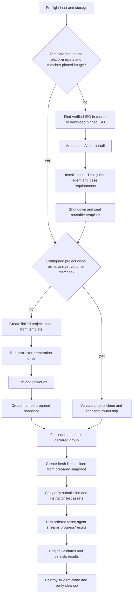

# KVM Alpine platform POC

Status: design and synthetic test fixture only. No KVM Alpine platform provider, installer, VM image, snapshot, clone, or guest-agent integration has been implemented. The example project at [examples/kvm-alpine-poc](../examples/kvm-alpine-poc/) uses the proposed `thot.dev/v2` configuration shape; it cannot currently be run by Thot.

## Purpose

The POC asks whether a very small Alpine Linux guest can safely host Thot's test agent and execute one short student script from a clean per-student linked clone. It tests the complete lifecycle, not just whether QEMU starts: ISO verification, automated installation, reusable template creation, project preparation, snapshotting, per-student cloning, bounded transfer/execution/result collection, and cleanup.

The platform is named `kvm-alpine`, distinct from the planned `kvm-debian`. Both use KVM and the same provider-level task/result contract, but must keep separate base images, package managers, init assumptions, agent builds, and preparation. `kvm-alpine` is the low-resource experiment; it is not a replacement for Debian compatibility or a claim of stronger isolation than KVM itself.

## Lifecycle to implement after this design is accepted

### Reusable template

The platform provider first checks for a VM with the reserved name `thot-alpine-platform` in its own ownership registry. A same-named unrelated libvirt domain must never be adopted or deleted. If absent, it checks the configured ISO cache; if missing, it downloads a version-pinned ISO from an allowlisted official mirror, verifies the detached checksum/signature against a pinned trusted key, and atomically publishes the verified file. `latest-stable` is convenient for discovery but must not be the identity used for reproducible runs.

Install Alpine unattended using a versioned answer file and `setup-alpine`/`setup-disk` flow, or a purpose-built image build if unattended installation proves fragile. The exact Alpine answer-file and disk-install commands are a POC question: boot-media environment, device naming, root account/SSH policy, networking and init choices must be verified on the target libvirt configuration. Install only the base packages needed to boot, accept engine tasks, and return results. A static musl guest agent is a likely fit; its build, signature, update path, and protocol compatibility must be pinned. The agent starts as an unprivileged account where possible; privileged test operations are explicitly granted inside this disposable guest only.

Power off cleanly after installation. Store template metadata beside the VM, including Alpine release, architecture, ISO URL and SHA-256, answer-file hash, package repository and package inventory, agent version/hash, virtual hardware, disk format, libvirt version, and template UUID. Any change to those inputs invalidates the template. The template is immutable/read-only after sealing and is never assigned student data.

### Project preparation baseline

The instructor configures a unique project VM name, such as `thot-alpine-poc-sum-project`. The provider verifies ownership metadata and provenance before reuse. If no valid prepared baseline exists, it creates a linked project clone from the reusable template, installs project-common dependencies (for this fixture, full Bash because Alpine's default shell is BusyBox `ash`), and executes instructor preparation scripts once under separate limits. The project preparation result is infrastructure provenance, not a student mark.

After preparation, flush writes and power off the VM before taking a disk snapshot. The snapshot identity is derived from project config, template identity, preparation script hashes, package inventory and provider version. A stale or mismatched snapshot must be rebuilt or explicitly selected for reuse; a same-named snapshot alone is not proof it matches. Preparation requires package/network access only if declared, constrained to a configured mirror. Preparation failure blocks this platform's student runs.

### Per-student execution

For each student or explicitly assigned group, create a linked clone from the prepared snapshot with a generated unique name and a fresh writable overlay. Transfer only that student's selected deliverable and declared instructor tests into a bounded, non-shared guest workspace. Inputs are read-only to the agent unless a test explicitly needs a working copy. Execute steps sequentially; syntax check runs first, functional check requires syntax success. The agent captures process exit code (nullable when no process started), stdout, stderr, elapsed time, timeout/resource status and bounded artifacts. It reports observations only; the engine owns check evaluation, rubric calculation, and the student expedient.

After results and artifacts have been acknowledged and persisted, shut down and delete the linked clone and overlay. Cleanup must work after timeout, agent loss and host/engine restart. Preserve only bounded diagnostics needed to explain a failure. A cleanup error remains visible and blocks unsafe reuse; never delete the base template or another project's VM while reconciling a student clone.

## Synthetic fast test project

The activity asks each student to submit `sum.sh`, a Bash program that accepts exactly two signed decimal integers and prints their sum followed by one newline. The POC test uses inputs 17 and 25 and expects exactly `42\n`. This small workload gives three useful cases without a compiler or long installation.

| Fixture | Behavior | Expected test outcome |
|---|---|---|
| `student1/sum.sh` | Valid Bash and adds the two integers | Syntax passes; functional output is 42; 10/10 |
| `student2/sum.sh` | Valid Bash but multiplies instead | Syntax passes; output is 425; syntax criterion earns 2/10, functional criterion fails |
| `student3/sum.sh` | Contains a missing closing parenthesis | Syntax fails; functional step is skipped; 0/10 |

Project assets are under [examples/kvm-alpine-poc](../examples/kvm-alpine-poc/): `configuration.thot.yaml` defines platform settings, preparation, resource limits, independent tests, and grading; `students.yaml` and `assignments.yaml` define synthetic identities/mapping; `students/studentN/sum.sh` contains the three deliverables; `extern/tests/` contains instructor-owned test scripts. All test code and deliverables are illustrative fixtures, not production sandbox implementations.

The configuration explicitly selects only `kvm-alpine`. It declares no other platform and no cross-platform dependencies. Student tests run with network denied. ISO/template acquisition is host-side privileged platform setup, not a test action and never controlled by submission content. The platform's guest-initiated result channel should be scoped to a run and clone; do not expose a general inbound guest port on the professor host.

## Host limitations observed for this POC

Inspected on 2026-11-21 in the current workspace environment:

| Resource | Observed | Consequence |
|---|---|---|
| Host type | Linux kernel `7.0.14-23-pve`; environment is itself a Proxmox VE virtual machine | This is a nested-virtualization setup, not bare metal |
| CPU | Intel Core i7-6700K; VT-x flag is visible; 8 vCPUs listed but only 4 online | Nested acceleration is not established by CPU flags alone |
| KVM device | `/dev/kvm` is absent | KVM/QEMU acceleration cannot run here; POC cannot be exercised in this environment |
| Memory | 4.0 GiB total, about 1.6 GiB available at inspection, no swap | Too little headroom for reliable guest startup plus engine and host services; even a 512 MiB guest may pressure the host |
| Disk | Root filesystem 25 GiB total, 11 GiB free | One small ISO may fit, but base image, project snapshot, three overlays, logs and normal workspace growth leave unsafe margin |
| Tools | `qemu-system-x86_64`, `virsh`, `virt-install`, Docker and `apk` are absent from PATH | No local VM/provider toolchain is installed; guest package manager is naturally not a host tool |

**Recommendation:** do not attempt this POC on the current workspace host. Use a dedicated Linux KVM host, or have the Proxmox administrator expose nested VT-x/KVM to this VM, create `/dev/kvm` with correct access, and allocate substantially more capacity. For a three-student sequential smoke test, start with at least 2–4 vCPUs, 4 GiB RAM allocated to this environment with at least 1 GiB reserved for the host/engine, and 12–20 GiB free working disk. These are prototype planning values, not certified minimums; measure and revise them. A dedicated KVM-capable host avoids nested virtualization uncertainty.

Before implementation, check `lscpu`, `/dev/kvm`, libvirt capabilities, actual online CPU count, memory headroom, free disk, snapshot/linked-clone support for the chosen storage pool, network firewalling, and permissions for the service identity. Fail preflight with a plain-language explanation if acceleration, storage, or cleanup prerequisites are missing; never fall back to running student code on the host.

## Open questions and proposed answers

| Issue | Risk / question | Proposal for the POC |
|---|---|---|
| ISO selection | Alpine `virt` media is much smaller than `standard`, but exact hardware/driver and setup behavior must be tested | Pin one x86_64 `alpine-virt` ISO version and its official checksum; do not download a moving alias during a run |
| Alpine release cadence | A release update changes packages and guest behavior | Keep template version explicit; update only by creating and validating a new template generation |
| Automated installation | Answer-file and disk installation flow may differ from assumptions | Prototype the exact unattended boot/install path and test reboot without ISO; document console/recovery path |
| Bash availability | Base Alpine uses BusyBox tools; shell behavior differs | Install Alpine `bash` package during project preparation; invoke Bash explicitly, never `/bin/sh` |
| Guest agent artifact | Alpine uses musl; existing Thot Rust binaries may target glibc | Decide static musl build versus a small compatible runtime package; pin hash/version and test protocol before snapshot |
| Template ownership | Name collisions could cause destructive cleanup | Store provider ownership UUID/metadata outside guest; refuse to adopt or remove unknown same-name domains |
| Clone semantics | Linked disk children depend on immutable parent/snapshot | Validate clone operation and backing chain; reserve quota and keep template read-only |
| Snapshot consistency | Running `apk` or services may leave writes in flight | Stop all preparation, sync, power off, then snapshot disks; no memory snapshot in POC |
| Network/credentials | `apk` mirror access can leak or allow guest egress | Mirror-only during template/preparation phases; deny during student tests; no private tokens in guest |
| Resource exhaustion | Student can fork processes, fill disk, or flood output | Enforce host-level cgroup/VM CPU, memory, disk and process limits; guest limits alone do not protect host |
| Evaluation semantics | Syntax error must not look like missing infrastructure evidence | Keep syntax failure as student evidence; boot/agent/transport/cleanup failure leaves grade pending |
| Rebuild/reuse | A project snapshot can go stale after config/scripts/packages change | Content-address preparation inputs and show “reuse” versus “rebuild”; never silently trust name-only matches |
| Result trust | Student root could alter or kill the in-guest agent | POC scope is workflow viability and accidental containment, not tamper-proof grading; document this limit in each run |

## Suggested POC success criteria

1. On a documented KVM-capable Linux host, acquire and checksum-verify the pinned Alpine ISO; install the template without interactive input and boot it after detaching installation media.
2. Install and handshake with the pinned guest agent; keep the template free of student deliverables and project-specific preparation.
3. Create the project clone once, install Bash, power off and snapshot; rerun must validate provenance and reuse it, while a changed prep hash must trigger rebuild.
4. Run the three students sequentially from separate linked clones. Confirm clean disk/process state between students and exactly the expected syntax/output/exit-code observations.
5. Demonstrate timeout cancellation, bounded stdout/stderr, agent disconnect handling, host/network isolation, forced cleanup, and safe recovery after engine restart.
6. Record wall-clock setup/clone/test/cleanup times, peak host RAM/CPU, template/snapshot/overlay sizes, and disk amplification. Decide from measurements whether this is viable on instructor hardware.

The current environment fails criterion 1 before VM creation because `/dev/kvm` is absent. It cannot provide POC results or substantiate resource estimates.

## External technical references

At the time this document was prepared, the official Alpine downloads page lists Alpine 3.24.4 as the current stable release, and the official x86_64 release index provides a 67 MiB `alpine-virt-3.24.4-x86_64.iso` plus SHA-256/signature files. Pin the exact release artifact and verify it; check the official index again when selecting the implementation image because releases change. [Alpine downloads](https://www.alpinelinux.org/downloads/), [official x86_64 release index](https://dl-cdn.alpinelinux.org/alpine/v3.24/releases/x86_64/).
