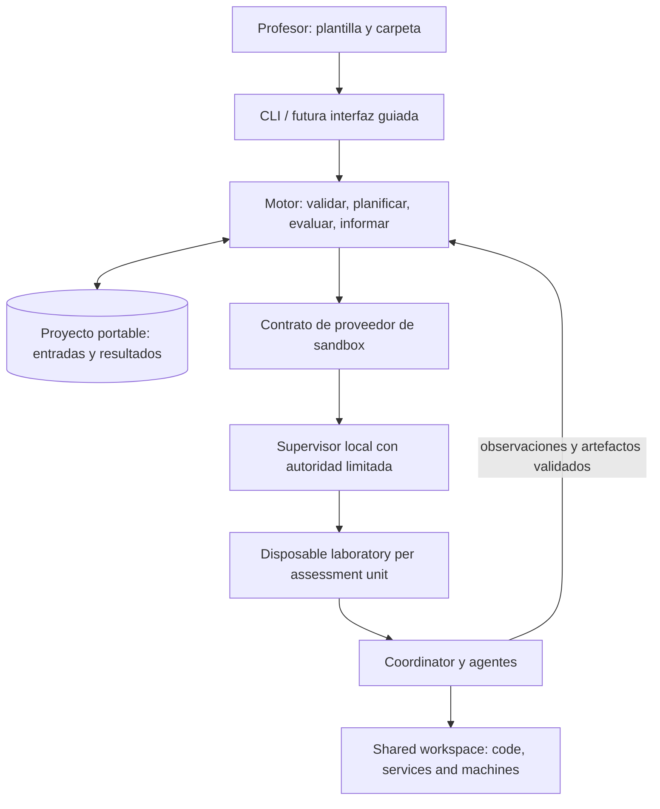
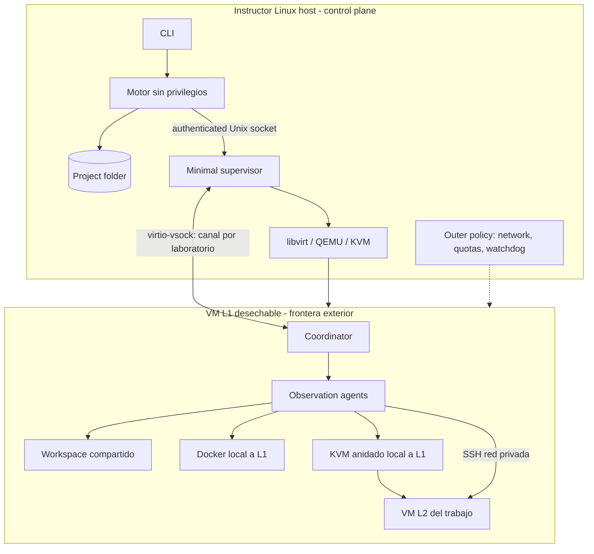
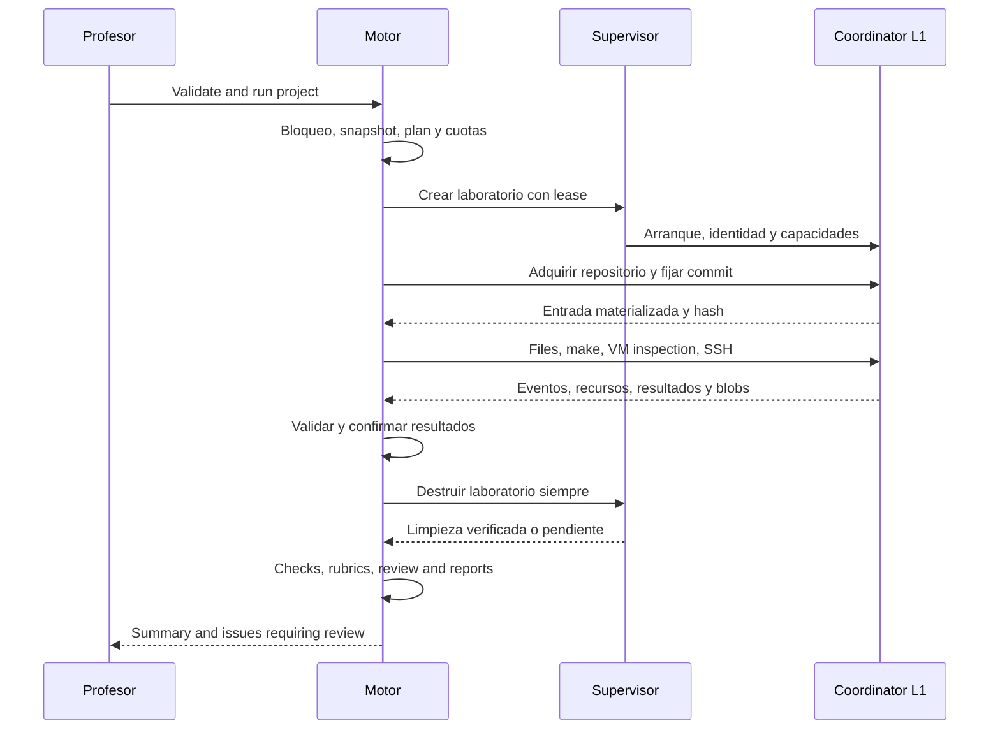

# Proposed architecture and justification

Status: target design v2, 2026-11-15. [Requirements](requirements.md), [model](data-model.md), [contracts](api-spec.md), [plan](implementation-plan.md) and [ADR](decisions/README.md) form a coherent proposal; They do not describe already published functionalities.

## Starting point

The POC catalog and guide documents a Rust `thotd` service, CLI, `configuration.yaml` configuration, SQLite and artifacts, integrated tests and external scripts, checks, rubrics, evaluation, files and PDF/CSV export. POC imports OVA with VirtualBox on Linux; SSH uses shared ports and forces sequential execution. The workspace also contains a transition to the `thot-virtualbox-agent` HTTP v1 agent, which uses SSH to VirtualBox, and to `runs/` folders (see [THOTD README](../apps/thotd/README.md) and [agent](../apps/thot-virtualbox-agent/README.md)). External processes inherit permissions from the service: there is no general KVM/Docker sandbox or web interface. Separation v1 does not credit isolation and is not equivalent to a general distributed fleet. The [catalog](IMPLEMENTED_CATALOG.md), [POC guide](THOT_VM_ACTIVITY_POC.md), and [current deployment](../deploy/README.md) remain operational references. The compilation evidence described there does not prove a real integration with VirtualBox.

The objective is to keep the evaluation reproducible from evidence, replacing the host-bound execution with an isolated laboratory and making the project a self-sufficient portfolio.

## Generic model

An **evaluation unit** is the explicit set of deliverables that are tested together. It can represent a group with several files or repositories. Comparisons between submissions require a declared joint unit, never implicit access to another student's laboratory. All agents in a unit share a laboratory, network, and resource registry. A class execution contains many units; it does not use a single VM for the entire class. This allows interaction without contamination between students.

The engine maintains the DAG, selects units, authorizes each task, persists observations, and calculates notes. The coordinator only dispatches authorized actions to agents and maintains processes/resources; It does not change the plan or calculate grades. Git, filesystem, exec, Docker, KVM, and SSH agents enforce typed action contracts. Communication between steps uses declared outputs and named resources, without depending on global ports or text accidentally extracted from a log.

## Initial Linux deployment

KVM/QEMU using libvirt is proposed for the outer VM. Docker organizes tools and services within L1; it does not constitute the security border against the host. A base image is selected by digest, with verified agents and tools; Each lab starts with a new overlay and limited working disk. No teacher directories are mounted on L1, neither via virtiofs/9p nor via bind mounts. Entries are transferred as blobs, verified, and extracted within the lab; The outputs are copied using a bounded receiver.

The supervisor has only the operations of creating, querying, stopping and destroying resources from its own namespace. It does not offer shell, arbitrary libvirt XML, host paths, or general access to the Docker/libvirt socket. The engine does not belong to the Docker/libvirt groups with general administrative access. An administrator-installed policy limits images, sizes, networks, CPUs, and devices; the teacher's YAML can only restrict it. Exact implementation of libvirt permissions requires phase 0 testing.

## Borders and threats

Any repository, image, file, output and student service is considered hostile. A faulty teaching script or compromised agent is also contained within L1. The kernel/hypervisor, supervisor, engine, and base image form the foundation of trust. Portable folders are data: opening or importing a project does not run scripts or install agents.

| Risk | Mandatory external control | Residual limit |
|---|---|---|
| Host Erase/Read | No folders, devices or host sockets on L1; Supervisor API closed | Hypervisor escape remains a risk |
| Escape from Docker or root on L1 | Destruction of all L1, limits imposed from L0 | Can alter evidence within L1 |
| Exfiltration, LAN, cloud metadata | No network by default; external filter blocks host, LAN, link-local, unauthorized IPv6 and other laboratories | Allowed HTTPS can also exfiltrate to authorized destinations |
| Fork bomb, memory/disk, logs | L0 quotas, fixed CPU/RAM, physical limit disk, byte/inode/event limits and watchdog | Activity may end incomplete |
| Malicious artifact | Extraction without links/devices/traversal, quotas and copy to staging; viewer escapes HTML and terminal | Do not open student binaries as host applications |
| Stolen credentials | External broker, minimum scopes, ephemeral tokens; writing before persisting | A secret given to hostile code is no longer a secret |
| Manipulation of observations | Separate student container agents, attributed results and hashes | There is no attestation of truth against root in L1 |

Privileged Docker, host networking, and libvirt control by student code are not allowed in the regular profile. For `make` that manages infrastructure, a profile `nested-lab` is enabled: its sockets and privileges only exist in L1. The grant may compromise observers of that same VM; the report indicates lower confidence. Separating observation in another VM would be an extension for adversarial evaluations, pending design. The engine checks only interpret data with limited parsers, without executing templates or scripts provided in results.

## Networks and acquisition

The acquisition phase supports Git HTTPS via outbound proxy with allowed targets, without direct LAN/host access. Every DNS redirect and resolution is re-validated, including submodules/LFS; `file://`, `ext::`, external helpers, and project checkout hooks are not supported. The exact commit and the tree are archived; branch names are not enough. For private repositories, the proxy embeds a read token without delivering it to the student processes. Dependencies and images are preloaded or unloaded by the same controlled mechanism. After acquisition, exit is withdrawn; An activity that needs it during testing must declare it.

The labs have separate isolated networks and no port publications to the host. Services are found through a resource record within L1. The vsock control channel has dedicated service and typed messages; it is not a tunnel to the engine API. L2 does not receive access to the control channel.

## Flow, status and faults

In a unit the steps are sequential by default. A DAG allows explicit parallelism if there are no concurrent writes to a resource; exclusive/shared locks are declared. `after` only commands; `requires` demands success. In the event of an infrastructure error, the branch is blocked, other units can continue. Exterior cleaning is independent of the teacher's `always` steps: these are not a safety barrier.

A timeout kills the process group/container and its descendants. If your detention cannot be proven or you could have left an arbitrary status, L1 is terminated and live resources are invalidated. The supervisor observes leases; When the engine dies, it stops and destroys orphan laboratories. Logs already committed are kept; Incomplete results are marked discontinued. Pending cleanup prevents declaring the environment released and blocks new admissions if unsafe resources remain.

There is no promise to resume memory or processes from a destroyed VM. Extending a run preserves compatible observations, but for a new step requiring live services the chain is rebuilt from inputs set in a clean lab. Repeating non-idempotent actions requires stated authorization or intervention. See ADR-0004.

## System requirements and operation

Reference profile to certify: Maintained Linux x86_64, systemd, cgroups v2, KVM, QEMU/libvirt, LSM AppArmor or SELinux and local storage with reliable locking, atomic renaming and quotas. The exact list of supported distributions/versions is fixed after testing; It is not universal support for any Linux.

Sizing starting point, no accredited minimum: 8 threads, 32 GiB RAM and 100 GiB free for a nested laboratory with 4 vCPUs, 12 GiB RAM and 40 GiB disk; reserve at least 8 GiB to the host. Each activity declares needs and the planner adds reserves before admitting it. L2 and Docker consume L1's budget, not unlimited additional reserves. VT-x/AMD-V hardware and nesting should be tested by booting an L2; detecting `/dev/kvm` is not enough. An already virtualized Linux is only suitable if it passes the same test.

An administrative installer prepares network, permissions, image and service. The teacher receives a "pass/not pass" diagnosis with concrete actions and a template; choose folder, check associations, validate, run and open the report. CLI first, future interface guided on the same API. The first use supports a technical installation, but subsequent evaluations do not require hypervisor commands.

The engine writes with the identity of the teacher or dedicated service with explicit ACL for the chosen folder; read-only entries during run, writable `runs/`, directories 0700 and files 0600 by default. The owner of foreign folders is not recursively changed. Exclusive lock prevents concurrent edits; consistent export only from a committed snapshot. Project backup and credential store are separate operations. Explicit retention by project, without automatically deleting original deliverables; Temporary disks are always deleted except for administrative quarantine with expiration. Deleting files on SSD is not equivalent to cryptographic deletion; encrypt the volume when necessary.

## Evolution and justification

The outer VM adds cost and requires nesting, but contains both ordinary processes and Docker and student-created VMs. Docker on the host reduces cost but shares kernel and increases control plane exposure; it is discarded for the first version. A single class VM would facilitate data contamination and leakage; is discarded. The local modular monolith and file system avoid premature distributed infrastructure.

The future remote provider can implement the same identifiers, tasks, leases, and transfers, but will need mTLS, project authorization, organization quotas, and remote storage. The local protocol is not opened to the Internet to obtain a server. SQLite will only be a rebuildable index after completing and verifying the POC migration.

Primary technical sources consulted on 2026-11-15: [Docker security](https://docs.docker.com/engine/security/) and [resource limits](https://docs.docker.com/engine/containers/resource_constraints/) support the need to configure isolation and quotas; [Nested KVM](https://docs.kernel.org/virt/kvm/x86/running-nested-guests.html) describes L0/L1/L2 and their conditions; [libvirt domains](https://libvirt.org/formatdomain.html) provides the resource/device configuration mechanisms. The selection and policies above are decisions proposed by Thot, subject to validation, not guarantees of those tools.