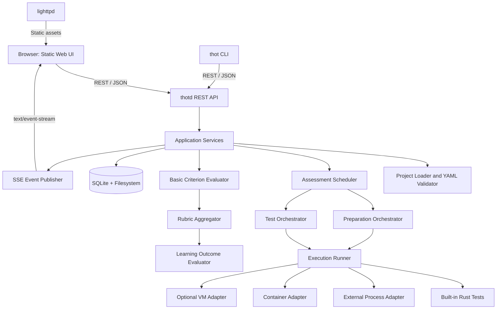

# Thot — Software Architecture

**Status:** Target architecture; only a subset is implemented. See [the VM activity POC status](THOT_VM_ACTIVITY_POC.md) for current behavior.
**Implementation:** Rust engine and CLI  
**Web server:** lighttpd  
**Configuration:** YAML  
**API:** REST over HTTP with JSON  
**Live progress:** Server-Sent Events (SSE)

## 1. Purpose

Thot is a lightweight, modular system for automated assessment of student submissions. It evolves the ideas behind Autotest, emphasizing predictable execution, bounded concurrency, a small deployment footprint, and a clear separation between executing tests and interpreting their results.

The system has three entry points:

- **Thot Engine (`thotd`)**: the Rust service responsible for projects, assessment runs, scheduling, execution, scoring, and persistence.
- **Thot CLI (`thot`)**: a Rust command-line client that communicates with the engine through its REST API.
- **Web UI**: static HTML, CSS, and JavaScript served by `lighttpd`. The browser uses the same REST API as the CLI.

The web UI and CLI are clients, not separate implementations of assessment logic. The engine is the source of truth for run state and results.

## 2. Architectural principles

1. Keep the engine focused on orchestration and assessment semantics.
2. Separate responsibilities into Rust modules with explicit interfaces.
3. Use one versioned API contract for the web UI and CLI.
4. Run tests sequentially for each student, while processing multiple students concurrently under a configurable limit.
5. Use versioned YAML for teacher-authored configuration.
6. Normalize built-in and external test outcomes into a common result model.
7. Keep process, container, and VM execution behind replaceable adapters.
8. Treat submissions, archives, scripts, and process output as untrusted.
9. Separate reusable project definitions from run-specific submissions and results.
10. Persist state so restarts do not silently lose assessment progress.

## 3. Functional workflow

### 3.1 Configure

The teacher loads an **Assessment Project** and imports a student roster and submissions. Optional run settings include the maximum number of students processed concurrently. In the current VM activity POC, a project is a `.thot.zip`, `.thot.tgz`, `.thot.gz`, or project directory containing a root `configuration.yaml`. The configuration is an ordered list of atomic tests, each identified by a platform and test name (for example, `VirtualBox/import_ova`) or by an `extern/<path>` script reference. Test entries can supply parameters, prerequisites, repeat counts, and timeouts; a test timeout overrides the project-wide timeout.

The engine validates YAML schemas, identifiers, paths, test references, prerequisites, rubric aggregations, and learning-outcome formulas before execution.

An **Assessment Project** defines how assessment is performed. An **Assessment Run** is one concrete execution of that project against a roster and a set of submissions.

### 3.2 Prepare

Preparation creates predictable, isolated workspaces for each student. Tasks may include:

- unpacking Moodle or cloud-drive exports;
- matching files to student identifiers;
- normalizing directory and filename conventions;
- copying or transforming files;
- generating manifests or derived files;
- provisioning containers or VMs when required.

Preparation tasks have explicit statuses, timeouts, and diagnostics. Tests must not start until their required preparation has succeeded. Common operations can be built into the engine; project-specific operations can use external scripts.

### 3.3 Execute tests

A **Test** is either a **Built-in Test**, implemented in Rust and registered with the engine, or an **External Test**, launched as a process such as Bash or Python, optionally inside a container. Built-in tests are organized in platform modules. External scripts supplied by a project run as child processes with an argument array and no implicit shell interpolation.

For a given student, tests execute sequentially in their declared order. The scheduler may process several students in parallel, up to the configured limit. Tests can declare prerequisites on earlier test outcomes or supported scoring results.

If a prerequisite is not satisfied, the dependent test is marked `skipped` with a reason, not reported as an ordinary failure.

A normalized **Test Result** records the run, student and test identifiers; start/end time and duration; process exit code; captured stdout and stderr within configured limits; status; failure, skip, timeout or cancellation reason; and metadata/artifact references. Per-test artifacts are stored under the delivery's `test_records/<delivery filename>/<test name>/artifacts` directory. The executor reports whether the process ran successfully; evaluation criteria interpret its output and observations separately.

The exit code is only one part of the result: a process may exit with code zero while a later criterion fails because expected output is missing.

### 3.4 Score basic criteria

A **Basic Criterion** evaluates a test result and returns `1` for pass or `0` for fail. Examples include checking that the exit code is zero, stderr is empty, stdout contains a string, stdout matches a regular expression, or a required file exists.

Each criterion should record an explanation. Timeouts, skipped tests, and runner errors should remain distinguishable from normal failures. By default, their score should be unavailable unless a criterion explicitly defines how to handle them.

### 3.5 Aggregate rubric criteria

A **Rubric Criterion** combines basic criteria using an aggregation method such as arithmetic mean, median, minimum, maximum, or weighted mean.

For example, `Correct users` can aggregate `user1 exists`, `user2 exists`, and `user3 exists`. Each aggregation must define how missing or unavailable inputs are handled. Weights and references must be validated before execution, and the calculated result should retain the inputs used.

### 3.6 Evaluate learning outcomes

A **Learning Outcome (LO)** corresponds to a Spanish **Resultado de Aprendizaje (RA)**. It applies a configured formula to selected rubric criteria.

Use a constrained expression language with documented operators and functions. Do not execute arbitrary shell, Python, JavaScript, or Rust code from YAML. Validate formulas before a run, reject unknown references and invalid operations, and record the formula version and inputs used.

### 3.7 Review and export

The teacher can inspect run progress, student status, test output, exit codes, timings, basic scores, rubric aggregates, learning-outcome scores, and errors or skips. CSV is a useful first export format.

Scoring and LO evaluation should be repeatable from stored test results without re-running tests, unless a new execution is explicitly requested.

### 3.8 Current VM activity implementation

The implemented POC skips students with no assigned delivery and deliveries assigned to no student; neither gets an expedient or tests in that run. If no student-delivery pairs are assigned, the run completes without expedients or tests. Otherwise, it creates one expedient per assigned student, groups work by assigned delivery, executes tests once for each distinct delivery, and copies the results into every student's expedient assigned to that delivery. Expedients expose `pending`, `running`, and `finished` lifecycle states. Multiple delivery groups may run concurrently up to the project's `concurrency` limit when tests do not use shared VirtualBox or SSH host resources; those adapters are restricted to concurrency one while guest forwarding ports are shared. The engine does not yet calculate scores or learning outcomes.

The assignment service compares student names, surnames, email usernames and addresses, external IDs, and IDs against delivery filenames using token and edit-distance similarity. A second scoring pass uses agreement across student fields to break close candidate matches. Professors can inspect and replace these suggestions before evaluation. Each student has at most one assigned delivery per project, while one delivery can be assigned to multiple students for group work. Unassigned deliveries remain listed for review.

Students and assignments are scoped to a current project. Assignment commands index the configured delivery folder before a run exists. Assignment imports resolve rows by `student_external_id` and `delivery_filename`; other row fields are ignored and populated from project records in the database. Creating a run selects that project; CLI commands invoked from a directory with root `configuration.yaml` select that directory's project. Root `students.csv` and one optional `assignments.yaml` or `assignments.json` inside the project bundle are imported during run creation. Valid rows replace saved assignments, while project students omitted from the file remain unassigned and are skipped. External IDs are required in stored project records; when CSV has no recognized external-ID column, email is copied to the external ID.

## 4. Logical architecture



This is a logical diagram, not a requirement to run each component as a separate process. Most engine components can initially be Rust modules inside one `thotd` process.

`lighttpd` serves the static frontend and may reverse-proxy API traffic. It does not execute tests or evaluate rubrics.

## 5. Main components

### 5.1 `thotd` — engine service

Responsibilities:

- expose the versioned REST API;
- load and validate assessment projects;
- import and associate rosters and submissions;
- create and manage assessment runs;
- schedule preparation and test execution;
- enforce per-student ordering and global concurrency limits;
- evaluate basic criteria, rubrics, and learning outcomes;
- persist state and results;
- publish progress events;
- retrieve and export results.

Keep the HTTP layer thin: it validates requests, calls application services, and serializes responses. Scheduler and scoring rules belong in their respective modules.

### 5.2 Project loader and YAML validator

This module parses project YAML into typed Rust structures and validates schema versions, identifiers, paths, references, prerequisites, dependency cycles, test types, aggregation parameters, formulas, and required runtime capabilities.

YAML is a configuration format, not the REST wire format. The engine parses YAML into typed structures; REST request and response bodies use JSON, which is convenient for browser clients and standard HTTP tooling.

### 5.3 Assessment scheduler

Use a bounded pool of student-level workers:

- one worker owns one student's preparation and test sequence;
- that worker executes the student's tests sequentially;
- a global limit controls the number of active student workers;
- prerequisites are checked before dependent operations;
- transitions and results are persisted as work progresses.

Avoid unbounded task creation. Define cancellation, timeouts, retry semantics, and restart recovery explicitly.

### 5.4 Preparation orchestrator

The preparation orchestrator runs preparation tasks and creates student workspaces. Each task has explicit inputs/outputs, working directory, timeout, status, and diagnostics. It can use built-in operations or external scripts and can request containers/VMs through adapters.

Preparation should be modeled separately from tests even if both use the same process runner.

### 5.5 Execution runner

The runner provides a common interface for built-in and external work. It sets the working directory and controlled environment, launches and supervises processes, enforces deadlines and output limits, terminates process groups on cancellation, captures stdout/stderr, and normalizes outcomes.

Represent external commands as an executable plus an argument array rather than concatenating shell strings. Shell interpretation should be explicit when a script requires it.

### 5.6 Built-in test registry

Built-in tests are small Rust implementations registered through a stable internal interface. Examples include file-existence checks, directory-layout checks, content matching, and structured-file validation.

They must return the same normalized result model as external tests. A registry is sufficient for the first release; dynamically loaded native plugins are not required.

### 5.7 Basic criterion evaluator

Evaluate declarative predicates over normalized test results. Keep criteria pure where possible so they can be unit-tested and re-evaluated without rerunning tests. Store score, status, explanation, and source-result references.

### 5.8 Rubric aggregator

Calculate rubric scores from basic criteria and, if explicitly supported, other rubric criteria. Validate aggregation types, weights, dependencies, and missing-value semantics. Store the aggregate and its input values.

### 5.9 Learning-outcome evaluator

Evaluate constrained formulas over rubric scores. It must not execute arbitrary code from project files. Parse and validate formulas before execution, and report invalid references, division by zero, unsupported functions, and missing inputs explicitly.

### 5.10 Persistence and artifacts

For a simple single-instance deployment, use:

- **SQLite** for project metadata, runs, student states, test results, scores, and artifact metadata;
- **filesystem storage** for project bundles, submissions, workspaces, large stdout/stderr artifacts, and reports.

Hide persistence behind Rust interfaces so a different database can be introduced later. Persist transitions often enough to recover after a restart; never silently mark interrupted work as complete.

## 6. Rust implementation: workspace and module boundaries

Use a Cargo workspace to separate the engine executable, CLI executable, and reusable domain/API types. This creates compile-time boundaries without requiring a microservice architecture.

Suggested repository layout:

```text
thot/
├── Cargo.toml
├── crates/
│   ├── thot-core/       # Domain types and assessment semantics
│   ├── thot-config/     # YAML parsing and validation
│   ├── thot-runner/     # Process execution and runner interfaces
│   ├── thot-storage/    # SQLite and filesystem persistence
│   ├── thot-api/        # Shared REST DTOs and API contract
│   ├── thotd/           # Engine service binary
│   └── thot-cli/        # CLI binary: thot
├── web/
│   ├── index.html
│   ├── css/
│   ├── js/
│   └── assets/
├── examples/
│   └── example-assessment/
├── docs/
│   └── ARCHITECTURE.md
└── packaging/
    ├── Dockerfile
    └── lighttpd.conf
```

This is a starting point, not a requirement to create a crate for every small module immediately. Keep the domain model independent of HTTP and storage. Start with fewer crates if that makes the first implementation simpler, then split along stable boundaries.

### 6.1 `thot-core`

Contains domain types and rules: project metadata, test definitions, prerequisites, run/student/test states, normalized results, basic criterion results, rubric scores, and LO scores. It should not depend on the HTTP framework, CLI parser, or database.

### 6.2 `thot-config`

Owns YAML parsing, schema-version handling, safe path checks, reference validation, and conversion into typed project definitions. Return structured errors suitable for CLI diagnostics and REST responses.

### 6.3 `thot-runner`

Owns the runner interface and implementations: built-in test dispatch, child-process execution, output capture, timeouts, cancellation, and optional container/VM adapters. Keep runtime-specific code behind interfaces so the scheduler does not depend on Docker or a VM implementation.

### 6.4 `thot-storage`

Owns SQLite, filesystem artifact management, transactions, and persistence models. Do not expose raw database types to the domain or API layers.

### 6.5 `thot-api`

Defines shared request/response data-transfer objects, API version constants, and serialization contracts. The engine and CLI can reuse these types, but the CLI should not import internal scheduler or storage modules.

### 6.6 `thotd`

Composes modules into a service. It owns application services, REST routes, SSE endpoints, listen address configuration, and startup/shutdown. A framework such as Axum with Tokio is a reasonable Rust implementation choice. Keep blocking operations from monopolizing async executor threads.

### 6.7 `thot` CLI

The CLI is an API client. It parses commands, sends HTTP requests, displays structured errors/status, uploads project/roster/submissions, starts and cancels runs, watches progress, retrieves test output, and exports results.

It must not independently implement scheduling, prerequisite evaluation, rubric aggregation, or LO formulas. This avoids discrepancies between the CLI and web UI.

Illustrative commands:

```text
thot --server http://localhost:8080 project validate ./assessment.tar.gz
thot --server http://localhost:8080 project upload ./assessment.tar.gz
thot --server http://localhost:8080 students import ./students.csv
thot --server http://localhost:8080 submissions import ./submissions/
thot --server http://localhost:8080 run create /path/to/assessment.thot.tgz
thot --server http://localhost:8080 run status RUN_ID
thot --server http://localhost:8080 run watch RUN_ID
thot --server http://localhost:8080 run results RUN_ID
thot --server http://localhost:8080 run cancel RUN_ID
```

These commands illustrate the intended UX; exact syntax should follow the first API contract. The CLI should accept a configurable server URL and a sensible local default. Credentials, if needed, must not be stored in project files or printed in logs.

## 7. Web UI and lighttpd

### 7.1 Static frontend

The web interface is static HTML, CSS, and JavaScript. It does not require Node.js in production. A build tool can be used during development, but the deployed output should be ordinary static files.

The UI calls REST for actions and queries, and uses SSE for live progress. REST remains authoritative: after reconnecting, the browser queries current state rather than relying on event history alone.

### 7.2 Why lighttpd

`lighttpd` is well suited to serving a small static UI with low resource overhead. It is not the application engine: it serves files and can optionally reverse-proxy API traffic.

Two deployment patterns are possible:

1. **Single container:** run `lighttpd` and `thotd` as separate processes in one container. This reduces deployment units but requires deliberate process supervision and couples their lifecycle.
2. **Separate containers:** run a static web container and an engine container on the same Docker Compose network. This allows independent updates and makes it easier to expose only the web server publicly.

**Recommendation:** use separate `lighttpd` and `thotd` containers within one Docker Compose deployment. It is still easy to distribute, while keeping the UI replaceable and the engine API on an internal network. If a single-container deployment becomes a hard requirement, preserve the same process and API boundaries.

### 7.3 Routing

Configure `lighttpd` to serve the static UI and proxy `/api/` and the SSE endpoint to `thotd`. Ensure proxy timeouts and buffering are compatible with SSE; buffering must not delay progress events. Same-origin proxying is preferable to cross-origin requests because it avoids unnecessary CORS configuration.

Example request flow:

```text
Browser
  ├── GET /                         -> lighttpd (HTML)
  ├── GET /css/app.css              -> lighttpd (CSS)
  ├── POST /api/v1/runs              -> thotd (create run)
  ├── GET /api/v1/runs/123            -> thotd (run state)
  └── GET /api/v1/runs/123/events     -> thotd (SSE)
```

The CLI sends equivalent HTTP requests directly to `thotd`, normally without going through `lighttpd`.

## 8. REST API and progress events

Use REST over HTTP for commands and queries. JSON is the wire format. YAML remains the human-authored project format and is parsed by the engine.

Illustrative endpoints:

- `GET /api/v1/health` — health/readiness;
- `GET /api/v1/projects` — list loaded projects;
- `POST /api/v1/projects` — upload/import a project;
- `POST /api/v1/students/import` — import a roster;
- `POST /api/v1/submissions/import` — import submissions;
- `POST /api/v1/runs` — create a run;
- `GET /api/v1/runs/{run_id}` — retrieve state and summary;
- `GET /api/v1/runs/{run_id}/students` — student statuses and scores;
- `GET /api/v1/runs/{run_id}/students/{student_id}/tests` — test results;
- `GET /api/v1/runs/{run_id}/events` — subscribe to SSE;
- `POST /api/v1/runs/{run_id}/cancel` — request cancellation;
- `GET /api/v1/runs/{run_id}/export` — export results.

The exact contract is provisional. Define stable identifiers, pagination, request-size limits, API versioning, and consistent error responses before the UI and CLI depend on it.

SSE is the recommended default for one-way progress. Include event IDs or sequence numbers for reconnection, but make REST retrieval the recovery mechanism. WebSockets are unnecessary unless a future feature requires sustained bidirectional communication.

## 9. Project-defined test bundles

The VM activity run loader accepts `.thot.zip`, `.thot.tgz`, and `.thot.gz` archives with `configuration.yaml` at the root, as well as unpacked project directories with that file. A project can also contain teacher-supplied programs, for example:

```text
linux_competition.thot.tgz
├── configuration.yaml
└── extern/
    └── tests/
        └── vm_start_time.py
```

`configuration.yaml` defines the activity name, a delivery folder (relative to the archive's containing directory or project directory, or an absolute path), maximum concurrency, global test timeout, an ordered list of tests, and an optional `checks` list. A test has a unique name and a `test` reference. Built-in references use `Platform/test_name`, such as `VirtualBox/import_ova` or `ssh/get_host_info`. External references use `extern/<project-relative-path>`. Optional fields provide scalar parameters, test timeout, earlier-test requirements, and repeat count. The engine expands repeats to names such as `start_time_01` and only runs a dependent test if all repetitions of each requirement pass. A check has a unique name, optional description, internal implementation name in `check`, related configured test name in `test`, and optional scalar parameters. The initial `pass` check returns 1 only when the named test (including all repeats) passed; otherwise it returns 0. Check results, nullable errors, and execution timestamps are stored in each student expedient's `checks` list. The CLI accepts project paths anywhere readable by the daemon and can discover one source when `thot run` is invoked without a subcommand.

Tests are atomic reusable functions grouped by platform under `crates/thot-engine/src/tests/`. A common invocation carries test parameters, timeout, project and delivery context, and artifact paths. A common outcome carries status, stdout, stderr, exit code, diagnostics, observations, and evidence. Built-in and external tests therefore persist through the same result model. External scripts receive parameters as `key=value` arguments and run as child processes with bounded time and output; they are trusted teacher code, not sandboxed code.

For the current POC, archive extraction rejects path traversal and links, limits archive size and entry count, and requires a regular root `configuration.yaml`. Importing a project does not run its scripts; an external program runs only when its configured test is reached. The current built-in registry provides VirtualBox import/start/stop/destroy and SSH host information checks. Additional platform adapters can be added without changing the project format.

The archive reader rejects path traversal and links, applies compressed/expanded size and entry limits, and requires a regular root `configuration.yaml`. Directory sources are snapshotted with symlink rejection. The CLI offers `thot run list`; bare `thot run` discovers exactly one supported archive or root configuration file, and bare `thot run status` resolves only when exactly one run is active. Run and expedient details, plus structured student command results, are rendered as YAML for terminal readability; the REST API continues to exchange JSON. Maintenance commands `thot clean`, `thot prune`, and `thot reset` reconcile orphan runtime data, prune old runs, or clear Thot database/runtime records with explicit confirmations for destructive operations.

Per-delivery expedients and artifacts are stored outside the reusable project. Each test result records process output and exit code. Artifacts are scoped under `test_records/<delivery filename>/<test name>/artifacts` within that delivery's artifact directory. Tests run in order within a delivery. Delivery concurrency follows the project setting for projects without shared resources; VirtualBox and SSH projects are restricted to one because their current adapters share loopback ports.

## 10. State model and failure semantics

A run may follow:

`created → validating → preparing → running → scoring → completed`

Other terminal states include `failed` and `cancelled`. Partial student failures should remain visible in the summary rather than collapsing all outcomes into one ambiguous status.

Test statuses should distinguish `passed`, `failed`, `skipped`, `timed_out`, `cancelled`, and `error`. Exit code is data, not the complete semantic status. Define retry behavior explicitly; preserving attempt history is preferable to overwriting previous results.

## 11. Security and operations

Treat project archives, student submissions, scripts, and process output as untrusted.

- Run with unprivileged accounts wherever feasible.
- Apply timeouts, output limits, and CPU/memory limits where supported.
- Terminate process groups on timeout/cancellation.
- Use separate per-student workspaces.
- Mount inputs read-only when modification is unnecessary.
- Keep secrets out of YAML and logs.
- Restrict API access beyond a trusted host/network.
- Define cleanup and retention policies.
- Record engine/project versions and execution metadata.
- Avoid unrestricted access to the Docker socket from the main engine process.

Docker socket access effectively grants powerful host control. Prefer a restricted runner/helper or another execution boundary. Direct access may be acceptable in a trusted lab, but document it as a security trade-off. A container alone is not a complete security boundary for arbitrary malicious code.

## 12. Testing strategy

- **Unit tests:** YAML validation, prerequisites, criterion predicates, aggregations, formulas, state transitions.
- **Runner tests:** exit codes, stdout/stderr, timeouts, cancellation, missing executables, output flooding.
- **Scheduler tests:** sequential tests per student, concurrency bounds, prerequisite skips, cancellation.
- **Integration tests:** import project/roster, stage submissions, execute tests, score, aggregate, evaluate LOs.
- **Recovery tests:** restart during preparation, execution, and persistence.
- **Security tests:** archive traversal, malicious paths, symlinks, oversized archives, workspace isolation.
- **API contract tests:** JSON schemas, error responses, CLI compatibility.

## 13. Recommended implementation sequence

1. Define domain types and versioned YAML schemas.
2. Implement safe project loading and validation.
3. Implement persistence and run state transitions.
4. Implement process execution with timeout, cancellation, and output capture.
5. Implement bounded scheduling and sequential per-student execution.
6. Add basic criteria, rubric aggregation, and LO formula evaluation.
7. Expose REST endpoints and SSE events.
8. Implement the Rust CLI as an API client.
9. Implement the static UI and `lighttpd` routing.
10. Add container execution through an adapter, then VM support if needed.
11. Add reporting, recovery, security hardening, and operations documentation.

## 14. Decisions to confirm

1. Are teacher-authored scripts trusted, or must they be treated as potentially malicious?
2. Is the deployment single-teacher/single-host, or is concurrent multi-user access required?
3. Confirm separate `lighttpd` and `thotd` containers in one Compose deployment.
4. Which roster and submission formats are required in the first release?
5. What are the missing-value and rounding rules for aggregations and LO formulas?
6. What is the retry policy for failed or interrupted tests?
7. What authentication and authorization does the API require?

## 15. Summary

The recommended design is a Rust engine (`thotd`) with modular configuration, scheduling, runner, scoring, and storage components; a Rust CLI (`thot`) that consumes the same REST API; and a static HTML/CSS/JavaScript frontend served by `lighttpd`.

Use YAML for project definitions and JSON for HTTP. Use SSE for progress. Start with SQLite and filesystem artifacts. Run tests sequentially per student and bound the number of concurrent student workers. Keep container and VM execution behind adapters and treat isolation as a first-class security decision.

This provides a compact initial implementation with clear extension points for importers, test types, execution backends, rubric methods, learning-outcome formulas, and reporting.
