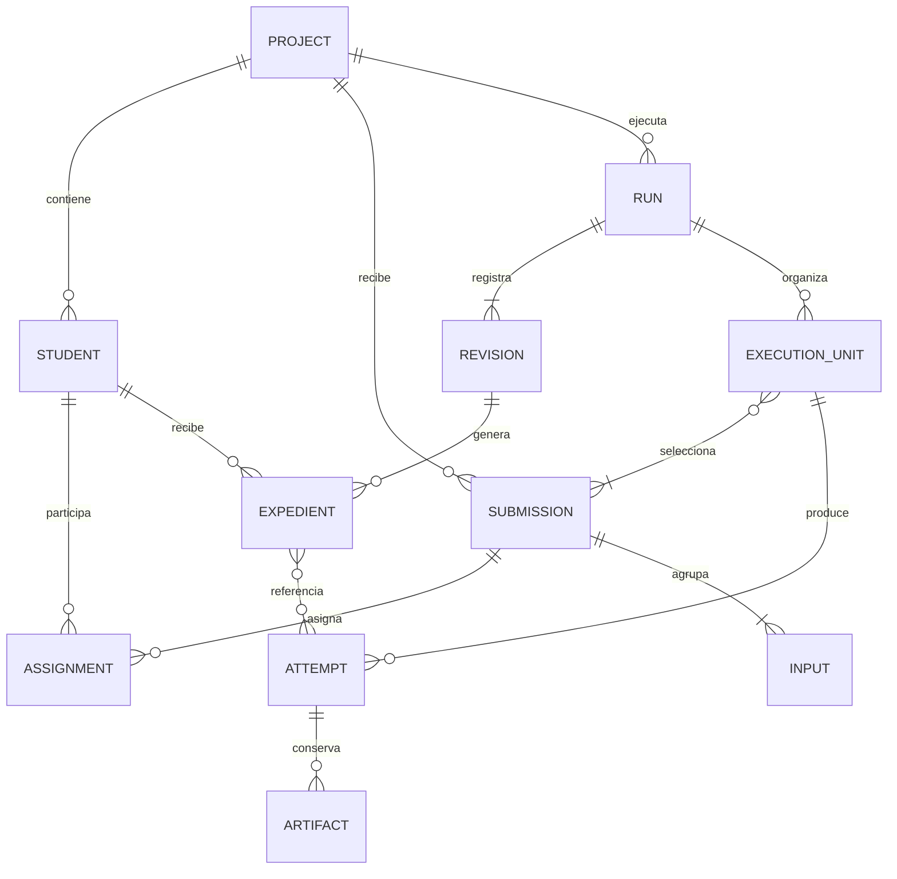
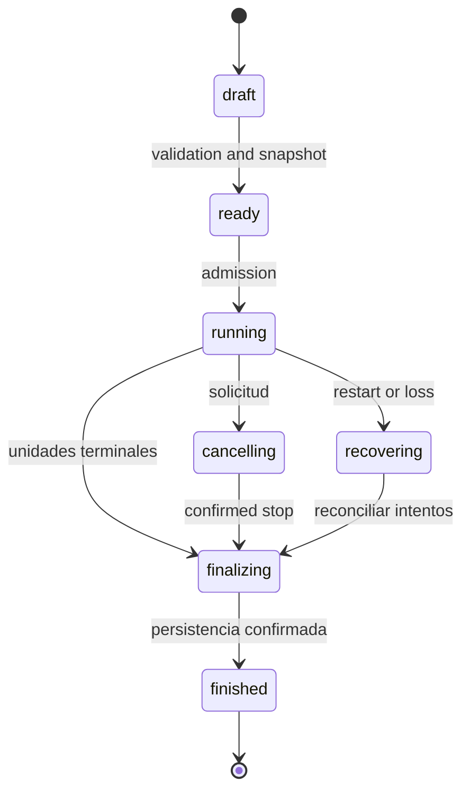

# Data model

> The [local evaluation migration target](local-evaluation.md) adds original/effective configuration and redacted setting provenance, sequenced progress, independent run/cleanup state and target-specific module identities. These additions are planned; current persisted formats are not silently migrated.

Status: Mixed. The broad relational model below remains a target design. P1 shared sandbox contracts and the portable run folder described below are implemented as initial Rust APIs; local sandbox runs can be integrity-verified and rendered as table, JSON, CSV, or offline HTML. This does not replace legacy POC SQLite or provide run archive import/regrade editing yet.

## Entities and identity



| Entity | Required fields and rules |
|---|---|
| Project | `schema_version`, `project_id` Stable UUID, Name, Configuration and Requested Policy |
| Student | `internal_id` UUID, non-empty unique external `id`, name; optional mail; `identity_field` choose import column |
| Submission | `submission_id` UUID, label, list of typed inputs; filename-independent identity |
| Input | `input_id`, type, selector/role, source, SHA-256, and size; Git adds URL without credential, ref requested and commit resolved |
| DeliveryAgent | `kind` (`local` or `gdrive`), non-secret source selector, version; local stores a path, Google Drive stores a folder URL only |
| DeliveryMetadata | exact `name`, `size_bytes`, optional `created_at`/`modified_at`, stable provider file ID/revision where available, MIME type and provider checksum; no OAuth secret or token |
| AcquiredDelivery | `name`, source kind and selector, provider ID/revision, fetched SHA-256, byte size, available source dates and acquisition time; payload is staged only for execution and is not retained in the run |
| Assignment | `student_internal_id`, `submission_id`; unique pairs, N×N; an individual correction does not alter shared results |
| ExecutionUnit | `unit_id`, ordered set of deliveries/inputs, effective workflow and footprint; a unit shares a laboratory |
| Run | `run_id`, UTC date, status, current revision, units and snapshot references |
| Review | `revision_id`, optional parent, create/extend/requalify/fix operation, actor, reason, input/configuration hashes and result selection |
| Attempt | `attempt_id`, unit, step, repetition, attempt number, task/lab, footprint, status and result |
| Artifact | `artifact_id`, relative path, media type, bytes, SHA-256, provenance and visibility |
| File | student, review, deliveries, references to attempts, checks, rubrics, calculated grade, correction and effective grade |
| Overriding | base revision, student, destination check/rubric/evaluation, value, author, reason, date; always validated against scale |

### Sandbox platform identity

Add a project-level `SandboxPlatform` record with a stable `platform_id`, kind (`kvm-debian`, `kvm-alpine`, `docker`, or `host`), kind-specific validated parameters, preparation definition, test membership, resource/network policy, and provider version. For `kvm-alpine`, the platform VM record includes professor-selected vCPU, memory, storage and nested-virtualization requirement. The provider records the reusable Alpine template identity separately from the per-project prepared baseline, package/repository inventory and project preparation script results. Each student receives a linked clone of that prepared baseline. Every preparation record and test attempt carries its platform ID, platform invocation ID, student/group unit ID, environment ID, and baseline reference where applicable. Results remain unambiguous if test names are reused on different platforms.

Add an immutable `TestModule` record with module ID, version, package digest, runtime/ABI version, declared capabilities, dependency assets and signing/verification metadata. P3's first Alpine runtime is `posix-shell-script-v1`: one UTF-8 `/bin/sh` script, with package SHA-256 pinned in the manifest. Other module assets are not supported by this runtime yet. The engine resolves the manifest and script before provisioning, records them as content-addressed run artifacts, then stages them in the disposable environment. The guest agent advertises typed capability IDs/versions in the VSOCK handshake, verifies the staged script digest again, and launches it as the unprivileged student user. A module may run only when all required capabilities are present. The same module digest and request/result semantics can be shared across compatible Linux adapters; Debian and Docker adapters remain unimplemented. Missing capability is `unsupported`, never an implicit rewrite or host fallback.

Schema v3 adds `EvaluationItem` records scoped to a platform. An item has a
stable ID/title, scale, calculation and criteria referencing named checks.
Store each item's status and nullable mark independently: technical gaps make
only affected items pending while completed items remain available. The
aggregate mark is nullable until all configured items are complete. V2 retains
the previous single-rubric shape.

Project preparation scripts are project-relative instructor-owned files. Their
actual SHA-256 is computed before baseline selection and included in the
baseline fingerprint. The run journal retains requested packages, package
manager, installed package inventory artifact, script digest/timeout/exit code,
and bounded stdout/stderr artifacts.

A KVM preparation record includes distribution/image digest, package manager and repository identity, preparation package/script hashes, installed package inventory, completion result, shutdown/flush confirmation, snapshot ID, backing-chain hashes, and provider version. An Alpine record also captures requested and verified nested-virtualization mode and outer VM resources. Each per-student linked clone references that baseline and records its overlay identity and nested resource limits. Docker environments record image digest and runtime identity. Host actions record the allowlisted adapter and policy version, with explicit `isolation_assurance: host-restricted`. Docker records whether it shares the host kernel or runs inside a KVM guest. Project and run records must never imply that these options provide equal isolation.

Platform-local dependency edges must have the same `platform_id` at both ends. Validation rejects cross-platform test dependencies and live-resource references. Final checks, rubrics, and expedients may combine completed results from multiple platforms inside the trusted engine; this does not grant a test access to another platform's files or live environment. Any future artifact bridge must be explicit, copied, hashed, read-only, and recorded as an imported input with provenance.

Internal IDs do not contain routes. `run_id` combines readable label and UTC seconds; Exclusive creation rejects collision and proposes suffix only when necessary. A teacher is not trusted to be the only client. Folder names derived from tags replace unsupported characters with `_` and add `_1`, `_2` suffixes in collisions. The original mapping → route is stored; identity is never deduced from the route. External references of the students are preserved exactly, without destructively normalizing accents.

## Portable folder

### Implemented P1 run package

`thot_engine::sandbox_repository::ProjectRunRepository` stores a run below
`<project>/results/<run-id>/`. Current paths are JSON/JSONL and the run is
single-writer while open:

```text
results/<run-id>/
  run.json                         # status and current committed revision
  snapshot/                         # exact configuration, roster, assignments
  results/<student-unit>.json       # assessment and delivery provenance; no payload
  artifacts/sha256/<prefix>/<hash>  # content-addressed stdout/stderr/evidence
  journal/events.jsonl              # fsynced sequence with previous/event hashes
  revisions/<revision-id>/revision.json
```

The repository creates a project-wide nonblocking writer lock, snapshots
bounded project metadata before execution, records delivery provenance
(source identity, name, size, timestamps when available, acquisition time and
SHA-256) in each student result, stores output blobs by digest, and atomically
publishes a revision pointer only after its result paths exist. Deliverable
bytes are staged for the current student, transferred to the sandbox, and
removed after that student's tests. The engine does not retain deliverable
backups; instructors keep the source in their own local folder or Drive. The
hash lets an instructor check later whether a source file matches the one
evaluated. A committed revision contains the configuration hash and
evidence-manifest hash. `verify_run` checks the configuration snapshot,
journal chain, revision metadata, result presence and evidence hashes.
Reopening a repository marks prior `created`/`running` runs
`interrupted`; it does not resume or replay uncertain external work. Run and
journal hashes detect accidental corruption, not malicious rewriting by a
person who can edit the whole folder. The folder is not safe for concurrent
writers over a network share unless filesystem locking and rename durability
are proven there.

When run under `sudo`, the repository restores ownership of the run tree,
results directory and writer lock to the invoking UID/GID on commit and on
drop/error cleanup. This allows the professor to read, archive, move and edit
the package after a privileged KVM run. It does not change ownership of
project inputs or guest resources. Run-package files use mode `0600` and
directories use `0700`; the results directory and lock are private to the
professor account so student deliverables are not exposed to other local users.

The current smoke CLI writes this package format from its KVM-Alpine run and
keeps a per-student JSON result. It excludes OAuth credentials and token
caches. `thot sandbox export/import` creates a bounded ZIP of a complete
verified run and verifies it again after extraction; `thot sandbox report`
renders table, JSON, CSV or offline HTML without a daemon. These tools do not
provide report editing, legacy SQLite import, retention policy, VM restoration
or reproducible replay.

```text
actividad/
  configuration.thot.yaml
  students.yaml                 # o students.csv
  submissions.yaml              # local or Git resources per submission
  assignments.yaml
  delivery/                     # optional local source; never required for Google Drive
  extern/                       # instructor scripts/configuration
  delivery/                     # originales importados
  overrides.yaml                # correcciones editables
  runs/<run-id>/
    run.yaml                    # status and pointer to committed revision
    snapshot/<revision-id>/     # configuration, roster and effective assignments
    revisions/<revision-id>.yaml
    journal/events.jsonl        # secuencia confirmada, sin secretos
    tests/<unit-id>/<step-id>/<attempt-id>/
      result.yaml
      stdout.bin
      stderr.bin
      artifacts/
    expedients/<revision-id>/<safe-student-id>.yaml
    reports/<revision-id>/      # HTML, PDF, CSV y manifiesto de generación
    integrity.yaml             # export inventory and hashes
```

`configuration.yaml` is supported as legacy with notice; both names together are error. Roster YAML takes precedence over CSV with notice; the snapshot preserves which one was used and the effective conversion. `assignments.yaml` is canonical; JSON is converted explicitly and the coexistence is error. `submissions.yaml` groups various inputs and preserves roles such as `source`, `disk`, `report`. Selection by role/type and exact cardinality or rank, never by incidental directory order. Deliverable payloads are temporary execution inputs, not run-package evidence; only source metadata and a content hash persist. The scheme validates extensions as hints, not as proof of the actual format.

For the current `thot.dev/v2` sandbox CLI, optional `delivery_agent` is a tagged configuration object: `{kind: local, path: ./submissions}` or `{kind: gdrive, folder_url: https://drive.google.com/drive/folders/ID}`. When omitted, `delivery_folder` (or its documented student-input-root fallback) selects local intake, then `delivery` is the final default. Assignment `deliverable` fields are exact names returned by `list`. OAuth client credentials and tokens are user-level secrets and are excluded from this model and all project snapshots.

The complete package includes all the tickets needed to repeat; a light export may exclude them, but it is marked `replayable: false` and lists absences. L1/L2 live disks are not portable results by default; They are preserved only as a requested and limited artifact. A materialized view can be regenerated without SQLite; All necessary data must be confirmed before the engine reports success.

## Results and statuses

`result.yaml` uses the [interfaces](contracts.md) envelope. Distinguishes operational status from academic meaning. `completed` means the action is over and your observations are available; a process with exit code 2 can be `completed`. `passed/failed` belongs to the engine check. Additional terminal states: `timed_out`, `resource_exceeded`, `platform_error`, `cancelled`, `interrupted`, `skipped`. In these cases there may be no exit code; a zero is never invented. A skip records a dependency or condition that caused it.

Each output preserves engine UTC times and agent monotonic duration, raw stdout/stderr with size/hash and truncation flag, exit code or signal, structured diagnostics, and JSON observations. Filter Output only creates one view; It does not replace the original. Persistent structured observations allow checks without parsing human messages. Log limits include drain/discard to not block processes.



The overall result of the run and `cleanup_state: clean|pending|failed` are independent. `finished` does not mean all tests correct; the summary includes units with error and `assessment_state: complete|needs_review`. No final grade is published if evidence is missing due to technical failure, except for explicit teaching correction. In actual absence of delivery, `not_delivered_mark` or null applies. For statistical checks, define cohort closure barrier and deduplicate shared units; recalculate when incorporating new deliveries and register the set of samples.

## Editing, reuse and consistency

The teacher can modify settings, associations and `overrides.yaml`; validate shows differences and confirm applies to revision. The run is a modifiable folder: revisions are small records of provenance, not complete copies of all the evidence. Copying a read-only run allows you to consult it; expanding it requires a writable copy. Direct editing of results causes integrity discrepancy: the modification is allowed to be imported as an attributed correction, without presenting it as the agent's original output. Local hashes do not prove that the owner did not also rewrite the manifest.

Reusable fingerprint = hash of materialized inputs + normalized step specification + selected outputs/dependencies + image and agent digest + protocol version + relevant execution policy + seed/replay. It is not enough to find the same test name. Changing only evaluation does not invalidate the observations. Live state dependencies require reconstruction even if there are cached results. Default results are never reused between different runs or students.

A single writer blocks the project; Temporary files are written to the same volume, synchronized and renamed, publishing the revision pointer at the end. When recovering, unconfirmed temps are ignored, the journal is reconciled, and the inventory is verified. Readers see the latest confirmed review. Active work on network folders/cloud sync is not supported without reliable locking; a snapshot is exported for transport. Retention removes artifacts only when no preserved revisions reference them and updates the inventory transactionally.
