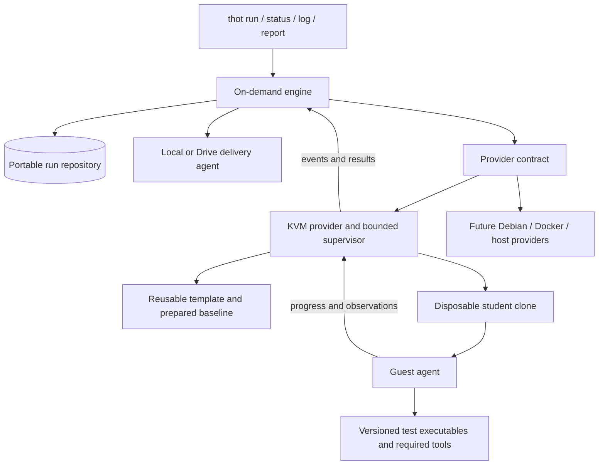
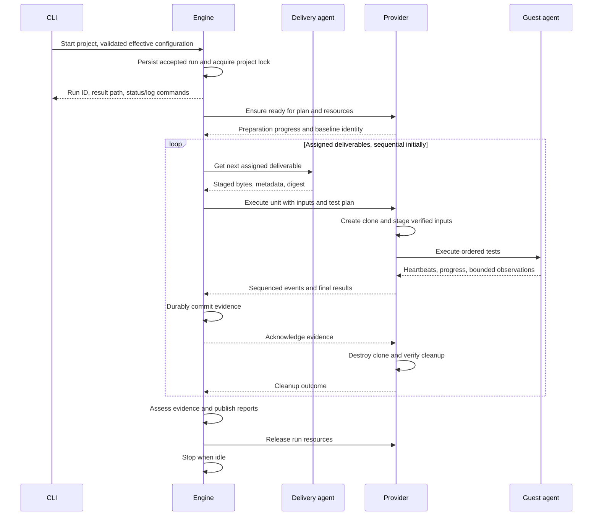

# Local evaluation architecture

Status: selected migration target; implementation is partial. The CLI background worker, compact Alpine profile/default resolution, guest heartbeats and directory input persistence have initial implementations. Cancellation, service-manager supervision for KVM runs, complete operation progress/deadlines and native executable modules remain planned. See [implementation status](../status.md), [ADR-0017](../decisions/0017-local-evaluation-cli.md), the [migration backlog](../planning/local-evaluation-migration.md) and the [CLI reference](../../apps/thot-cli/README.md).

This document takes precedence over older target-design passages concerning command entry points, local service lifetime, configuration defaults, module packaging and the ordinary classroom threat model. Existing v2/v3 parsers, protocol v2, archived results and accepted assessment semantics remain unchanged until explicit migration.

## Findings in the current implementation

| Area | Current behavior and consequence |
|---|---|
| Execution | Sandbox projects use `thot run` to launch a detached local worker; `thot sandbox run` is a compatibility alias. Legacy daemon projects still submit to `thotd`, so orchestration and evidence stores are not yet one engine path. |
| Persistence | Sandbox runs use `results/<evaluation-id>` journals, revisions and artifacts. Daemon runs use expedients and a database. The common command surface preserves both, but histories are not unified or interchangeable. |
| Services | The installer uses socket activation for the legacy daemon and VirtualBox agent. The KVM worker is detached by the CLI and is not yet supervised or reconciled by a service manager after a crash or logout. |
| Configuration | Installed and user defaults, project runtime settings, `.env` and environment overrides resolve KVM settings. Compact v4 platform profiles and v2/v3 configurations normalize to the existing Alpine project model; a provider-neutral v4 typed plan and provenance report are not complete. |
| Progress | The detached worker has a heartbeat and operation log; Alpine guest tasks report heartbeats and bounded output. Progress does not yet have a durable structured stage-event contract for every provider operation, and cancellation/recovery are incomplete. |
| Modules | The Alpine guest can run a digest-verified x86-64 ELF module as well as POSIX shell modules. A general native JSON event/result ABI, catalogue and cross-platform module portability are not complete. VirtualBox and libguestfs still use separate implementations. |
| Qualification | The three-student Bash fixture passed on the recovered Debian 13/KVM host. Synthetic libvirt lifecycle smoke passed on the other documented run. Real OVA capacity, complete multiboot checks and suitable nested execution still need evidence. |

## One run, one owner, replaceable providers

The CLI is a client of an on-demand local engine. It does not spawn a second evaluation implementation. The engine owns planning, intake, durable evidence, checks, rubrics and reports. A sandbox provider owns provisioning, baseline caching, student clones, deadlines and resource cleanup. The guest agent executes tests and reports observations; it never grades or writes expedients.



No engine API exposes create/delete VM as an evaluation operation. Provider-private typed template, baseline and student handles remain opaque. Submit a deliverable with its ordered plan, observe its progress, cancel it and reconcile it through the provider contract. Independent platforms cannot depend on each other's live state. Existing single-platform Alpine support is the first migration slice; additional providers are separate qualifications.



Preparation may precede downloads to detect missing capabilities early. Intake and transfer have their own bounded progress. Failure to acknowledge evidence does not keep a guest alive indefinitely: the provider spools bounded results locally, destroys the guest under its deadline, and exposes recovery state. Cleanup uncertainty blocks further admission for the affected provider.

## Professor-facing command contract

All commands below are **target behavior**, not instructions for the current release. Project argument defaults to the current directory. Help presents these first:

| Target command | Meaning |
|---|---|
| `thot init [PROJECT] --template NAME` | Create a small activity project without overwriting existing work. |
| `thot doctor [PROJECT]` | Check installation, capacity, credentials and required platform capabilities; explain concrete fixes. Does not execute student code. |
| `thot validate [PROJECT]` | Validate syntax, assignments, dependencies and configuration; no provisioning. |
| `thot run [PROJECT]` | Accept and start a background evaluation; print run ID, location, and commands to follow it. |
| `thot status [PROJECT] [--run ID] [--watch] [--json]` | Read durable progress, including last update and whether the engine/provider is reachable. |
| `thot log [PROJECT] [--run ID] [--follow] [--level LEVEL]` | Show diagnostic events and bounded output with source, test and timestamp. |
| `thot cancel [PROJECT] [--run ID]` | Request cancellation and cleanup; print how to follow completion. |
| `thot report [PROJECT] [--run ID]` | Show grade summary and report locations; retain detailed export subcommands. |
| `thot config show [PROJECT] --effective` | Show resolved values and their sources with secrets redacted. |
| `thot project migrate [PROJECT] --output DIRECTORY` | Explicitly produce a converted configuration and migration notes; never execute it. |

Exit zero from `run` means durably accepted, not graded successfully. Failure to start returns a nonzero exit with actionable details; a later failure appears in status. A future `--wait` is a client attachment to the same job, not another runner. Closing a terminal or a log follower does not cancel the run. `status` and `report` work from files with no engine, do not provision anything, and must say when data is stale.

Selection: current project's active run, otherwise its latest run. Multiple active matches require `--run`; never pick a run from another project. Initial policy is one active run per project and one student clone per provider. Show project and run ID in every mutation and summary. Cancellation and deletion are separate operations.

Preserve the current command catalogue through compatibility adapters:

| Existing command family | Migration destination |
|---|---|
| `run`, `run create`, `sandbox run` | Same background engine submission; retain explicit project/delivery overrides. `sandbox run` becomes a deprecated alias with a clear warning about changed background behavior. |
| `run list`, `run status`, `run cancel` | `runs`, `status`, `cancel`; old spellings remain aliases. |
| `run checks`, `run expedient` | `regrade --run ID` and `expedient ID`; checks/regrading use saved evidence and create a new assessment revision, no student execution. |
| `run cleanup`, `run delete`, `clean`, `prune`, `reset` | Keep advanced maintenance commands, ownership checks, scope previews and existing destructive confirmations. Cleanup does not delete original submissions. |
| `import students`, `get students`, `assignments guess/get/import` | Retain roster/assignment operations and CSV/JSON formats; expose them in project help. |
| `deliveries list/get` | Retain local/Drive inventory and retrieval, including explicit output destination. |
| `report runs/deliveries/tests/checks/test_stats/checks_stats/rubric_stats/expedients` | Preserve existing report views and formats through repository adapters; unsupported historical fields are explicitly unavailable. |
| `report grades` | Preserve all/student/professor PDF and evaluation-item CSV options and output-directory selection. |
| `sandbox report/export/import` | `report`, `archive export/import`; preserve JSON/CSV/HTML and verified archive behavior. Existing aliases remain. |
| Global connection flags | Retain existing host/port settings for legacy remote API users; normal local operation needs neither. Do not reassign existing short flags silently. |

No supported command disappears before equivalent behavior, migration documentation and deprecation coverage exist. Legacy remote daemon mode remains explicit; it is not the default local architecture.

## Configuration: intent first, defaults resolved once

Use a new explicit project schema, `thot.dev/v4`, rather than making strict v2/v3 documents silently mean something else. The current adapter accepts compact Alpine profiles and derives legacy provider fields into the existing normalized model. It preserves v2 rubrics and v3 independent evaluation items/checks; no scoring data is rewritten. The adapter is an initial v4 slice, not yet the generic multi-provider grammar proposed below.

Resolution, from lowest to highest priority:

1. Versioned built-in defaults (fresh installation works without a configuration file).
2. System configuration `/etc/thot/config.yaml`.
3. User configuration `${XDG_CONFIG_HOME:-~/.config}/thot/config.yaml`.
4. Project configuration.
5. Project `.env`, parsed as data, never sourced by a shell.
6. Process environment, for documented supported keys.
7. Explicit CLI overrides.

Only recognized runtime-setting keys are accepted in `.env`/environment overrides; they cannot silently replace tests or rubrics. Maps merge by key, lists replace as a whole, omitted values inherit, and null is rejected unless the field explicitly supports it. Unknown settings and invalid units fail validation with field/source names. Administrator ceilings are a separate constraint applied after resolution, not an overridable defaults layer. They are optional deployment policy, not a second professor-authored resource declaration.

The professor declares `resources` once. Provider template parameters, admission budgets and runtime limits derive from it. If old `template_vm` and `limits` disagree, migration stops with both values and asks the professor to select one; it never guesses. Provider-generated VM names and storage paths are normally hidden. Cache keys include base image, agent/protocol compatibility, preparation inputs and relevant resource/device settings; changed requirements invalidate incompatible baselines. Never rewrite a parent disk with active descendants.

Current v4 **Alpine project fragment**. Provider image, agent, clone, input and output defaults come from the installed defaults/profile; the professor supplies workload resources and assessment behavior:

```yaml
schema_version: thot.dev/v4
project_id: ova-screening
name: OVA screening
delivery_folder: deliveries
delivery_limits: {max_bytes: 21474836480}
sandbox_platforms:
  - id: laboratory
    kind: kvm-alpine
    profile: alpine-ova
    resources: {cpus: 4, memory_mib: 12288, disk_gib: 100}
    preparation:
      packages: [qemu-img, libvirt]
      scripts: [{path: extern/prepare-lab.sh}]
    tests:
      - {id: import, argv: [import_ova, submission.ova], timeout_seconds: 1800}
      - {id: start, requires: [import], argv: [start_vm], timeout_seconds: 300}
```

The provider-neutral `delivery`, `platforms`, explicit durations/units and provider-derived cache identity shown in the generic design remain later v4 work. Today, use `delivery_folder`/`delivery_agent`, `sandbox_platforms`, and the `*_mib`, `*_gib`, and `timeout_seconds` fields above. The parser rejects unknown fields rather than accepting the future example as if it were live.
These resource/package values illustrate intent, not a certified Alpine package set or OVA minimum. The activity template must include tested packages, required daemon/firmware setup and full assessments. The installer ships global defaults and the module catalogue; the professor chooses workload size and activity-specific preparation. Packages install through the platform package manager, followed by professor scripts inside baseline preparation. No silent VirtualBox-to-libvirt substitution. A host that cannot satisfy required nesting fails with an explanation; TCG must be explicitly selected where the assessment permits it.

Default intake remains the existing local deliverables folder. Drive selection uses the folder URL and a named credential profile; add a guided `thot deliveries login` flow for first consent. OAuth client setup remains a documented prerequisite for installations without a distributed client registration. Tokens stay in the professor's credential store, never `.env`, snapshots or guests. Resolve relative paths against the file defining them, report the resolved path, and archive portable project-relative references separately from machine-local runtime paths.

Persist original project bytes, normalized effective plan, defaults/catalogue versions, redacted setting provenance, module digests and resolved image/package identities. Restart an accepted run using that snapshot, not freshly changed defaults. A copied project resolves machine paths on the new host and preflights again; imported results do not execute anything.

## On-demand operation without continuous Thot daemons

Target Linux installation installs binaries, defaults and dormant service definitions. `thot run` starts a user engine through the local service manager, independent of the terminal. Where user-manager lifetime cannot survive logout, installation must configure and verify that support or provide the system transient-service mode; merely forking or using `nohup` is insufficient. Installation-time administrator setup is acceptable; routine evaluation must not require `sudo env ...`.

The engine starts only required providers/legacy agents and reference-counts shared workers across runs. All Thot-owned workers stop after the last run, evidence flush and bounded cleanup, with a short idle grace (default 30 seconds). Existing machine-managed libvirt services are not stopped by Thot. Templates and baselines persist powered off. A deprecated always-on daemon installation remains supported during migration, without binding a competing endpoint.

Use a local user-owned Unix socket and singleton startup lock. Provider operations requiring privilege use a narrow installed helper for Thot-owned resources; project scripts run inside the guest, not through an arbitrary root command interface. Full host-hardening infrastructure is not a prerequisite to the first CLI slice. Status remains readable if startup fails. A run cannot be accepted until there is a durable record and a supervised worker responsible for it.

## Progress, deadlines and failure semantics

Heartbeats prove liveness; progress describes work. Neither proves that a test is advancing. Each provider operation and guest task emits started/progress/finished events with `run_id`, `unit_id`, `platform_id`, optional `test_id`, `attempt`, `source`, monotonic source sequence, UTC observation time, stage, counters where measurable and human-readable summary. The engine assigns its own durable journal sequence and receive timestamp. Preserve the latest event and current operation even for silent programs.

Proposed defaults: heartbeat every 5 seconds, stale after 20 seconds, disconnected after 60 seconds; operation-specific deadlines remain independently enforced. Local elapsed deadlines use monotonic clocks; wall-clock timestamps are for presentation. Default preparation 30 minutes, guest boot 5 minutes, test 10 minutes, cancellation grace 10 seconds and cleanup 2 minutes are starting settings, not certification of every workload. Intake/transfer default to a 2-minute no-byte-progress deadline plus a 2-hour total deadline; activity templates can raise finite budgets for large images. Derive a finite unit budget from transfers, boot, ordered test budgets and cleanup; derive run budget from preparation and unit count. Freeze these at acceptance and show expected maximums.

| Layer | Mandatory control |
|---|---|
| Engine | Bounded intake and run budget; detect provider disconnect; persist interruption and request reconciliation. |
| Provider supervisor | Bounded provisioning/preparation/transfer/boot/host subprocesses; independent engine lease and cleanup watchdog. |
| Guest agent | Per-test process-group timeout, concurrent heartbeats/cancellation, bounded output and bounded pipe draining after exit. |
| Transport | Connection, handshake, frame-read/write and idle deadlines; bounded queues with terminal events prioritized. Partial frames cannot hold a connection forever. |
| Module | Bounded tool calls and useful stage events; module watchdog failure still covered by guest and provider deadlines. |

On timeout: record the active operation, request cooperative stop, kill its process group after grace, then tear down the disposable guest if stop cannot be confirmed. A supervisor lease expires when engine communication is lost; it reclaims its resources without engine intervention. On engine restart, reconcile owned operations; mark incomplete attempts interrupted and require explicit retry. No automatic replay of non-idempotent tests. A supervisor that itself dies cannot enforce deadlines: service-manager restart plus provider startup reconciliation handles that case, and status must disclose cleanup unknown. Never claim a stopped guest without verification.

Extend protocol v2 through capability negotiation for progress and cancel only where wire compatibility permits; otherwise bump the major version. Keep framed, bounded messages and existing per-session authentication. Older agents must fail preflight with an upgrade/rebuild-baseline instruction if live supervision is required. Independent control processing must not block behind test execution or stdout. Persistent events are deduplicated by source/attempt/sequence; acknowledgements follow durable append. Large output stays in bounded artifact streams, not heartbeat frames. Redact credentials; expose truncation and dropped diagnostic counts.

Execution outcomes remain pass/fail/skip/timeout/infrastructure failure at the appropriate observation/assessment layers. Infrastructure failure, unsupported capability, disconnect and interrupted attempts yield pending assessment, never a fabricated zero. Timeout is recorded as execution evidence; only an explicitly configured academic rule can assess a successfully observed test timeout as failure. Run lifecycle is separate: accepted, preparing, running, assessing, completed, failed, cancelled or interrupted, with cleanup pending/complete/failed tracked independently. `completed` does not imply passing grades. Terminal evaluation with cleanup pending remains visibly incomplete operationally.

Example target status:

```text
OVA screening · run 01... · running · 2/24 submissions
student2 · laboratory · import · converting disk (7m 12s elapsed)
Agent heard 3s ago · operation deadline in 22m 48s · cleanup not started
Grades: 1 assessed, 0 pending infrastructure · results: ./results/01...
Details: thot log --run 01... --follow
```

Show byte counters when known; do not invent percentage or ETA for opaque tools. Persist progress summaries at a bounded rate and terminal events immediately. `log` adds command/tool names, safe stderr tails and correlation IDs; status avoids protocol/debug jargon.

## Portable modules: Rust executable contract

Add `native-executable-v1` alongside `posix-shell-script-v1`, not as a breaking replacement. Ship versioned module bundles with a manifest mapping supported OS/architecture/libc targets to executable and asset digests, required capabilities/tools and request/result schema versions. Resolve and pin them automatically from the installed catalogue; professors normally name `libvirt/import_ova`, not binary paths or hashes. Custom instructor scripts remain supported.

Use a separate process boundary: one JSON request on stdin, JSON-line events and one terminal result on stdout, diagnostics on stderr. Requests contain staged workspace/resource references and operation parameters, never engine credentials or arbitrary host paths. Agent enforces line/frame/output bounds, validates event/result schemas, captures exit/signal and converts missing/malformed terminal results to infrastructure failure. Structured terminal observations take precedence over legacy exit conventions; the manifest selects the ABI so existing shell semantics remain unchanged. Resource IDs allow import/start/stop/destroy within the same student clone; they cannot refer to another student's or host VM.

Build Rust modules for Linux targets actually supported, preferring musl/static where dependencies permit. Validate dynamic library and tool dependencies before execution; architecture/ABI incompatibility fails preflight, never falls back to host execution. A static executable does not include QEMU, libvirt daemons, guestfish appliances, firmware or kernel support. Preparation remains responsible for those. Shared Rust domain logic and typed subprocess adapters avoid rewriting academic tests for each platform; different backends implement the same capability semantics. Guest-local libvirt permission from ADR-0016 remains inside the disposable clone.

Migrate libvirt lifecycle first with fixture parity (OVA/OVF parsing, safe extraction, manifests, conversion, lifecycle and cleanup), then libguestfs and VirtualBox. Preserve tool output/evidence and distinguish student defects from missing host/guest dependencies. Debian, Docker and host reuse requires separate capability/conformance tests, not just compiling a Rust binary. Full EFI/GRUB/Windows/shared-data assessment is a separate activity feature, not implied by lifecycle module parity.

## Practical safety and resource policy

The ordinary profile addresses accidental destructive scripts, runaway processes, oversized archives and cross-student contamination. Keep disposable per-student environments, bounded resources/output/time, safe extraction, no host home/disk/socket mounts, credentials outside guests and provider-owned cleanup. Explicit host execution remains visibly unisolated and limited to professor-approved operations; do not claim PDF/image parsers are automatically harmless.

Preparation may access standard repositories; student execution is offline unless the activity requires networking. Avoid requiring professors to author hash manifests, packet-filter rules, image-signing systems or per-test identity policies. Thot derives digests and installs reasonable defaults. Keep professional adversarial hardening, attestation, mandatory signing infrastructure and complex network brokers as optional/future profiles; do not claim protection against a determined guest escape or evidence forgery. Existing project safety bounds and verified archives are retained. Capacity admission must account for source OVA, extracted disks, conversion workspace, clone growth and host reserve: a 20 GiB intake allowance is not a 20 GiB disk budget.
