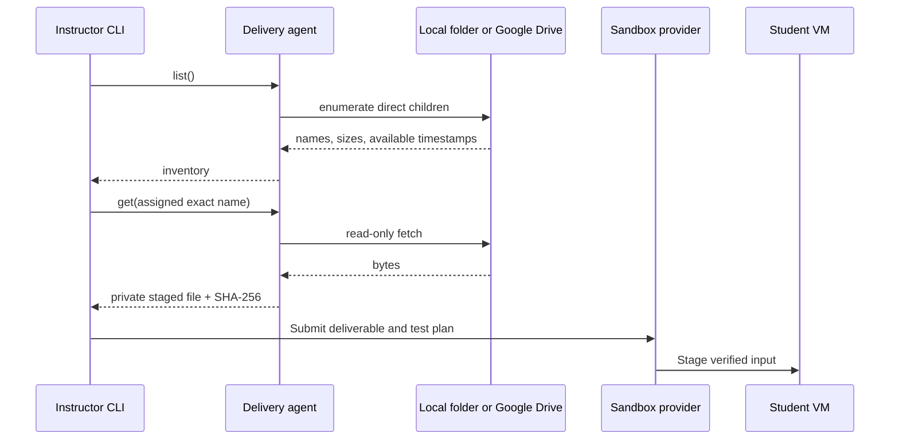
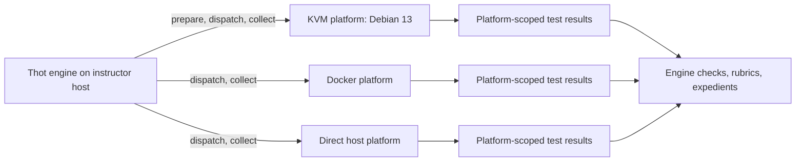
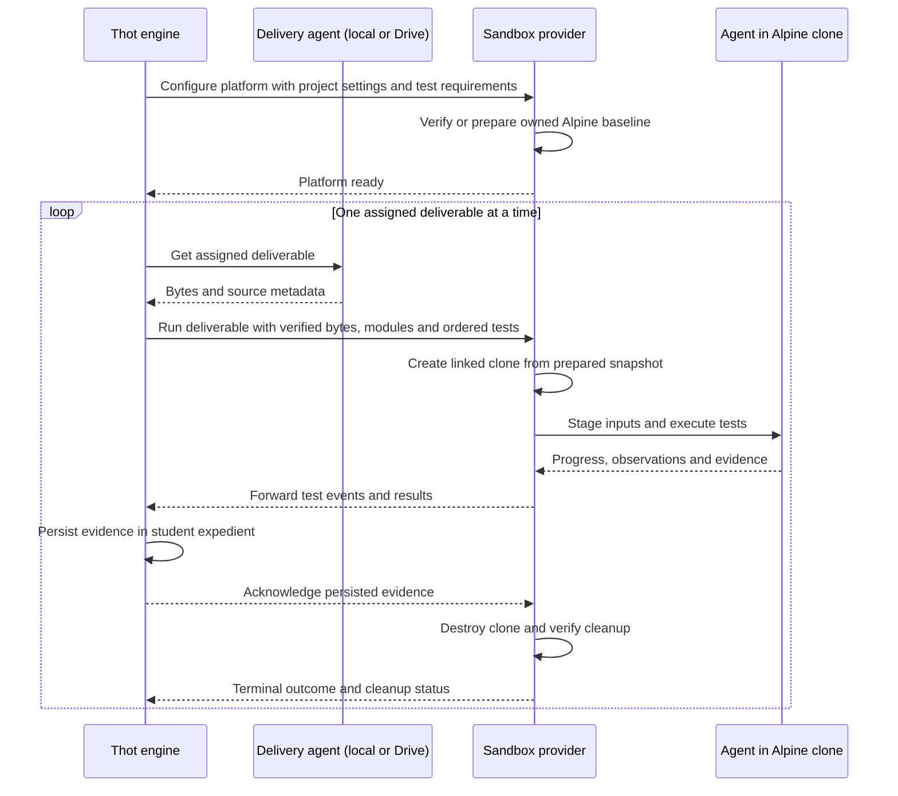
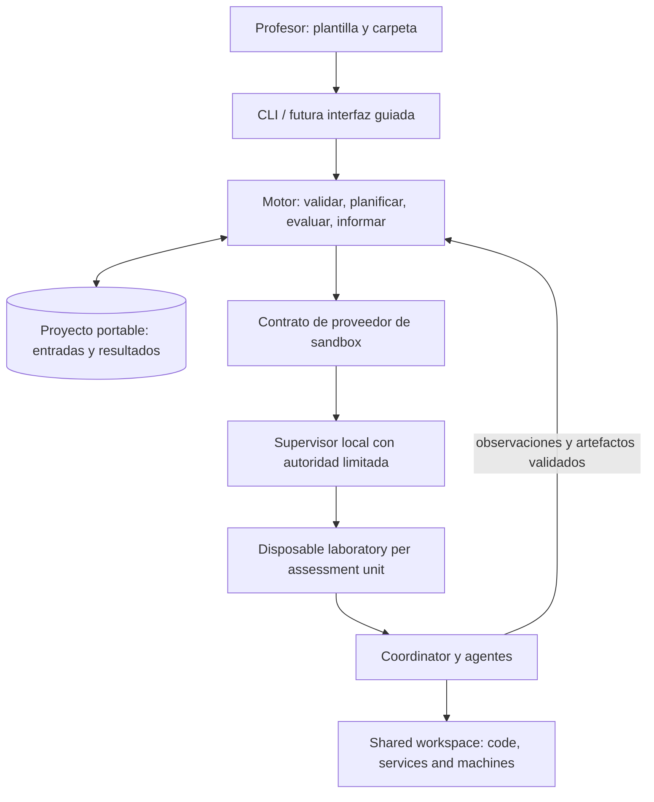
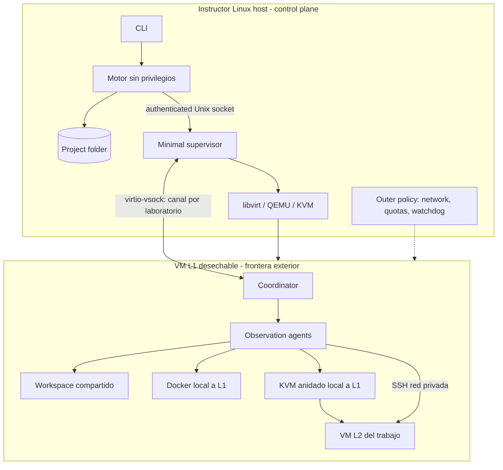

# Proposed architecture and justification

Status: target design v2, 2026-11-15. [Requirements](requirements.md), [model](data-model.md), [contracts](contracts.md), [plan](../planning/platform-roadmap.md) and [ADR](../decisions/README.md) form a coherent proposal; They do not describe already published functionalities.

## Starting point

The existing daemon evaluates VirtualBox deliveries through an HTTP agent and stores project runs and student expedients. The local Alpine CLI implements a separate sandbox workflow. Consult the [implementation status](../status.md) for the evidence and limits of each path.

The objective is to keep the evaluation reproducible from evidence, replacing the host-bound execution with an isolated laboratory and making the project a self-sufficient portfolio.

## Deliverable intake agents

Student work enters through a read-only delivery-agent boundary before it reaches a sandbox. The project chooses one provider per evaluation: local filesystem or Google Drive. `list` returns exact names, sizes, and available dates; `get(name)` materializes one bounded item into private host staging. The runner hashes the acquired bytes and sends only the selected submission into the student environment. Assignments reference names from the inventory, not machine-specific source paths. Local filesystem remains the default when the project omits an agent declaration.

Google Drive OAuth is performed as the professor through a loopback desktop-app callback and requests a read-only scope. The refresh/access token cache is outside the project and result archive. Sandbox agents never receive Google credentials. The current `kvm-alpine` CLI uses this contract; the legacy daemon delivery-folder flow has not yet migrated.



## Generic model

## Sandbox platforms and test phases

Thot defines a **sandbox platform** as the execution boundary selected for a named group of tests. The first design supports three platform kinds. Each platform is independent: a test can consume its submission and declared platform inputs, but cannot depend on another platform's test result, filesystem, running service, or VM. Thot's engine can combine results from all platforms into one student expedient after execution, but that is a reporting/evaluation step rather than cross-platform test interaction.



| Platform | Proposed lifecycle | Suitable use | Isolation and constraints |
|---|---|---|---|
| `kvm` | Create a Debian 13 base VM; install pinned Thot agent and required tools; run the instructor's one-time preparation phase; stop and snapshot the prepared disk; for each student create a linked clone, copy only that student's delivery and declared instructor test files, run steps sequentially, collect bounded results, then destroy clone | Dangerous scripts, packages, system changes, Docker, or activities requiring guest VMs | Strongest of the three choices, but uses the most disk, RAM, CPU, and setup time. KVM, storage quotas, networking, clone/snapshot consistency, image patching, and cleanup must be proven. Linked clones depend on an unchanged parent image and are not independent backups. |
| `docker` | Build or fetch a pinned base image; for each student create a fresh container and writable layer, mount only declared inputs, execute sequential tests, collect bounded results, then remove the container and its writable layer | Lightweight Linux command-line tools and dependencies when a shared host kernel is acceptable | Container isolation shares the host kernel and is weaker than a VM boundary. No privileged mode, host PID/network, Docker socket, arbitrary host mounts, or unbounded capabilities. A container must not be presented as equivalent to KVM for hostile code. |
| `host` | Execute a declared read-only or otherwise low-risk adapter on the Thot host and capture its result | Static parsing of PDFs, source archives, or other files using reviewed tools, without executing student programs | No sandbox boundary. Only permitted by administrator policy after the action is classified as safe. If Thot itself runs in an administrator-managed VM, that VM can provide an outer boundary, but the project must not assume this without a verified host capability declaration. |

The KVM family has distinct platform kinds: `kvm-debian` for a general-purpose Debian 13 environment and `kvm-alpine` for Alpine Linux. They share the KVM lifecycle, reusable test-module contract, and task/result protocol, but have separate images, agents, package managers and platform capability adapters. The Alpine platform may be configured as a low-resource environment for simple tasks or with larger resources and nested virtualization for workloads such as OVA multiboot. The professor selects memory, storage, vCPU and nested-virtualization settings; Thot validates host capability and resource availability but cannot infer a suitable workload size. `kvm-alpine` remains a POC, not a supported production platform. Its current state is in the [KVM Alpine POC](../implementation/kvm-alpine.md).

### Reusable test modules

Evaluation logic is packaged independently from the platform that executes it.
The engine resolves each configured test to a versioned module package, pins
its digest and declared capability requirements, and transfers the package
with the task to the platform agent. A test module follows one stable
request/result contract and returns observations; it does not calculate
grades. The agent supplies a platform adapter implementing the capabilities
the module declares, such as bounded process execution, read-only file access,
disk inspection, VM lifecycle, console interaction, guest probing, artifact
writing and cancellation.

The same test package is used on `kvm-alpine`, `kvm-debian`, Docker and
permitted host execution. Platform adapters may implement a capability using
different tools, but must satisfy the same typed semantics and evidence
contract. The engine checks capability compatibility before creating a
sandbox. If no compatible adapter exists, the test is rejected or reported as
unsupported; it is never silently rewritten to a different test or run on the
host. Platform-specific code belongs in adapters, not duplicate assessment
logic. Test packages are immutable, hashed, resource-bounded and transferred
without student data or OAuth credentials.

The exact module packaging format, ABI, capability versioning and trust/signing
policy remain to be decided before implementation. The target must support
modules that call typed adapters, not arbitrary host shell commands. A module
may use an explicitly declared guest process capability for commands inside
the isolated environment; that does not grant host or hypervisor access.

Each platform has two distinct phases. **Preparation** runs once per project baseline to install/configure common resources from a pinned base, package-manager repositories and professor-controlled preparation scripts. For KVM, Thot then shuts down the prepared VM and creates a verified snapshot. `kvm-alpine` package preparation uses the configured Alpine repositories (`apk`); a professor script may install a tool unavailable from those repositories, such as a selected VirtualBox build, subject to the declared network, hash and timeout policy. **Student execution** creates a fresh linked clone for each student (or declared group), transfers the selected deliverable and the pinned test-module packages it needs, then runs tests in order. The clone is destroyed and cleanup verified before the next deliverable is processed. Preparation output is not student evidence and must not affect another student or platform. Preparation failure blocks that platform before student work begins. A student test failure does not stop later tests unless its declared dependency policy says so.

For OVA multiboot on `kvm-alpine`, the Alpine sandbox VM itself is configured
with enough memory, disk and vCPU for the professor's workload, and nested
virtualization is enabled when required. The test packages and platform
adapter run inside this disposable Alpine clone. They use the nested
virtualization capability available inside that boundary to inspect/boot the
student OVA. The professor owns choosing resource values, while host preflight
must check KVM nesting support, configured device exposure and aggregate
resource limits before any clone is created. The low-resource smoke profile
is not suitable for Windows OVA execution.

The in-guest agent is an execution and collection component. It receives an authorized, bounded task sequence, executes one test at a time, enforces timeouts, captures stdout/stderr/exit status and platform diagnostics, and returns progress and artifacts to the engine. It does not create expedients, apply checks, calculate grades, choose new tests, or interpret academic success. The engine validates each result, stores it under `(run, student-or-group, platform, test, attempt)`, then computes checks/rubrics and expedients centrally. A nonzero process exit can be a valid observation; infrastructure failure is separate from academic failure.



### Declarative platform configuration

The project configuration has a list of named `sandbox_platforms`. Each platform owns its kind-specific resource limits, preparation steps, test list, network policy, and artifact policy. Tests belong to exactly one platform. Cross-platform dependencies are rejected at project validation. Platform test dependencies must be acyclic and refer only to tests in the same platform. The same test definition may be reused by explicit duplication, but it does not share runtime state across platforms.

```yaml
sandbox_platforms:
  - id: isolated-vm
    kind: kvm
    image: debian-13-thot@sha256:<pinned-digest>
    vm:
      name_prefix: thot-assessment
      vcpu: 2
      memory_mib: 4096
      disk_gib: 24
      snapshot: prepared-baseline
    network: deny-by-default
    preparation:
      timeout_seconds: 900
      packages: [python3, make, gcc]
      scripts: [extern/vm/prepare.sh]
    tests: [files, unit, integration]
  - id: static-files
    kind: host
    policy: reviewed-read-only
    tests: [pdf-metadata, archive-inventory]
  - id: lint-container
    kind: docker
    image: debian:13-slim@sha256:<pinned-digest>
    limits: {cpus: 2, memory_mib: 2048, disk_gib: 4}
    network: deny
    tests: [lint]
```

This is a conceptual schema, not the current parser contract. Before implementation, decide if Docker runs directly under an administrator-controlled host daemon or inside the KVM platform. Direct host Docker offers lower resource cost but does not have KVM's outer isolation. When Docker runs inside the per-student KVM clone, it is an execution mode within the KVM boundary rather than a third independent boundary. Both modes should not share a `kind: docker` label without a required `isolation_scope` field. For now, independent host-Docker is permitted only for trusted/low-risk tasks or an explicitly isolated Thot host, and must be visibly reported as lower assurance.

An Alpine nested-VM workload will use an explicit platform profile and
preparation contract. This is illustrative; property names must be finalized
in the shared Rust model and API specification:

```yaml
sandbox_platforms:
  - id: ova-multiboot
    kind: kvm-alpine
    vm:
      vcpu: 6
      memory_mib: 12288
      disk_gib: 80
      nested_virtualization: required
    network:
      template_install: allowlisted-alpine-repositories
      preparation: allowlisted-alpine-repositories-and-professor-sources
      student_tests: deny
    preparation:
      timeout_seconds: 1800
      packages: [qemu-system-x86_64, libvirt, libguestfs]
      scripts:
        - path: extern/platform/install-virtualbox.sh
          sha256: <pinned-script-digest>
          timeout_seconds: 900
    tests:
      - id: ova-layout
        module: thot.ova-layout@1
        digest: sha256:<pinned-module-digest>
        requires_capabilities: [artifact.read, disk.inspect]
      - id: multiboot-shared-data
        module: thot.multiboot-shared-data@1
        digest: sha256:<pinned-module-digest>
        requires_capabilities: [nested-vm.create, nested-vm.console, guest-probe]
```

Package names and memory values above are examples, not verified Alpine
packages or a recommended minimum. The professor chooses suitable resources;
the engine must verify configured bounds and host nested-KVM capability. The
preparation script is instructor-owned trusted code, staged from the project,
hashed, network-limited and run only while preparing the reusable baseline.
Student OVA contents must not be allowed to change package preparation or
module versions.

Preparation is privileged project content. It is trusted instructor code, pinned and hashed in the run snapshot, constrained by a separate timeout and network policy, and never copied from a student submission. Package installation follows the platform package manager: `apk` for Alpine and `apt` for Debian. Repository packages may introduce non-reproducible versions or compromised dependencies. Prefer version pins from a controlled mirror. If the needed tool is not provided by standard repositories, the professor may provide a project-relative preparation script with a digest, timeout and allowed network policy. Record package versions, repository identity, image digest, script hashes and complete output; a later run must state whether it reuses the recorded baseline or rebuilds it.

The platform boundary is not a result dependency. Common assessment logic may refer to result IDs from any platform after all applicable platform executions reach terminal state. A test may not read another platform's files, environment variables, resource registry, live network service, stdout, or exit code. If an activity truly requires interaction, put those steps in one platform (usually a KVM guest, where Docker and nested services can coexist) or define a future explicit bridge contract with a separate threat review. No implicit file copy or host path bridge is allowed.



An **evaluation unit** is the explicit set of deliverables that are tested together. It can represent a group with several files or repositories. Comparisons between submissions require a declared joint unit, never implicit access to another student's laboratory. All agents in a unit share a laboratory, network, and resource registry. A class execution contains many units; it does not use a single VM for the entire class. This allows interaction without contamination between students.

The engine maintains the DAG, selects units, authorizes each task, persists observations, and calculates notes. The coordinator only dispatches authorized actions to agents and maintains processes/resources; It does not change the plan or calculate grades. Git, filesystem, exec, Docker, KVM, and SSH agents enforce typed action contracts. Communication between steps uses declared outputs and named resources, without depending on global ports or text accidentally extracted from a log.

## Initial Linux deployment



KVM/QEMU using libvirt is proposed for the outer VM. Docker organizes tools and services within L1; it does not constitute the security border against the host. A base image is selected by digest, with verified agents and tools; Each lab starts with a new overlay and limited working disk. No teacher directories are mounted on L1, neither via virtiofs/9p nor via bind mounts. Entries are transferred as blobs, verified, and extracted within the lab; The outputs are copied using a bounded receiver.

The supervisor has only the operations of creating, querying, stopping and destroying resources from its own namespace. It does not offer shell, arbitrary libvirt XML, host paths, or general access to the Docker/libvirt socket. The engine does not belong to the Docker/libvirt groups with general administrative access. An administrator-installed policy limits images, sizes, networks, CPUs, and devices; the teacher's YAML can only restrict it. Exact implementation of libvirt permissions requires phase 0 testing.

## Borders and threats

Any repository, image, file, output and student service is considered hostile. A faulty teaching script or compromised agent is also contained within L1. The kernel/hypervisor, supervisor, engine, and base image form the foundation of trust. Portable folders are data: opening or importing a project does not run scripts or install agents.

| Risk | Mandatory external control | Residual limit |
|---|---|---|
| Host Erase/Read | No folders, devices or host sockets on L1; Supervisor API closed | Hypervisor escape remains a risk |
| Escape from Docker or root on L1 | Destruction of all L1, limits imposed from L0 | Can alter evidence within L1 |
| Exfiltration, LAN, cloud metadata | No network by default; external filter blocks host, LAN, link-local, unauthorized IPv6 and other laboratories | Allowed HTTPS can also exfiltrate to authorized destinations |
| Fork bomb, memory/disk, logs | L0 quotas, fixed CPU/RAM, physical limit disk, byte/inode/event limits and watchdog | Activity may end incomplete |
| Malicious artifact | Extraction without links/devices/traversal, quotas and copy to staging; viewer escapes HTML and terminal | Do not open student binaries as host applications |
| Stolen credentials | External broker, minimum scopes, ephemeral tokens; writing before persisting | A secret given to hostile code is no longer a secret |
| Manipulation of observations | Separate student container agents, attributed results and hashes | There is no attestation of truth against root in L1 |

Privileged Docker, host networking, and libvirt control by student code are not allowed in the regular profile. For `make` that manages infrastructure, a profile `nested-lab` is enabled: its sockets and privileges only exist in L1. The grant may compromise observers of that same VM; the report indicates lower confidence. Separating observation in another VM would be an extension for adversarial evaluations, pending design. The engine checks only interpret data with limited parsers, without executing templates or scripts provided in results.

## Networks and acquisition

The acquisition phase supports Git HTTPS via outbound proxy with allowed targets, without direct LAN/host access. Every DNS redirect and resolution is re-validated, including submodules/LFS; `file://`, `ext::`, external helpers, and project checkout hooks are not supported. The exact commit and the tree are archived; branch names are not enough. For private repositories, the proxy embeds a read token without delivering it to the student processes. Dependencies and images are preloaded or unloaded by the same controlled mechanism. After acquisition, exit is withdrawn; An activity that needs it during testing must declare it.

The labs have separate isolated networks and no port publications to the host. Services are found through a resource record within L1. The vsock control channel has dedicated service and typed messages; it is not a tunnel to the engine API. L2 does not receive access to the control channel.

## Flow, status and faults

The provider forwards progress and normalized test results to the engine. It reconciles its own environments after interruption. The engine resumes delivery intake after confirmed cleanup.

In a unit the steps are sequential by default. A DAG allows explicit parallelism if there are no concurrent writes to a resource; exclusive/shared locks are declared. `after` only commands; `requires` demands success. In the event of an infrastructure error, the branch is blocked, other units can continue. Exterior cleaning is independent of the teacher's `always` steps: these are not a safety barrier.

A timeout kills the process group/container and its descendants. If your detention cannot be proven or you could have left an arbitrary status, L1 is terminated and live resources are invalidated. The supervisor observes leases; When the engine dies, it stops and destroys orphan laboratories. Logs already committed are kept; Incomplete results are marked discontinued. Pending cleanup prevents declaring the environment released and blocks new admissions if unsafe resources remain.

There is no promise to resume memory or processes from a destroyed VM. Extending a run preserves compatible observations, but for a new step requiring live services the chain is rebuilt from inputs set in a clean lab. Repeating non-idempotent actions requires stated authorization or intervention. See ADR-0004.

## System requirements and operation

Reference profile to certify: Maintained Linux x86_64, systemd, cgroups v2, KVM, QEMU/libvirt, LSM AppArmor or SELinux and local storage with reliable locking, atomic renaming and quotas. The exact list of supported distributions/versions is fixed after testing; It is not universal support for any Linux.

Sizing starting point, no accredited minimum: 8 threads, 32 GiB RAM and 100 GiB free for a nested laboratory with 4 vCPUs, 12 GiB RAM and 40 GiB disk; reserve at least 8 GiB to the host. Each activity declares needs and the planner adds reserves before admitting it. L2 and Docker consume L1's budget, not unlimited additional reserves. VT-x/AMD-V hardware and nesting should be tested by booting an L2; detecting `/dev/kvm` is not enough. An already virtualized Linux is only suitable if it passes the same test.

An administrative installer prepares network, permissions, image and service. The teacher receives a "pass/not pass" diagnosis with concrete actions and a template; choose folder, check associations, validate, run and open the report. CLI first, future interface guided on the same API. The first use supports a technical installation, but subsequent evaluations do not require hypervisor commands.

The engine writes with the identity of the teacher or dedicated service with explicit ACL for the chosen folder; read-only entries during run, writable `runs/`, directories 0700 and files 0600 by default. The owner of foreign folders is not recursively changed. Exclusive lock prevents concurrent edits; consistent export only from a committed snapshot. Project backup and credential store are separate operations. Explicit retention by project, without automatically deleting original deliverables; Temporary disks are always deleted except for administrative quarantine with expiration. Deleting files on SSD is not equivalent to cryptographic deletion; encrypt the volume when necessary.

## Evolution and justification

The outer VM adds cost and requires nesting, but contains both ordinary processes and Docker and student-created VMs. Docker on the host reduces cost but shares kernel and increases control plane exposure; it is discarded for the first version. A single class VM would facilitate data contamination and leakage; is discarded. The local modular monolith and file system avoid premature distributed infrastructure.

The future remote provider can implement the same identifiers, tasks, leases, and transfers, but will need mTLS, project authorization, organization quotas, and remote storage. The local protocol is not opened to the Internet to obtain a server. SQLite will only be a rebuildable index after completing and verifying the POC migration.

Primary technical sources consulted on 2026-11-15: [Docker security](https://docs.docker.com/engine/security/) and [resource limits](https://docs.docker.com/engine/containers/resource_constraints/) support the need to configure isolation and quotas; [Nested KVM](https://docs.kernel.org/virt/kvm/x86/running-nested-guests.html) describes L0/L1/L2 and their conditions; [libvirt domains](https://libvirt.org/formatdomain.html) provides the resource/device configuration mechanisms. The selection and policies above are decisions proposed by Thot, subject to validation, not guarantees of those tools.
