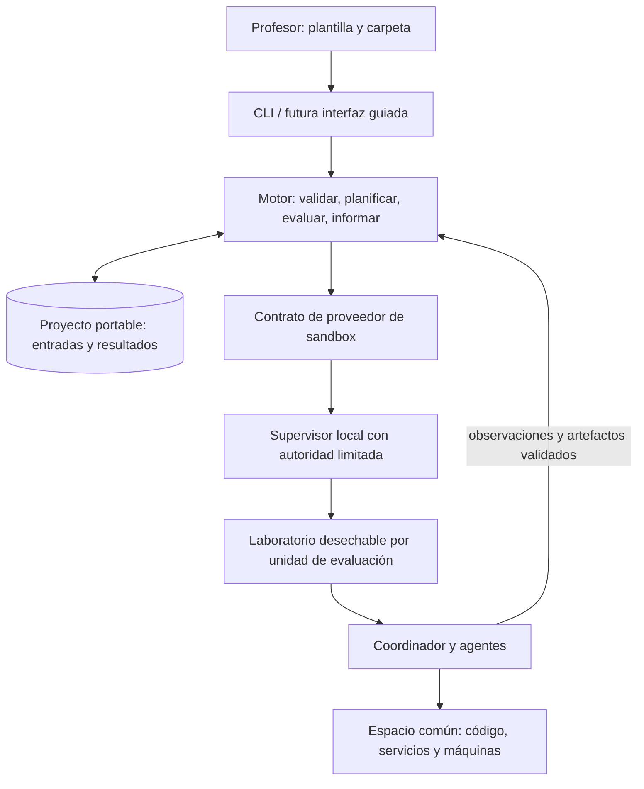
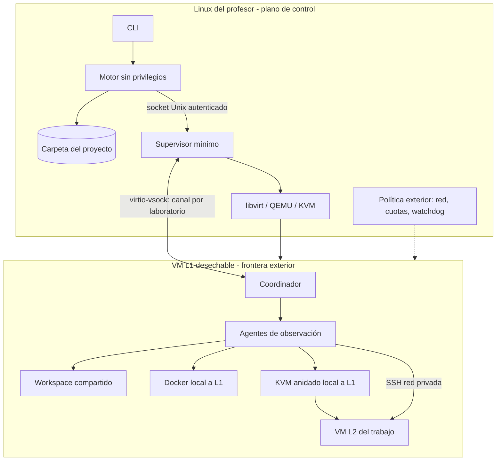
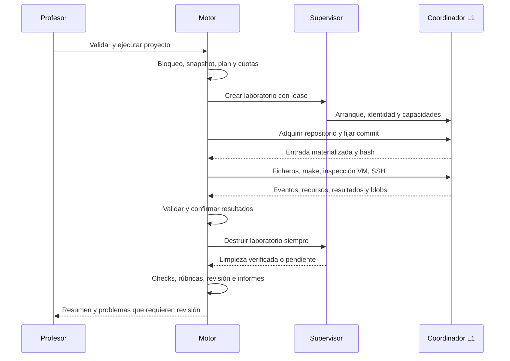

# Arquitectura propuesta y justificación

Estado: diseño objetivo v2, 2026-11-15. [Requisitos](requirements.md), [modelo](data-model.md), [contratos](api-spec.md), [plan](implementation-plan.md) y [ADR](decisions/README.md) forman una propuesta coherente; no describen funcionalidades ya publicadas.

## Punto de partida

El catálogo y la guía del POC documentan un servicio Rust `thotd`, CLI, configuración `configuration.yaml`, SQLite y artefactos, pruebas integradas y scripts externos, checks, rúbricas, evaluación, expedientes y exportación PDF/CSV. El POC importa OVA con VirtualBox en Linux; SSH utiliza puertos compartidos y fuerza ejecución secuencial. El workspace contiene además una transición al agente HTTP v1 `thot-virtualbox-agent`, que usa SSH hacia VirtualBox, y a carpetas `runs/` (véanse los [README de thotd](../apps/thotd/README.md) y del [agente](../apps/thot-virtualbox-agent/README.md)). Los procesos externos heredan permisos del servicio: no hay sandbox general KVM/Docker ni interfaz web. La separación v1 no acredita aislamiento y no equivale a una flota distribuida general. El [catálogo](IMPLEMENTED_CATALOG.md), la [guía del POC](THOT_VM_ACTIVITY_POC.md) y [despliegue actual](../deploy/README.md) siguen siendo referencias operativas. La evidencia de compilación descrita allí no acredita una integración real con VirtualBox.

El objetivo es conservar la evaluación reproducible desde evidencias, sustituyendo la ejecución ligada al host por un laboratorio aislado y haciendo del proyecto una carpeta autosuficiente.

## Modelo genérico

Una **unidad de evaluación** es el conjunto explícito de entregas que se prueba junto. Puede representar un grupo con varios ficheros o repositorios. Comparaciones entre entregas requieren una unidad conjunta declarada, nunca acceso implícito al laboratorio de otro alumno. Todos los agentes de una unidad comparten laboratorio, red y registro de recursos. Una ejecución de clase contiene muchas unidades; no utiliza una sola VM para toda la clase. Así se permite interacción sin contaminación entre alumnos.

El motor mantiene el DAG, selecciona unidades, autoriza cada tarea, persiste observaciones y calcula notas. El coordinador sólo despacha acciones autorizadas a agentes y mantiene procesos/recursos; no cambia el plan ni calcula notas. Los agentes Git, filesystem, exec, Docker, KVM y SSH aplican contratos de acción tipados. La comunicación entre pasos usa salidas declaradas y recursos nombrados, sin depender de puertos globales o texto extraído accidentalmente de un log.

## Despliegue inicial Linux

Se propone KVM/QEMU mediante libvirt para la VM exterior. Docker organiza herramientas y servicios dentro de L1; no constituye la frontera de seguridad frente al host. Se selecciona una imagen base por digest, con agentes y herramientas verificadas; cada laboratorio arranca con overlay nuevo y disco de trabajo limitado. Ningún directorio del profesor se monta en L1, ni mediante virtiofs/9p ni mediante bind mounts. Las entradas se transfieren como blobs, se verifican y se extraen dentro del laboratorio; las salidas se copian mediante un receptor acotado.

El supervisor tiene sólo operaciones crear, consultar, parar y destruir recursos de su propio namespace. No ofrece shell, XML arbitrario de libvirt, rutas del host ni acceso general al socket Docker/libvirt. El motor no pertenece a los grupos Docker/libvirt con acceso administrativo general. Una política instalada por administrador limita imágenes, tamaños, redes, CPU y dispositivos; el YAML del profesor sólo puede restringirla. La implementación exacta de permisos libvirt requiere el ensayo de fase 0.

## Fronteras y amenazas

Se considera hostil todo repositorio, imagen, archivo, salida y servicio del alumno. También se contiene un script docente defectuoso o un agente comprometido dentro de L1. El kernel/hipervisor, supervisor, motor e imagen base forman la base de confianza. Las carpetas portables son datos: abrir o importar un proyecto no ejecuta scripts ni instala agentes.

| Riesgo | Control exterior obligatorio | Límite residual |
|---|---|---|
| Borrado/lectura del host | Sin carpetas, dispositivos ni sockets del host en L1; API del supervisor cerrada | Escape de hipervisor sigue siendo riesgo |
| Escape de Docker o root en L1 | Destrucción de toda L1, límites impuestos desde L0 | Puede alterar pruebas dentro de L1 |
| Exfiltración, LAN, metadatos cloud | Sin red por defecto; filtro exterior bloquea host, LAN, link-local, IPv6 no autorizado y otros laboratorios | HTTPS permitido también puede exfiltrar hacia destinos autorizados |
| Fork bomb, memoria/disco, logs | Cuotas L0, CPU/RAM fijas, disco con límite físico, límites de bytes/inodos/eventos y watchdog | Actividad puede finalizar incompleta |
| Artefacto malicioso | Extracción sin enlaces/dispositivos/traversal, cuotas y copia a staging; visor escapa HTML y terminal | No abrir binarios del alumno como aplicaciones del host |
| Credenciales robadas | Broker externo, ámbitos mínimos, tokens efímeros; redacción antes de persistir | Un secreto entregado a código hostil deja de ser secreto |
| Manipulación de observaciones | Agentes separados de contenedores del alumno, resultados atribuidos y hashes | No hay atestación de veracidad frente a root en L1 |

No se permite Docker privilegiado, host networking ni control de libvirt por código del alumno en el perfil ordinario. Para `make` que administra infraestructura se habilita un perfil `nested-lab`: sus sockets y privilegios sólo existen en L1. La concesión puede comprometer observadores de esa misma VM; el informe indica menor confianza. Separar observación en otra VM sería una ampliación para evaluaciones adversariales, pendiente de diseño. Los checks del motor sólo interpretan datos con parsers limitados, sin ejecutar plantillas o scripts aportados en resultados.

## Redes y adquisición

La fase de adquisición admite Git HTTPS mediante proxy de salida con destinos permitidos, sin acceso directo a LAN/host. Cada redirección y resolución DNS se vuelve a validar, incluyendo submódulos/LFS; no se admiten `file://`, `ext::`, helpers externos ni hooks de checkout del proyecto. Se archiva el commit exacto y el árbol; nombres de rama no bastan. Para repositorios privados, el proxy incorpora un token de lectura sin entregarlo a los procesos del alumno. Dependencias e imágenes se precargan o descargan por el mismo mecanismo controlado. Tras adquisición se retira salida; una actividad que la necesite durante pruebas debe declararlo.

Los laboratorios tienen redes aisladas distintas y ninguna publicación de puertos hacia el host. Los servicios se encuentran mediante un registro de recursos dentro de L1. El canal de control vsock tiene servicio dedicado y mensajes tipados; no es un túnel a la API del motor. L2 no recibe acceso al canal de control.

## Flujo, estado y fallos

En una unidad los pasos son secuenciales por defecto. Un DAG permite paralelismo explícito si no hay escrituras concurrentes sobre un recurso; se declaran bloqueos exclusivos/compartidos. `after` sólo ordena; `requires` exige éxito. Ante un error de infraestructura se bloquea la rama, otras unidades pueden continuar. La limpieza exterior es independiente de los pasos `always` del profesor: éstos no son una barrera de seguridad.

Un timeout mata el grupo de procesos/contenedor y sus descendientes. Si no puede acreditarse su detención o pudo dejar estado arbitrario, se termina L1 y se invalidan recursos vivos. El supervisor observa leases; al morir el motor, detiene y destruye laboratorios huérfanos. Los logs ya confirmados se conservan; resultados incompletos se marcan interrumpidos. La limpieza pendiente impide declarar el entorno liberado y bloquea nuevas admisiones si quedan recursos inseguros.

No se promete reanudar memoria o procesos de una VM destruida. Ampliar un run conserva observaciones compatibles, pero para un nuevo paso que requiera servicios vivos se reconstruye la cadena desde entradas fijadas en un laboratorio limpio. Repetir acciones no idempotentes requiere autorización declarada o intervención. Véase ADR-0004.

## Requisitos del sistema y operación

Perfil de referencia a certificar: Linux x86_64 mantenido, systemd, cgroups v2, KVM, QEMU/libvirt, LSM AppArmor o SELinux y almacenamiento local con bloqueo fiable, renombrado atómico y cuotas. La lista exacta de distribuciones/versiones soportadas se fija tras el ensayo; no es soporte universal para cualquier Linux.

Punto de partida de dimensionamiento, no mínimo acreditado: 8 hilos, 32 GiB RAM y 100 GiB libres para un laboratorio nested de 4 vCPU, 12 GiB RAM y 40 GiB disco; reservar al menos 8 GiB al host. Cada actividad declara necesidades y el planificador suma reservas antes de admitirla. L2 y Docker consumen el presupuesto de L1, no reservas adicionales ilimitadas. Hardware VT-x/AMD-V y nesting deben probarse arrancando una L2; detectar `/dev/kvm` no basta. Un Linux ya virtualizado sólo es apto si supera la misma prueba.

Un instalador administrativo prepara red, permisos, imagen y servicio. El profesor recibe un diagnóstico «apto/no apto» con acciones concretas y una plantilla; elige carpeta, revisa asociaciones, valida, ejecuta y abre el informe. CLI primero, futura interfaz guiada sobre la misma API. El primer uso admite una instalación técnica, pero las siguientes evaluaciones no requieren comandos de hipervisor.

El motor escribe con la identidad del profesor o servicio dedicado con ACL explícita para la carpeta elegida; entradas sólo lectura durante el run, `runs/` escribible, directorios 0700 y ficheros 0600 por defecto. No se cambia recursivamente el propietario de carpetas ajenas. Bloqueo exclusivo impide ediciones concurrentes; exportación consistente sólo desde un snapshot confirmado. Backup del proyecto y almacén de credenciales son operaciones separadas. Retención explícita por proyecto, sin borrar entregas originales automáticamente; los discos temporales se eliminan siempre salvo cuarentena administrativa con caducidad. El borrado de ficheros en SSD no equivale a borrado criptográfico; cifrar el volumen cuando sea necesario.

## Evolución y justificación

La VM exterior añade coste y exige nesting, pero contiene tanto procesos ordinarios como Docker y VM creadas por alumnos. Docker sobre el host reduce coste pero comparte kernel y aumenta la exposición del plano de control; se descarta para la primera versión. Una única VM de clase facilitaría contaminación y filtración de datos; se descarta. El monolito modular local y el sistema de ficheros evitan una infraestructura distribuida prematura.

El futuro proveedor remoto puede implementar los mismos identificadores, tareas, leases y transferencias, pero necesitará mTLS, autorización por proyecto, cuotas de organización y almacenamiento remoto. No se abre el protocolo local a Internet para obtener un servidor. SQLite sólo será índice reconstruible tras completar y verificar la migración del POC.

Fuentes técnicas primarias consultadas el 2026-11-15: [seguridad de Docker](https://docs.docker.com/engine/security/) y [límites de recursos](https://docs.docker.com/engine/containers/resource_constraints/) sustentan la necesidad de configurar aislamiento y cuotas; [KVM anidado](https://docs.kernel.org/virt/kvm/x86/running-nested-guests.html) describe L0/L1/L2 y sus condiciones; [dominios libvirt](https://libvirt.org/formatdomain.html) proporciona los mecanismos de configuración de recursos/dispositivos. La selección y las políticas anteriores son decisiones propuestas por Thot, sujetas a validación, no garantías de esas herramientas.
