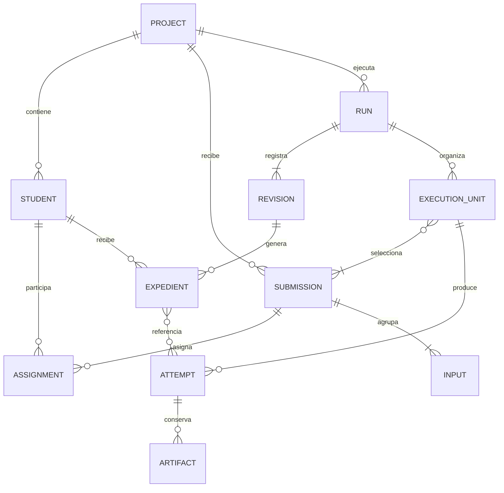
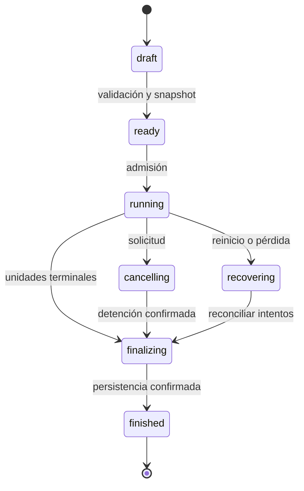

# Modelo de datos

Estado: propuesta v2. Los nombres siguientes son contratos objetivo; no sustituyen todavía los tipos Rust ni el esquema SQLite del POC.

## Entidades e identidad



| Entidad | Campos obligatorios y reglas |
|---|---|
| Project | `schema_version`, `project_id` UUID estable, nombre, configuración y política solicitada |
| Student | `internal_id` UUID, `id` externo único no vacío, nombre; correo opcional; `identity_field` elige columna de importación |
| Submission | `submission_id` UUID, etiqueta, lista de inputs tipados; identidad independiente del nombre de fichero |
| Input | `input_id`, tipo, selector/rol, origen, SHA-256 y tamaño; Git añade URL sin credencial, ref solicitada y commit resuelto |
| Assignment | `student_internal_id`, `submission_id`; pares únicos, N×N; una corrección individual no altera resultados compartidos |
| ExecutionUnit | `unit_id`, conjunto ordenado de entregas/inputs, workflow efectivo y huella; una unidad comparte laboratorio |
| Run | `run_id`, fecha UTC, estado, revisión actual, unidades y referencias a snapshots |
| Revision | `revision_id`, padre opcional, operación crear/ampliar/recalificar/corregir, actor, motivo, hashes de inputs/configuración y selección de resultados |
| Attempt | `attempt_id`, unidad, paso, repetición, número de intento, tarea/laboratorio, huella, estado y resultado |
| Artifact | `artifact_id`, ruta relativa, media type, bytes, SHA-256, procedencia y visibilidad |
| Expedient | estudiante, revisión, entregas, referencias a intentos, checks, rúbricas, nota calculada, corrección y nota efectiva |
| Override | revisión base, estudiante, destino check/rúbrica/evaluación, valor, autor, motivo, fecha; siempre validado contra escala |

IDs internos no contienen rutas. `run_id` combina etiqueta legible y UTC de segundos; creación exclusiva rechaza colisión y propone sufijo sólo cuando sea necesario. No se confía en que un profesor sea el único cliente. Los nombres de carpeta derivados de etiquetas sustituyen caracteres no admitidos por `_` y añaden sufijos `_1`, `_2` en colisiones. Se almacena el mapeo original → ruta; la identidad nunca se deduce de la ruta. Referencias externas del alumnado se conservan exactamente, sin normalizar destructivamente acentos.

## Carpeta portable

```text
actividad/
  configuration.thot.yaml
  students.yaml                 # o students.csv
  submissions.yaml              # recursos locales o Git por entrega
  assignments.yaml
  extern/                       # scripts/configuración del profesor
  delivery/                     # originales importados
  overrides.yaml                # correcciones editables
  runs/<run-id>/
    run.yaml                    # estado y puntero a revisión confirmada
    snapshot/<revision-id>/     # configuración, roster y asociaciones efectivas
    inputs/<sha256>/            # copias materializadas, incluido árbol Git
    revisions/<revision-id>.yaml
    journal/events.jsonl        # secuencia confirmada, sin secretos
    tests/<unit-id>/<step-id>/<attempt-id>/
      result.yaml
      stdout.bin
      stderr.bin
      artifacts/
    expedients/<revision-id>/<safe-student-id>.yaml
    reports/<revision-id>/      # HTML, PDF, CSV y manifiesto de generación
    integrity.yaml             # inventario y hashes de exportación
```

`configuration.yaml` se admite como legado con aviso; ambos nombres juntos son error. Roster YAML prevalece sobre CSV con aviso; el snapshot conserva cuál se usó y la conversión efectiva. `assignments.yaml` es canónico; JSON se convierte explícitamente y la coexistencia es error. `submissions.yaml` agrupa varios inputs y conserva roles como `source`, `disk`, `report`. Selección por rol/tipo y cardinalidad exacta o rango, nunca por orden incidental de directorio. El esquema valida extensiones como indicios, no como prueba del formato real.

El paquete completo incluye todas las entradas necesarias para repetir; una exportación ligera puede excluirlas, pero se marca `replayable: false` y enumera ausencias. Los discos vivos L1/L2 no son resultados portables por defecto; se preservan sólo como artefacto solicitado y acotado. Una vista materializada puede regenerarse sin SQLite; todos los datos necesarios deben estar confirmados antes de que el motor informe éxito.

## Resultados y estados

`result.yaml` usa el envelope de [interfaces](api-spec.md). Distingue el estado operativo del significado académico. `completed` significa que la acción terminó y sus observaciones están disponibles; un proceso con exit code 2 puede estar `completed`. `passed/failed` pertenece al check del motor. Estados terminales adicionales: `timed_out`, `resource_exceeded`, `platform_error`, `cancelled`, `interrupted`, `skipped`. En estos casos puede no haber código de salida; nunca se inventa un cero. Un skip registra dependencia o condición que lo causó.

Cada resultado conserva tiempos UTC del motor y duración monotónica del agente, stdout/stderr crudos con tamaño/hash y marca de truncamiento, exit code o señal, diagnósticos estructurados y observaciones JSON. Filtrar salida sólo crea una vista; no reemplaza el original. Observaciones estructuradas persistidas permiten checks sin parsear mensajes humanos. Límites de logs incluyen drenaje/descartado para no bloquear procesos.



El resultado global del run y `cleanup_state: clean|pending|failed` son independientes. `finished` no significa todas las pruebas correctas; el resumen incluye unidades con error y `assessment_state: complete|needs_review`. No se publica nota definitiva si falta evidencia por fallo técnico, salvo corrección docente explícita. En ausencia real de entrega se aplica `not_delivered_mark` o null. Para checks estadísticos, definir barrera de cierre de cohorte y deduplicar unidades compartidas; recalcular al incorporar nuevas entregas y registrar el conjunto de muestras.

## Edición, reutilización y consistencia

El profesor puede modificar configuración, asociaciones y `overrides.yaml`; validar muestra las diferencias y confirmar aplica una revisión. El run es una carpeta modificable: las revisiones son pequeños registros de procedencia, no copias completas de todas las evidencias. Copiar un run de sólo lectura permite consultarlo; ampliarlo exige copia escribible. Edición directa de resultados provoca discrepancia de integridad: se permite importar la modificación como corrección atribuida, sin presentarla como salida original del agente. Hashes locales no prueban que el propietario no haya reescrito también el manifiesto.

Huella reutilizable = hash de inputs materializados + especificación normalizada del paso + salidas/dependencias seleccionadas + digest de imagen y agentes + versión de protocolo + política de ejecución relevante + semilla/repetición. No basta encontrar el mismo nombre de prueba. Cambiar sólo evaluación no invalida las observaciones. Dependencias de estado vivo requieren reconstrucción aunque haya resultados cacheados. Nunca se reutilizan resultados por defecto entre runs o alumnos distintos.

Un solo escritor bloquea el proyecto; ficheros temporales se escriben en el mismo volumen, se sincronizan y renombran, publicando el puntero de revisión al final. Al recuperar se ignoran temporales no confirmados, se reconcilia el diario y se verifica el inventario. Los lectores ven la última revisión confirmada. No se soporta trabajo activo en carpetas de red/sincronización cloud sin bloqueo fiable; se exporta un snapshot para transportarlo. Retención elimina artefactos sólo cuando ninguna revisión conservada los referencia y actualiza el inventario de forma transaccional.
