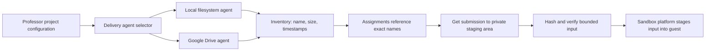

# Deliverable intake agents

Thot reads student work through a read-only delivery agent. The agent separates the location of submissions from evaluation configuration, so the sandbox runner and grading workflow use the same `list` and `get` contract regardless of where files are stored.



## Contract

Every agent implements two operations:

- `list()` returns direct child deliverables with their exact name, byte size, creation time when available, and last modified time when available. Directories are valid deliverables for local project/repository checkouts; their size is the recursive sum of regular files and their modified date is the newest child date.
- `get(name, destination)` retrieves exactly one item with that exact name. Zero matches and ambiguous names are errors. The retrieved object records its source metadata and SHA-256 digest. Defaults are 128 MiB and 10,000 files; project configuration can raise these to 64 GiB and 100,000 files. Symlinks and unsupported filesystem entries are rejected.

Assignments use the inventory name, not an arbitrary source path. This makes the same assignment portable between local and Google Drive sources. Duplicate names in a Google Drive folder are rejected for retrieval because Drive permits duplicate filenames.

## Configuration

`delivery_agent` is optional in `configuration.thot.yaml`. If absent, Thot uses the local filesystem. Its root is selected in this order: configured `delivery_folder`, the parent directory of a student-deliverable path template (for legacy projects), then `delivery`. Relative paths resolve under the project directory; absolute local paths are permitted for instructor-controlled sources.

```yaml
delivery_folder: ./delivery
# Defaults are 128 MiB and 10,000 files. Raise these only when host storage,
# guest staging and processing capacity are sufficient.
delivery_limits:
  max_bytes: 21474836480 # 20 GiB
  max_files: 10000
# Omit delivery_agent to use the local filesystem at delivery_folder.
# To set an explicit local source:
delivery_agent:
  kind: local
  path: ./submissions

# Or select Google Drive instead:
# delivery_agent:
#   kind: gdrive
#   folder_url: https://drive.google.com/drive/folders/GOOGLE_FOLDER_ID
```

Only one source is selected per project. Platforms in one evaluation share the configured intake source, while platform execution remains isolated. The local source can list files and directories. Google Drive currently lists and downloads ordinary uploaded files; nested folders, Google Docs/Sheets/Slides native documents, shortcuts, and shared-drive edge cases are not represented as deliverables yet.

## Google OAuth setup

The professor creates or selects a Google Cloud project, enables Google Drive API, and creates an OAuth client of type **Desktop app**. The client ID and secret are supplied to Thot on first authorization as `THOT_GDRIVE_CLIENT_ID` and `THOT_GDRIVE_CLIENT_SECRET`. Running `thot deliveries list PROJECT` opens the browser consent flow and requests the read-only `drive.readonly` scope. The local loopback callback validates a one-use state value. Access and refresh tokens are stored under the professor's config directory in `~/.config/thot/google-drive-token.json` with owner-only permissions; token files are not stored in the project or result archive. When the command runs under `sudo`, Thot resolves the invoking user's home through `SUDO_USER` so it reuses that user's token cache.

For a headless host, run `thot deliveries list` on the professor's desktop once with the same token file and Google OAuth client configured. The authorization callback still requires a browser on the machine performing the authorization; token transfer to another host should use a secure user-managed channel. Do not include OAuth secrets or token files in shared project directories, Git, or student deliverables.

Google's consent-screen publishing and verification rules depend on the Google Cloud project and its selected scopes. An OAuth application left in Testing mode may have refresh-token lifetime restrictions. The professor is responsible for configuring an approved OAuth client for the intended use.

## CLI

```sh
thot deliveries list ./course-project
thot deliveries get assignment-17.zip ./course-project --output ./review/assignment-17.zip
sudo thot sandbox run ./course-project
```

`get` refuses to overwrite an existing output. `thot run` processes one student at a time. For a local source it hashes and reads the professor's file directly, without making a host-side payload copy. For Google Drive it downloads only the current student's deliverable into private temporary staging, transfers it to the guest, then deletes that staged download after the student's tests. The original Drive file is never deleted. Results keep the name, size, available timestamps, provider identifiers/revision, and SHA-256, but not the deliverable bytes. The standalone `thot deliveries get` command intentionally writes a copy to the professor's requested output path.

## Boundaries and open work

- The local filesystem agent trusts the professor's selected root and reads it without modifying its source. Evaluation hashes the selected source and streams it into the guest; the guest verifies the transfer hash. If the source changes during transfer, the guest rejects the mismatch.
- Google Drive credentials are user credentials, not a service-account credential. Access is limited to read-only OAuth permission, but `drive.readonly` grants the application read access to all files visible to that professor's Google account. A narrower scope that can read a pre-existing instructor-selected folder is not currently available with this simple installed-app flow.
- OAuth token revocation, expired/revoked consent, account changes, network loss, and Google API quota errors are reported as intake failures and do not create a grade.
- HTTP responses are downloaded with bounded size and request timeouts. Retry/backoff, resumable downloads, shared-drive drive-ID selection, and duplicate-name disambiguation by file ID remain future work.
- The feature currently integrates with the local `kvm-alpine` professor CLI. Legacy daemon run creation still reads its configured local `delivery_folder`; migrating that API workflow to this agent contract is a separate integration task.
