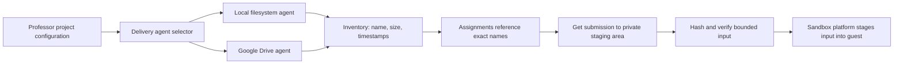

# Deliverable intake agents

Thot reads student work through a read-only delivery agent. The agent separates the location of submissions from evaluation configuration, so the sandbox runner and grading workflow use the same `list` and `get` contract regardless of where files are stored.



## Contract

Every agent implements two operations:

- `list()` returns direct child deliverables with their exact name, byte size, creation time when available, and last modified time when available. Directories are valid deliverables for local project/repository checkouts; their size is the recursive sum of regular files and their modified date is the newest child date.
- `get(name, destination)` retrieves exactly one item with that exact name. Zero matches and ambiguous names are errors. The retrieved object records its source metadata and SHA-256 digest. Defaults are 128 MiB and 10,000 files; project configuration can raise these to 64 GiB and 100,000 files. Symlinks and unsupported filesystem entries are rejected.

Assignments use the inventory name, not an arbitrary source path. This makes the same assignment portable between local and Google Drive sources. Duplicate names in a Google Drive folder are rejected for retrieval because Drive permits duplicate filenames.

## Configuration

`delivery_agent` is optional in `configuration.thot.yaml`. If absent, Thot uses the local filesystem. Its root is selected in this order: configured `delivery_folder`, the parent directory of a student-deliverable path template (for legacy projects), then `delivery`. Relative paths resolve under the project directory; absolute local paths are permitted for instructor-controlled sources.

```yaml
delivery_folder: ./delivery
# Defaults are 128 MiB and 10,000 files. Raise these only when host storage,
# guest staging and processing capacity are sufficient.
delivery_limits:
  max_bytes: 21474836480 # 20 GiB
  max_files: 10000
# Omit delivery_agent to use the local filesystem at delivery_folder.
# To set an explicit local source:
delivery_agent:
  kind: local
  path: ./submissions

# Or select Google Drive instead:
# delivery_agent:
#   kind: gdrive
#   folder_url: https://drive.google.com/drive/folders/GOOGLE_FOLDER_ID
```

Only one source is selected per project. Platforms in one evaluation share the configured intake source, while platform execution remains isolated. The local source can list files and directories. Google Drive currently lists and downloads ordinary uploaded files; nested folders, Google Docs/Sheets/Slides native documents, shortcuts, and shared-drive edge cases are not represented as deliverables yet.

## Google Drive professor setup

The developer registers the OAuth application and builds Thot with its client credentials. Ask the developer to add your Google account as a test user for a pilot. Builds without a bundled client require the `THOT_GDRIVE_CLIENT_ID` and `THOT_GDRIVE_CLIENT_SECRET` environment variables. See the [developer guide](google-drive-developer.md).

Set the Drive folder URL above, then run as your normal user:

```sh
thot deliveries list PROJECT
```

Replace `PROJECT` with the project directory. Thot opens a browser or prints a
link; open it on the same computer, sign in to the Google account that can
read the folder and consent. A Testing app can show an unverified-app warning;
proceed only if you recognize the app provided by the developer. Return to the
terminal and check that the expected files are listed. The browser message alone
does not confirm a successful token exchange. If authorization fails, share
only the non-secret error with the developer; test-user configuration, an
expired authorization or Workspace policy may require attention.

Thot requests `drive.readonly`: it can read **all files visible to the account**,
not only the selected folder. It does not need your Google password. Tokens and
the client values are cached in `~/.config/thot/google-drive-token.json`
(or the configured user token path), outside the project, with owner-only
permissions. Later runs by the same user can reuse the cache; Testing consent
may expire after seven days. Existing caches tied to a different client ID
require reauthorization: move the old cache to a private backup before using the
new client. Never put tokens in a project, container image, guest or results.

For a headless host, authorize on a desktop with the same OAuth client, then
securely transfer the private cache to the user running Thot on the host. A
container needs a private persistent token volume. This is currently manual;
Thot does not provide a guided transfer or headless device-code login. The
browser callback must reach localhost on the machine performing authorization.

## CLI

```sh
thot deliveries list ./course-project
thot deliveries get assignment-17.zip ./course-project --output ./review/assignment-17.zip
sudo thot sandbox run ./course-project
```

`get` refuses to overwrite an existing output. `thot run` processes one student at a time. For a local source it hashes and reads the professor's file directly, without making a host-side payload copy. For Google Drive it downloads only the current student's deliverable into private temporary staging, transfers it to the guest, then deletes that staged download after the student's tests. The original Drive file is never deleted. Results keep the name, size, available timestamps, provider identifiers/revision, and SHA-256, but not the deliverable bytes. The standalone `thot deliveries get` command intentionally writes a copy to the professor's requested output path.

## Boundaries and open work

- The local filesystem agent trusts the professor's selected root and reads it without modifying its source. Evaluation hashes the selected source and streams it into the guest; the guest verifies the transfer hash. If the source changes during transfer, the guest rejects the mismatch.
- Google Drive credentials are user credentials, not a service-account credential. Access is limited to read-only OAuth permission, but `drive.readonly` grants the application read access to all files visible to that professor's Google account. A narrower scope that can read a pre-existing instructor-selected folder is not currently available with this simple installed-app flow.
- OAuth token revocation, expired/revoked consent, account changes, network loss, and Google API quota errors are reported as intake failures and do not create a grade.
- HTTP responses are downloaded with bounded size and request timeouts. Retry/backoff, resumable downloads and shared-drive drive-ID selection remain future work. Assignments can disambiguate by provider ID, but standalone `deliveries get` accepts names only.
- The feature currently integrates with the local `kvm-alpine` professor CLI. Legacy daemon run creation still reads its configured local `delivery_folder`; migrating that API workflow to this agent contract is a separate integration task.
