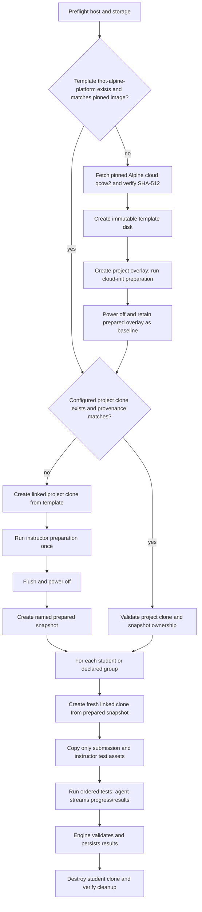

# KVM Alpine platform POC

Status: **the local `thot sandbox run` workflow passes the three-student Alpine smoke with hashed preparation scripts and a digest-pinned POSIX-shell test module; the managed server provider is still in progress**. The CLI writes a portable, verified run folder and captures module/preparation evidence, but does not yet publish legacy engine expedients or expose sandbox history through `thotd`. Google Drive OAuth and read-only access are implemented but have not been exercised against a live account. See the [P3 validation record](../planning/evidence/platform-p3-alpine-20261123.md) and [Implementation test record](#implementation-test-record) for scope and remaining work.

## Purpose

The POC asks whether a very small Alpine Linux guest can safely host Thot's test agent and execute student work from a clean per-student linked clone. The current smoke verifies pinned cloud-image acquisition, hashed project preparation with Bash and archived preparation output/package inventory, a versioned digest-pinned test module, per-student overlays, acknowledged chunked SHA-256 transfer, sequential bounded execution over VSOCK, rubric scoring, durable run evidence, and cleanup. It does not validate Windows OVA execution, unattended ISO installation, named libvirt snapshots, crash recovery/replay, or the managed provider/daemon integration.

The platform is named `kvm-alpine`, distinct from the planned `kvm-debian`. Both use KVM and the same provider-level task/result contract, but must keep separate base images, package managers, init assumptions, agent builds, and preparation. `kvm-alpine` is the low-resource experiment; it is not a replacement for Debian compatibility or a claim of stronger isolation than KVM itself.

## Frozen POC contract (phase 0)

Phase 0 decisions are recorded in [ADR-0008](../decisions/0008-kvm-alpine-poc-contract.md). The canonical project file is `configuration.thot.yaml` with `schema_version: thot.dev/v2`; `thot-core::sandbox_project::SandboxProject` is the shared configuration model. Checks list the test IDs they depend on, and tests declare exact expected exit/output checks. Legacy VM activity YAML and `/api/v1` remain unchanged. The single async `SandboxProvider` lifecycle interface belongs in `thot-runner`; opaque template, baseline, and student-environment handles are required by the managed provider architecture. The current local CLI path has not yet been refactored onto that lifecycle interface.

For this local POC, the guest initiates a per-environment VSOCK connection to a host listener. Frames use a four-byte big-endian length followed by UTF-8 JSON, capped at 1 MiB; blobs are chunked and hashed. A per-clone one-use secret and the expected peer CID scope the session. This authenticates the active VM session, not guest integrity. Execution status (`completed`, `timed_out`, `resource_exceeded`, `platform_error`, `cancelled`, `interrupted`) is separate from engine assessment (`passed`, `failed`, `skipped`, `pending`) and cleanup (`clean`, `pending`, `failed`). Results persist bounded raw streams and artifacts by content hash alongside configuration, input, image, baseline, task, timing, process, diagnostic, assessment, and cleanup provenance. Secrets and VM disks are not ordinary result artifacts.

These are accepted long-term contracts. The local CLI has a folder-based run repository with locking, journal, artifacts and revisions, but is not yet wired through the `SandboxProvider` trait or daemon. Restart reconciliation does not replay provider work; incomplete runs are marked interrupted.

## Lifecycle architecture and implemented POC path

The target architecture below remains the desired provider lifecycle. The current CLI is deliberately narrower: it treats the verified Alpine cloud qcow2 as an immutable template disk, creates a project qcow2 overlay and boots it with cloud-init to install preparation packages/scripts, then uses that powered-off overlay as the linked backing baseline. It creates one student overlay per student and transfers the agent, token, submission, and tests on a per-clone cloud-init ISO. The CLI does not create a named libvirt template VM or snapshot, and the agent is injected per student rather than preinstalled in the template. These are explicit POC shortcuts, not claims that the complete architecture is done.

### Reusable template

The platform provider first checks for a VM with the reserved name `thot-alpine-platform` in its own ownership registry. A same-named unrelated libvirt domain must never be adopted or deleted. If absent, it checks the configured ISO cache; if missing, it downloads a version-pinned ISO from an allowlisted official mirror, verifies the detached checksum/signature against a pinned trusted key, and atomically publishes the verified file. `latest-stable` is convenient for discovery but must not be the identity used for reproducible runs.

Install Alpine unattended using a versioned answer file and `setup-alpine`/`setup-disk` flow, or a purpose-built image build if unattended installation proves fragile. The exact Alpine answer-file and disk-install commands are a POC question: boot-media environment, device naming, root account/SSH policy, networking and init choices must be verified on the target libvirt configuration. Install only the base packages needed to boot, accept engine tasks, and return results. A static musl guest agent is a likely fit; its build, signature, update path, and protocol compatibility must be pinned. The agent starts as an unprivileged account where possible; privileged test operations are explicitly granted inside this disposable guest only.

Power off cleanly after installation. Store template metadata beside the VM, including Alpine release, architecture, ISO URL and SHA-256, answer-file hash, package repository and package inventory, agent version/hash, virtual hardware, disk format, libvirt version, and template UUID. Any change to those inputs invalidates the template. The template is immutable/read-only after sealing and is never assigned student data.

### Project preparation baseline

The instructor configures a unique project VM name, such as `thot-alpine-poc-sum-project`. The local runner fingerprints the prepared overlay against the pinned image, VM settings, package list, network policy and actual SHA-256 of each project-relative script. If no matching baseline exists, it creates a linked project overlay, installs requested `apk` packages (full Bash for this fixture), and runs hashed instructor scripts in order with individual timeouts. The run folder records script digest, timeout, exit code, bounded stdout/stderr and installed package inventory as infrastructure evidence, not a student mark. Preparation failure blocks student execution.

After preparation, flush writes and power off the VM before taking a disk snapshot. The snapshot identity is derived from project config, template identity, preparation script hashes, package inventory and provider version. A stale or mismatched snapshot must be rebuilt or explicitly selected for reuse; a same-named snapshot alone is not proof it matches. Preparation requires package/network access only if declared, constrained to a configured mirror. Preparation failure blocks this platform's student runs.

### Per-student execution

For each student or explicitly assigned group, create a linked clone from the prepared baseline with a generated unique name and fresh writable overlay. Transfer only that student's selected deliverable, declared instructor tests, and needed module package into the guest. File staging streams chunks, acknowledges each chunk, and publishes only after SHA-256 verification; the configured host aggregate intake limit is capped at 64 GiB. Inputs/module packages are read-only to test processes. Execute steps sequentially; syntax check runs first, then direct argv tests or a pinned `posix-shell-script-v1` module. The agent captures exit code, stdout, stderr, elapsed time, timeout/status and diagnostics. It verifies module capabilities and package digest again before running as UID/GID 1001. The engine side owns check evaluation, rubric calculation and the durable run package.

The Alpine guest additionally advertises `libvirt.system` only when its own
libvirt socket is group-owned by `libvirt` and grants that group read/write
access. The agent grants this supplementary group only to the pinned module
that declares the capability; it clears supplementary groups for every other
test. The socket remains inside the disposable Alpine guest and is not the
professor host's libvirt socket. In the `posix-shell-script-v1` module ABI,
exit code 75 means platform/infrastructure failure and maps to typed
`platform_error`; other nonzero module exits are ordinary completed test
actions. See [ADR-0015](../decisions/0015-module-platform-failure-exit-code.md).

After results and artifacts have been acknowledged and persisted, shut down and delete the linked clone and overlay. Cleanup must work after timeout, agent loss and host/engine restart. Preserve only bounded diagnostics needed to explain a failure. A cleanup error remains visible and blocks unsafe reuse; never delete the base template or another project's VM while reconciling a student clone.

## Synthetic fast test project

The activity asks each student to submit `sum.sh`, a Bash program that accepts exactly two signed decimal integers and prints their sum followed by one newline. The POC test uses inputs 17 and 25 and expects exactly `42\n`. This small workload gives three useful cases without a compiler or long installation.

| Fixture | Behavior | Expected test outcome |
|---|---|---|
| `student1/sum.sh` | Valid Bash and adds the two integers | Syntax passes; functional output is 42; 10/10 |
| `student2/sum.sh` | Valid Bash but multiplies instead | Syntax passes; output is 425; syntax criterion earns 2/10, functional criterion fails |
| `student3/sum.sh` | Contains a missing closing parenthesis | Syntax fails; functional step is skipped; 0/10 |

Project assets are under [examples/kvm-alpine-poc](../../examples/kvm-alpine-poc/): `configuration.thot.yaml` defines platform settings, local delivery-folder default, preparation, resource limits, independent tests, and grading; `students.yaml` and `assignments.yaml` define synthetic identities and inventory-name mappings; `students/studentN/sum.sh` contains the three deliverables; `extern/tests/` contains instructor-owned test scripts. Deliverables enter through the read-only `thot-delivery` list/get contract; see [Delivery agents](../guides/delivery-agents.md). All test code and deliverables are illustrative fixtures, not production sandbox implementations.

The configuration explicitly selects only `kvm-alpine`. It declares no other platform and no cross-platform dependencies. Student tests run with network denied. ISO/template acquisition is host-side privileged platform setup, not a test action and never controlled by submission content. The platform's guest-initiated result channel should be scoped to a run and clone; do not expose a general inbound guest port on the professor host.

## Host limitations observed for this POC

The following table describes the repository development host inspected on 2026-11-21. It is not the separately authorized test host at `192.168.1.35`:

| Resource | Observed | Consequence |
|---|---|---|
| Host type | Linux kernel `7.0.14-23-pve`; environment is itself a Proxmox VE virtual machine | This is a nested-virtualization setup, not bare metal |
| CPU | Intel Core i7-6700K; VT-x flag is visible; 8 vCPUs listed but only 4 online | Nested acceleration is not established by CPU flags alone |
| KVM device | `/dev/kvm` is absent | KVM/QEMU acceleration cannot run here; POC cannot be exercised in this environment |
| Memory | 4.0 GiB total, about 1.6 GiB available at inspection, no swap | Too little headroom for reliable guest startup plus engine and host services; even a 512 MiB guest may pressure the host |
| Disk | Root filesystem 25 GiB total, 11 GiB free | One small ISO may fit, but base image, project snapshot, three overlays, logs and normal workspace growth leave unsafe margin |
| Tools | `qemu-system-x86_64`, `virsh`, `virt-install`, Docker and `apk` are absent from PATH | No local VM/provider toolchain is installed; guest package manager is naturally not a host tool |

**Recommendation:** do not attempt this POC on the current workspace host. Use a dedicated Linux KVM host, or have the Proxmox administrator expose nested VT-x/KVM to this VM, create `/dev/kvm` with correct access, and allocate substantially more capacity. For a three-student sequential smoke test, start with at least 2–4 vCPUs, 4 GiB RAM allocated to this environment with at least 1 GiB reserved for the host/engine, and 12–20 GiB free working disk. These are prototype planning values, not certified minimums; measure and revise them. A dedicated KVM-capable host avoids nested virtualization uncertainty.

The separate Debian 13 test host `192.168.1.35` has `/dev/kvm`, 4 vCPUs, about 3.8 GiB RAM plus swap, and libvirt/QEMU management tools. The three-student smoke workflow passed there. It is itself a VM, and the successful smoke run does not establish production capacity or security hardening.

Before implementation, check `lscpu`, `/dev/kvm`, libvirt capabilities, actual online CPU count, memory headroom, free disk, snapshot/linked-clone support for the chosen storage pool, network firewalling, and permissions for the service identity. Fail preflight with a plain-language explanation if acceleration, storage, or cleanup prerequisites are missing; never fall back to running student code on the host.

## Open questions and proposed answers

| Issue | Risk / question | Proposal for the POC |
|---|---|---|
| ISO selection | Alpine `virt` media is much smaller than `standard`, but exact hardware/driver and setup behavior must be tested | Pin one x86_64 `alpine-virt` ISO version and its official checksum; do not download a moving alias during a run |
| Alpine release cadence | A release update changes packages and guest behavior | Keep template version explicit; update only by creating and validating a new template generation |
| Automated installation | Answer-file and disk installation flow may differ from assumptions | Prototype the exact unattended boot/install path and test reboot without ISO; document console/recovery path |
| Bash availability | Base Alpine uses BusyBox tools; shell behavior differs | Install Alpine `bash` package during project preparation; invoke Bash explicitly, never `/bin/sh` |
| Guest agent artifact | Alpine uses musl; existing Thot Rust binaries may target glibc | Decide static musl build versus a small compatible runtime package; pin hash/version and test protocol before snapshot |
| Template ownership | Name collisions could cause destructive cleanup | Store provider ownership UUID/metadata outside guest; refuse to adopt or remove unknown same-name domains |
| Clone semantics | Linked disk children depend on immutable parent/snapshot | Validate clone operation and backing chain; reserve quota and keep template read-only |
| Snapshot consistency | Running `apk` or services may leave writes in flight | Stop all preparation, sync, power off, then snapshot disks; no memory snapshot in POC |
| Network/credentials | `apk` mirror access can leak or allow guest egress | Mirror-only during template/preparation phases; deny during student tests; no private tokens in guest |
| Resource exhaustion | Student can fork processes, fill disk, or flood output | Enforce host-level cgroup/VM CPU, memory, disk and process limits; guest limits alone do not protect host |
| Evaluation semantics | Syntax error must not look like missing infrastructure evidence | Keep syntax failure as student evidence; boot/agent/transport/cleanup failure leaves grade pending |
| Rebuild/reuse | A project snapshot can go stale after config/scripts/packages change | Content-address preparation inputs and show “reuse” versus “rebuild”; never silently trust name-only matches |
| Result trust | Student root could alter or kill the in-guest agent | POC scope is workflow viability and accidental containment, not tamper-proof grading; document this limit in each run |

## Current implementation gaps and difficult decisions

The smoke path is real and was exercised on the test host, but it is a purpose-built CLI rather than the final Thot provider. Keep these gaps visible while continuing implementation:

| Area | Current state | Work still needed for POC closure |
|---|---|---|
| Project configuration | The CLI reads shared `thot-core::sandbox_project::SandboxProject` types, rejects unknown schema fields, and validates IDs, paths, resource ceilings, test ordering, and rubric references before host side effects. | Add schema compatibility tests, path/directory-transfer limits, and support additional platform kinds only through explicit provider implementations. |
| Template and baseline | Pinned cloud qcow2 is SHA-512 verified and copied to a named template disk. A linked project overlay runs cloud-init preparation and becomes the baseline after shutdown. | Create/own an actual named template VM and named libvirt snapshot as designed, or explicitly revise the contract to define disk overlays as the baseline. Verify baseline boot completion and preparation success rather than relying on a fixed wait. Verify provenance before reuse and handle changed preparation inputs. |
| Guest agent | Static Alpine-compatible agent connects through VSOCK using a per-student token and run/unit IDs. It stages bounded files with SHA-256 verification and runs tasks sequentially as locked UID/GID 1001 with supplementary groups cleared, timeout, and capped stdout/stderr. | Agent is injected by cloud-init for each student, not installed into the reusable template. Verify peer CID against libvirt domain identity; verify handshake replay/version behavior; implement disconnect/retry semantics. Add process, CPU, memory, and writable-disk limits. |
| Isolation policy | Student domains are launched with `--network none`; preparation has the default libvirt network. Test modules run as UID 1001 inside a disposable KVM guest. | Enforce host ceilings, disk quotas, pids, and guest policy. Test that no student access to host or other guests is possible. Define whether the assessor guest needs any capabilities beyond the current unprivileged task user. |
| Assessment | The CLI delegates exact test checks and weighted rubric scoring to `thot-engine`; the guest agent only reports observations. The current run repository keeps technical/infrastructure outcomes separate from academic grades. | Route assessments into the engine's legacy expedient store and expose sandbox status/reports through `thotd`; extend recovery semantics beyond the local CLI run repository. |
| Evidence and portability | The verified run folder persists immutable configuration/input/artifact references, content hashes, task/test results, bounded streams, diagnostics, preparation/module provenance, and cleanup state. A professor-owned archive can be moved as a folder. | Define supported archive import/export compatibility and project-level retention. Publish reports through `thotd` and legacy expedients, and document version upgrade/migration behavior. |
| Ownership and recovery | Student cleanup checks that the domain references the expected overlay before destroying/undefining it; a drop guard attempts cleanup on errors. The run repository has a writer lock, journal/revision verification, and marks incomplete runs interrupted. | Add a provider-level durable VM ownership registry, daemon/startup reconciliation, idempotent provider operations, and tested recovery after host/daemon termination. Audit cleanup failures rather than ignoring them. |
| Template trust | The cloud image digest is pinned and checked. | Verify a publisher signature or document the digest trust/bootstrap process. Decide how image updates and Alpine support lifecycle changes trigger baseline rebuilds. |
| Performance and UX | Three sequential students passed on the test host. | Measure first setup, repeated setup, clone/run/cleanup time, peak RAM/CPU, image/overlay growth, and usability of failure messages on instructor-grade hardware. |

A key design decision remains whether a project baseline is a libvirt snapshot, a powered-off backing qcow2 overlay, or a storage-pool snapshot. The current smoke uses a linked qcow2 overlay because it is simple and worked on the available host; the final provider should hide that choice behind typed handles and record its provenance.

## Plan to close the POC

Work in order. Each phase has a gate; do not move a guest test to “passed” based on mocked output or host execution. Keep student tests sequential for this POC so that resource use and cross-student contamination are easy to reason about.

```mermaid
flowchart LR
  A[0 Scope and contracts] --> B[1 Compiling core and runner]
  B --> C[2 Config and fixture validation]
  C --> D[3 Host preflight and ownership]
  D --> E[4 Alpine template install]
  E --> F[5 Project preparation and snapshot]
  F --> G[6 Student clone and agent execution]
  G --> H[7 Engine evaluation and durable records]
  H --> I[8 End-to-end host run and evidence]
```

| Phase | Ordered work and dependencies | Exit gate |
|---|---|---|
| 0. Freeze the POC contract — complete | ADR-0008 decides the `thot.dev/v2` project shape, Rust model names, single provider lifecycle and opaque handles, guest-initiated VSOCK framing/authentication, execution versus assessment statuses, and durable evidence. Legacy VM activity YAML and `/api/v1` are explicitly unchanged. | Decision recorded in [ADR-0008](../decisions/0008-kvm-alpine-poc-contract.md). |
| 1. Restore build integrity — workspace builds | The incompatible generated provider scaffolding was removed from the active module tree. A focused `thot-alpine-poc` CLI and guest agent compile with the workspace. The canonical engine/provider integration is still pending. | `cargo check --workspace` succeeds. Workspace tests and lint have not been run as part of this smoke validation. |
| 2. Make the fixture authoritative | Implement YAML deserialize/validation, strict unknown-field handling or documented extension handling, path containment, test dependency order, timeout/output/VM limits, and rubric schema. Align `configuration.thot.yaml`, students, assignments, tests, and README. Fix expected scoring to 10/2/0 and infrastructure failures to pending. | A configuration test loads the real example and validates all student mappings, file paths, dependency semantics, limits, and rubric. Invalid paths, unsupported platform fields, and invalid limits fail before any VM is touched. |
| 3. Host preflight and ownership registry | Measure actual CPU availability, RAM and filesystem free bytes; verify `/dev/kvm`, QEMU/libvirt tools and URI, storage pool/capacity, snapshot/linked-clone capability, firewall/network policy, service user access, and configured ceilings. Add a durable Thot-owned UUID/metadata registry, per-project locks, and safe name collision behavior. | Preflight gives actionable failures for deliberately missing prerequisites. An unrelated same-name VM is neither adopted nor deleted. Duplicate starts are rejected and ownership metadata survives process restart. |
| 4. Build and verify the Alpine template | Select a pinned ISO and verify the official checksum/signature using a trusted source; correct filename/URL and cache behavior; implement bounded atomic download. Implement documented unattended Alpine install, configure networking/SSH or VSOCK, install minimal runtime and the pinned static/musl guest agent, detach ISO, reboot, verify agent handshake, power off, and seal metadata/disk. | From an empty cache and empty registry, a fresh host setup creates `thot-alpine-platform` noninteractively. A second run verifies and reuses it. Corrupt ISO, changed digest, failed install, and same-name foreign domain are rejected without damaging other resources. |
| 5. Build prepared project baseline | Create the configured unique project clone from the sealed template; install Bash and declared common resources; execute preparation scripts in deterministic order under limits and declared network policy; record output/status and content hashes; sync and power off; create/verify a disk snapshot and provenance. Implement stale-baseline rebuild policy. | First preparation creates and snapshots a baseline; identical rerun reuses it; changed package/script/config/template hash rebuilds it. Failure prevents student execution and is reported as infrastructure failure. |
| 6. Execute one student safely | Create a unique linked clone per student from the prepared snapshot; transfer only validated, bounded deliverable and instructor assets; verify guest paths and hashes; run one task at a time through authenticated framed protocol; collect progress and complete results. Enforce host-level resource/network restrictions, output caps with full pipe draining, timeout/descendant termination, and unconditional cleanup. | A deliberately instrumented test proves student writes/processes/network do not survive into the next clone; timeout, oversized output, malformed request, guest crash, and agent disconnect have bounded outcomes and safe cleanup. |
| 7. Integrate engine assessment and records | Make the engine generate each declared test task and dependency; validate agent protocol/task IDs; evaluate only received observations; preserve student failure separately from infrastructure failure; calculate fixture rubric; write durable run/test/result/expedient records and artifacts; support run status/cancel/restart reconciliation through the API/CLI path selected for the POC. | No path can synthesize `Passed`. The three fixture results are exactly 10/10, 2/10, and 0/10, while infrastructure failures remain pending. Results survive a daemon restart and can be exported/read by the professor. |
| 8. Run on the authorized KVM host and close | Confirm host capacity and systemd/service identity; use a dedicated test data root and preserve the existing service until a separately verified daemon is ready. Run from an empty template state, then rerun to prove template/baseline reuse. Execute all three students sequentially, inspect guest/domain/disk cleanup, test forced failure/restart recovery, and record measurements. | All six success criteria below have command logs, run IDs, result artifacts, and resource measurements. Update the host record with actual evidence and remaining limitations; only then mark POC complete. |

### Phase ordering and stopping rules

Phases 0–2 are required before any privileged VM action. Phases 3–6 are required before a test can be called sandboxed. Phase 7 is required before results can be called Thot assessments. Phase 8 is the closure evidence. If a phase fails, preserve the failure as a visible infrastructure state, clean up only resources with verified Thot ownership, and stop dependent phases. Never convert startup, transport, timeout, or cleanup failures to a zero grade.

## Implementation test record

On 2026-11-23, `cargo test --workspace` passed, focused Clippy for the changed delivery, CLI, KVM runner, and Alpine agent targets passed with warnings denied, and release binaries built for the host and x86_64 musl guest. Workspace-wide Clippy still reports existing warnings in legacy engine and VirtualBox code. The guest agent built as a static x86_64 musl binary. The remote Debian 13 test host had `/dev/kvm`, libvirt, QEMU, `virt-install`, `cloud-localds`, and qemu image tools available. The integrated `thot sandbox run` command acquired student deliverables through the local delivery agent, downloaded the pinned Alpine 3.24.1 cloud-init image, verified its SHA-512 digest, prepared a linked project overlay with Bash, and launched three independent student overlays with student networking disabled. Each agent connected over VSOCK; input transfer hashes were checked by the guest; tests ran sequentially as locked UID/GID 1001 with supplementary groups cleared; captured result JSON was saved per student; and the CLI destroyed/undefined each student domain and removed its overlay.

Observed results were student1 **10/10**, student2 **2/10**, and student3 **0/10**. The portable JSON evidence is checked into [examples/kvm-alpine-poc/results/2026-11-23-delivery-agent-kvm-retest](../../examples/kvm-alpine-poc/results/2026-11-23-delivery-agent-kvm-retest/). The temporary probe domain was also undefined. Template and prepared-baseline qcow2 files remain on the test host for reuse. The pre-existing `thotd` service was not modified. `thot deliveries list` and `get` were also exercised against the example local folder. Google Drive behavior is covered by unit tests and static compilation but awaits live OAuth credentials and consent.

This is a smoke-test pass, not full POC closure. Important limits remain: the project image is a linked qcow2 overlay rather than a named libvirt snapshot; no managed provider or named template VM is maintained; the guest agent is injected by cloud-init for each student rather than installed into the reusable template; the CLI does not submit observations to a daemon run service or persist legacy expedients; resource limits beyond configured VM resources, output caps, and per-task timeout are not comprehensively enforced; and agent-disconnect recovery is incomplete. The initial `posix-shell-script-v1` module has no asset bundles and is not yet portable to Debian/Docker adapters. Resource measurements and repeated-run reuse have not been characterized. The VSOCK handshake binds a one-use token and run/unit IDs but does not attest the guest.

The current closure work should continue by integrating the passing lifecycle into the frozen provider contract, enforcing ownership and host policy, persisting full evidence through the engine, adding failure/recovery tests, and measuring resources. The passing synthetic scores establish the narrow Alpine execution path only.

## Libvirt OVA module smoke update (2026-11-24)

The example project `examples/ova-screening-kvm-alpine/` now carries a pinned
portable `thot.libvirt.ova-vm` module with `import_ova`, `start_vm`, `stop_vm`,
and `destroy_vm` actions. The module safely extracts a single OVF descriptor,
checks optional OVA manifest hashes, supports VDI/VMDK conversion to qcow2,
maps CPU/memory/disks and BIOS/EFI where understood, and defines an offline
libvirt domain. Importing an actual student operating system and validating
its boots is outside this lifecycle module's current test coverage.

Alpine 3.24 preparation installs QEMU/libvirt, OVMF, D-Bus, and PolicyKit. It
creates a named unprivileged UID/GID 1001 identity, enables the system services,
makes `virtproxyd`'s network dependency optional for offline student clones,
and grants the guest-local `libvirt` group `org.libvirt.unix.manage` through a
PolicyKit rule. When a pinned module requests `libvirt.system@1`, the Alpine
agent starts the fixed guest-local service list and adds the `libvirt`
supplementary group to just that child process after checking socket ownership
and mode. It does not expose the host libvirt socket. The module reserves exit
75 for infrastructure failures so a platform issue remains pending rather
than becoming a student zero.

The final smoke run on the test host used a synthetic 70 KiB OVA containing a
64 MiB VMDK. All four actions returned exit 0, the report was 10/10, the
cleanup status was clean, and the host had no remaining test domains. The
preserved run is
`/home/sysadmin/ova-screening-kvm-alpine/results/libvirt-module-smoke/results/d8bf796b-5e8c-4e58-aead-9f76a831963a`.
Earlier failed smoke runs were also retained; they exposed missing D-Bus,
PolicyKit policy, guest NSS identity, invalid libvirt XML, and JSON path
serialization issues.

The supplied 8.49 GB OVA has not been imported on this host with the final
module. The earlier actual-OVA run stopped at unavailable guest-local libvirt
before module execution. Current host free space is insufficient for another
full OVA intake plus guest staging. The OVA's OVF declares a 60 GiB virtual
disk, so the example config now requests a 100 GiB Alpine guest and requires a
host with correspondingly larger free storage. The synthetic smoke does not
qualify actual OVF compatibility, EFI startup, nested KVM acceleration,
multiboot menu behavior, Windows, or shared-data access.

## Suggested POC success criteria

1. **Passed for the smoke path:** download the pinned Alpine cloud image, verify SHA-512, and boot it noninteractively with cloud-init. ISO-based unattended install remains out of scope for this POC revision.
2. **Partial:** the static agent completes authenticated VSOCK handshakes from student guests. It is injected per student; template installation and guest integrity attestation are not implemented.
3. **Partial:** the project overlay installs Bash and is reused as a linked backing baseline. A named libvirt snapshot and provenance-driven reuse/rebuild validation remain open.
4. **Passed:** run three students sequentially from separate linked overlays; confirm the expected syntax/output/exit-code observations and 10/2/0 scores. The final archived report records the dependent test as skipped for student3.
5. **Open:** demonstrate timeout cancellation, oversized output, disconnect handling, host/network isolation beyond the no-NIC check, forced cleanup, and recovery after process/engine restart.
6. **Open:** record wall-clock setup/clone/test/cleanup times, peak host RAM/CPU, template/baseline/overlay sizes, and disk amplification. Decide from measurements whether this is viable on instructor hardware.

The repository development host lacks `/dev/kvm`, so VM execution must continue on a configured KVM host. The remote test host has demonstrated the three-student smoke workflow, but no resource viability claim is made until setup, peak RAM/CPU, disk amplification, timeouts, and recovery are measured.

## External technical references

The POC pins the Alpine 3.24.1 x86_64 BIOS cloud-init qcow2 image and verifies its SHA-512 digest. This was chosen because the official cloud-init image booted reliably with `cloud-localds` on the test host; it replaces the initial ISO-install experiment for this POC. The pin must be reviewed before future deployment, and signature verification remains a separate follow-up. [Alpine downloads](https://www.alpinelinux.org/downloads/), [Alpine cloud image index](https://dl-cdn.alpinelinux.org/alpine/v3.24/releases/cloud/).
