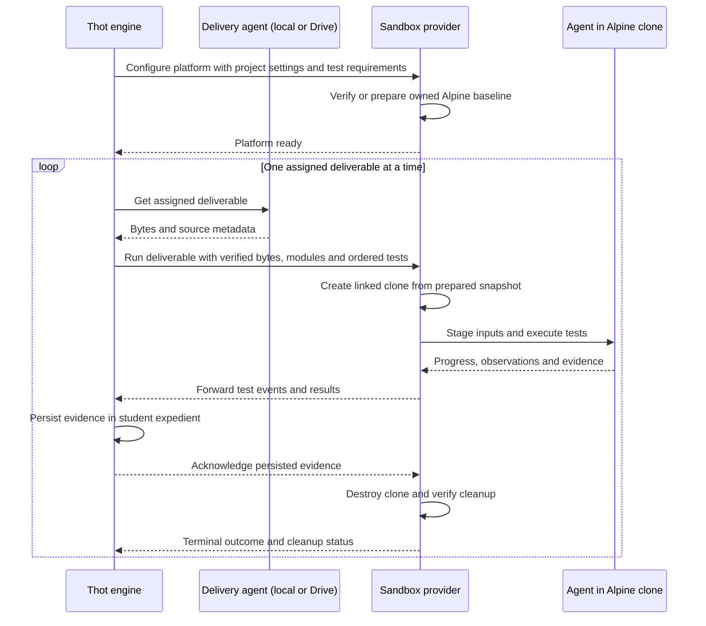

# OVA multiboot on `kvm-alpine`: gaps, decisions, and delivery plan

**Status:** architecture planning is established, but implementation and
qualification remain open. P4–P7 work now includes a v3 independent-item
evaluation contract and local portable-report command; the OVA workflow is
still not executable end-to-end through the KVM Alpine CLI. This document tracks
the remaining provider, OVA operation, security and hardware gates.

**Goal:** a professor configures one project in YAML, authorizes read-only
Google Drive access, assigns named OVA files to students, runs the project on a
Linux/KVM host, and receives portable per-student evidence and two calculated
evaluation items. The evaluation must establish whether each OVA has the
required EFI, Arch Linux, Alpine Linux, Windows, and shared-data partitions;
whether each OS can boot from the configured GRUB menu; and whether all three
OSes can read and write the shared data partition.

This plan builds on the current KVM Alpine CLI and delivery-agent work. It does
not propose migrating this use case back to legacy VirtualBox. VirtualBox is
useful as a reference for OVA import behavior, but the target execution path is
the new provider architecture and KVM.

## 1. Current baseline

### What exists

- `thot sandbox run` loads `configuration.thot.yaml` with the shared
  `thot-core` `SandboxProject` model and currently runs one `kvm-alpine`
  platform.
- The CLI has a host-side KVM Alpine implementation that downloads a pinned
  Alpine cloud image, creates a prepared disk baseline and student overlays,
  sends inputs to a guest agent over VSOCK, and saves local result JSON.
- Project YAML can select a local filesystem or Google Drive delivery agent.
  Assignments identify submissions by exact names from the inventory.
- Google OAuth is read-only and the credential cache stays outside project
  data. The CLI can list and get Drive submissions for its current sandbox
  intake flow.
- The Alpine guest agent executes sequential `exec` argv tasks, captures
  bounded stdout/stderr, exit code, timing and timeout status, and returns
  observations. The engine can evaluate the current simple test/check/rubric
  contract.
- The legacy engine already has isolated-by-process helper code for supported
  disk image inventory and a VirtualBox OVA import flow, but those are not
  wired into the v2 KVM project test model.
- Internal typed contracts name OVA inventory, partition-table, filesystem,
  installed-system, GRUB boot and shared-data operations. These are contract
  types only: no provider/agent adapter currently executes these operations
  against a submitted OVA.
- `thot.dev/v3` represents independent evaluation items. The local report
  command verifies a completed run folder before rendering table, JSON, CSV or
  offline HTML.

### Supplied OVA: static intake evidence only

The instructor-provided `ArchLinux_Dualboot.ova` was inspected without
extracting its virtual disk or booting it. Its SHA-256 is
`3a9195aa6d7f0842f297e065bc04b66ae2da18380da287f5feaa2a273af030b5`.
The tar directory contains one OVF, one 540,672-byte NVRAM file, and one
stream-optimized VMDK whose archive member is 8,487,255,552 bytes. The OVF
declares a 60 GiB virtual disk, 4 GiB RAM, one vCPU, EFI firmware, and one
VirtualBox NAT adapter. The manifest uses SHA-1 digests. These declarations do
not establish actual partition layout, successful boot, or guest correctness.

The disposable test host currently has 4 CPUs, about 5.8 GiB RAM, a 60 GiB
root filesystem with about 39 GiB free, and KVM enabled. This is insufficient
to qualify a 4 GiB nested Windows VM inside a useful Alpine environment while
keeping host headroom. The 60 GiB virtual disk may also expand close to the
host's remaining storage during conversion or guest writes. Only the tar
directory and small OVF descriptor were read; no virtual-disk parser or boot
operation was exercised. The activity remains blocked on a larger resource profile and a
validated clone-local disk inspection path.

### What the new architecture does not yet do

The KVM Alpine POC is not the managed `SandboxProvider` implementation. Its
local CLI path has a narrower lifecycle and result format. It does not
currently publish engine expedients or expose a daemon-managed run history.
The v3 schema supports independent evaluation items, and internal Rust
contracts name typed OVA/disk/boot operations, but YAML cannot yet configure
those operations and the guest agent only executes POSIX-shell modules. There
is no OVA parser workflow, nested-VM operation, or multi-OS boot test. The
current smoke profile is designed for short shell tests, not for starting a
Windows VM inside the guest. The target configuration must let the professor
size the outer Alpine VM and explicitly require nested virtualization for
this use case.

P1 retains Google Drive IDs and revision/version metadata, records the provider
checksum when offered, supports selecting an assignment by stable
`deliverable_id`, and streams downloads to disk while computing an independent
SHA-256. `delivery_limits.max_bytes` and `max_files` are configurable up to
64 GiB and 100,000 files (defaults remain 128 MiB and 10,000 files). Large-file
live Drive acquisition, resumable downloads, project-wide disk quota
reservation and safe OVA parsing remain unqualified.

## 2. Gap analysis

| Area | Current gap | Required outcome |
|---|---|---|
| Delivery selection | The local sandbox CLI resolves assignments through local/Google Drive agents and persists acquired source metadata and bytes in the verified run folder. It is not wired into a daemon-managed sandbox provider. | Provider-backed orchestration selects the assigned item once and records immutable source identity, with restart-safe intake and ACK sequencing. |
| Google Drive OVA transfer | Large-file streaming and provenance primitives exist, but live OAuth/OVA-size transfer, interruption recovery, Shared Drives and disk quota reservation have not been qualified. Duplicate exact names require stable IDs. | Bounded streaming to private staging, disk reservations, stable file ID + revision/size/hash, explicit duplicate-name resolution, and no credential flow into guests. |
| Project schema | V2 remains one platform, `exec`/POSIX module and one rubric. V3 adds independent evaluation items. Typed OVA operations exist only in internal Rust contracts; there is no YAML workflow/operation adapter. | Versioned module and nested-VM task definitions; exact observation selectors; two independent evaluation items configurable for this use case. |
| KVM platform lifecycle | The local CLI uses a cloud image, linked qcow2 baseline and per-student overlay with cleanup. It is not a `SandboxProvider` implementation and lacks persistent ownership registry, named snapshot lifecycle, nested resources and restart reconciliation. | Provider-backed template, project baseline, per-student and nested-VM lifecycle, ownership, cancellation, cleanup and recovery contracts before class use. |
| OVA ingestion | OVA is a tar archive whose OVF references one or more virtual disks; safely unpacking, validating the descriptor, and mapping multiple disks are not in the v2 flow. | Quota-bound, non-following, path-safe OVA intake; verify OVF references and declared sizes; reject traversal, links, sparse-file abuse, excess entries and unsupported controllers before provisioning. |
| Disk layout inspection | Existing legacy `disk_info` can list disk/filesystem objects, but the KVM guest has no typed operation to inspect an OVA, GPT type GUIDs, EFI files, or multiple disks. | In-clone parser returns normalized partition and OS candidates, GPT type GUIDs, filesystem and label metadata, EFI boot files, per-disk identity, limits, diagnostics, and content hashes. |
| OS identification | No robust Arch, Alpine, Windows, or EFI installation detector across multiple attached disks. `linux_rootfs_info` is not a multi-installation inventory. | Report each detected installation with confidence and evidence; distinguish `not_found`, `unsupported`, and `inspection_error`; define how names/labels are assigned to required roles. |
| GRUB verification | No GRUB parser, menu-entry contract, or way to select a particular entry and prove OS identity. The existing `start_vm` only starts one default VM boot. | A deterministic supported GRUB entry selector; boot each required entry with the in-clone VirtualBox console; confirm OS identity; capture per-entry status/output/timeouts. |
| Nested virtualization | The smoke guest has no QEMU/libvirt stack or passed-through `/dev/kvm`; its 1 vCPU/512 MiB, 2 GiB profile cannot host this OVA. Configuration resource ceilings allow larger outer guests, but this does not pass through nesting or enforce a child-VM budget. | Professor-configurable outer resources plus explicit nested KVM capability, host and guest preflight, child-VM CPU/RAM/disk ceilings, and enforcement inside the disposable per-student clone. |
| Shared data check | No operation boots each OS and verifies an identical shared volume. A detected partition is not evidence that it mounts or is usable. | A defined guest verification channel for Arch, Alpine and Windows; isolated fresh state per OS; run-specific marker write, flush, cross-OS read, write and re-read; cleanup and evidence per OS. |
| Guest trust | Student-controlled OS root can falsify in-guest reports. No guest attestation exists. | State the assurance model. Use independent disk observations where possible and report boot/guest command evidence as observed behavior, not proof against a deliberately deceptive root user. |
| Result model | The local run repository persists input provenance, bounded streams and content-addressed artifacts, preparation/module data, cleanup and revisions. No normalized OVA per-disk/per-OS result is produced, and it is not published as a daemon expedient. | Per-student source provenance; normalized per-disk and per-OS results; bounded evidence; provider cleanup state; assessment and instructor override separated. |
| Evaluation model | V3 supports independent weighted items and a pending-aware local summary/export, but there are no OVA observation selectors or evidence-specific checks. | Checks for layout, each OS boot, each shared read/write, academic failure vs infrastructure uncertainty, two calculated items, plus report CSV/PDF or gradebook-compatible export. |
| Professor experience | No configuration validation for the proposed boot profiles, shared-volume rules, OVA limits, or resource admission. OAuth is a CLI flow and the project currently has no guided run summary. | Validate project before obtaining a VM; explain OAuth, Drive file mapping, resource estimate and host requirements in plain language; render actionable per-student and per-platform reports. |
| Validation | No fixtures cover genuine OVA parsing, nested boot, Windows, shared-volume interoperability, Drive downloads at OVA size, or recovery. | Synthetic, redistributable test images and Drive mock fixtures; one real disposable-host qualification matrix before release. |

## 2.1 Target run lifecycle

The desired flow uses a reusable Alpine base template and a separate prepared
baseline for each project:



The engine requests the next deliverable only after the provider reports
completion and verified cleanup. A disconnect or pending cleanup pauses intake.
The engine queries the same attempt while the provider reconciles its resources.

## 3. Implementation decisions

| Decision | First implementation |
|---|---|
| D1. Placement | **Unqualified proposal:** host KVM exposes nested virtualization to Alpine; a nested hypervisor imports and boots the OVA with EFI. VirtualBox remains the current candidate, but the project has no VirtualBox-in-Alpine installation or nested KVM device pass-through proof. Before implementation, compare VirtualBox and QEMU/KVM in Alpine for package availability, EFI/OVF import fidelity, console automation, Windows behavior, and required privilege. Do not assume either is usable until a known-good EFI VM boots inside a disposable clone. |
| D2. Preparation and sizing | Use professor-selected vCPU, RAM, disk and nesting, subject to admission limits. Install declared Alpine repository packages, then hashed professor scripts in order. Before sealing the powered-off baseline, use the execution account to boot and remove a known-good EFI guest. A failed probe blocks intake. |
| D3. Disk tests | Adopt the professor’s proposal. Ship separate internal partition-table, filesystem and installed-OS inventory tests. Each emits facts for every supported disk. The engine applies configurable checks to the joined observations. |
| D4. GRUB | The course declares one unique menu path per OS. Use the VirtualBox console to select the actual GRUB entry from a cold boot, allowing Windows chainloading. Save the selected entry and corroborate the running OS identity. A menu label or successful VM start alone earns no boot credit. |
| D5. Shared access | Use a course-supplied, versioned probe in each OS on a private clone-local channel. Limit requests to OS identity, volume identity and marker read/write/flush. For already-delivered OVAs without that probe, use a documented manual console observation with attributed instructor review. Missing instrumentation alone leaves the item pending. |
| D6. Drive identity | Keep exact filename assignments. Resolve duplicates explicitly by file ID. Pin folder, ID, version when available, size and acquired SHA-256. Retries use staged bytes or verify the same revision. |
| D7. Authentication | Qualify ordinary uploaded OVAs in the professor’s My Drive folder with desktop read-only OAuth first. Keep tokens on the laptop. Shared Drives and server authentication are separate extensions. |
| D8. Scoring | Preserve execution status, dependency skip reason and cleanup status separately from assessment. Confirmed missing partitions or a reproducible broken entry earn the configured zero. Incomplete inspection, authentication failure, unsupported hardware or uncertain timeout leave affected items pending. |
| D9. Retention | Archive the roster, assignments, configuration, input fingerprints, module/tool versions, observations and bounded evidence. Derived disks expire with their clone. Keeping an immutable source OVA for replay is an explicit storage choice. |
| D10. Modules and schema | Start with catalogue-installed Rust workers using versioned JSON requests/results and target-specific builds from common source. Resolve and lock package digests once per run. The provider transfers missing bundles and invokes local adapters. Introduce an explicit v3 project reader for module tasks and multiple evaluation items alongside the existing strict v2 reader. |

The first qualification profile is x86-64, unencrypted GPT disks and UEFI GRUB. The pilot uses instructor-approved Arch, Alpine and Windows installations. Encryption, Secure Boot, TPM-dependent images and dynamically generated menus outside the qualified profile receive a review diagnostic. The instructor supplies legitimate Windows test media and assessment access.

### Disk observations and engine checks

Import once per distinct assigned OVA. The import module returns ordered, clone-scoped disk handles. The provider opens each disk read-only for inventory while the inner VM is off. Share one inspection session and immutable inventory across modules when tools allow it. Use a stable key comprising disk handle and partition number, supplemented by partition UUID where available. Preserve unknown fields as null and record tool errors separately.

| Proposed test name | Observations |
|---|---|
| `libguestfs/partition_table` | Per disk, table scheme, logical sector size and disk identifier. Per partition, number, start/end sectors, size, type GUID or MBR type, partition UUID, GPT name and flags where available. |
| `libguestfs/filesystems` | Partition key, filesystem type, UUID, label and readability. Reuse the existing disk inventory parser. |
| `libguestfs/installed_systems` | All detected roots keyed to partitions, distro and version, EFI loader paths and Windows system markers. The current Linux helper selects one root and needs extension for multiboot. |

The course checks query the joined rows. Require five distinct roles: EFI type GUID plus readable EFI loader, an Arch root, an Alpine root, a Windows system volume, and a separate shared volume matching the instructor’s filesystem and label/UUID rule. An unreadable disk or ambiguous mapping triggers review. The same modules can grade a different layout by changing the checks.

For boot testing, keep **one writable OVA copy for the entire deliverable**. Shut down cleanly between Arch, Alpine and Windows. Preserve the shared partition across boots, including when it resides on the same disk as the OS roots. Each OS writes and flushes a fresh challenge, reads it back, and reads a challenge from another OS. Revisit the first OS to close the cycle. Record partition identity, nonce digest and per-OS results. Guest evidence establishes observed behavior under the course trust model. Discard all writes when the provider removes the clone.

### Reuse from the VM activity implementation

| Existing behavior | Application to the new run |
|---|---|
| Project-defined ordered tests and prerequisites | Keep module names and dependency semantics. Pass run-scoped disk and VM handles between tests in the same clone. |
| Group assignments and student expedients | Download and test once per distinct assigned delivery. Reference that evidence from each assigned student’s expedient. An unassigned student receives the configured missing-delivery treatment. |
| Process capture, checks, rubric aggregation and reports | Adapt normalized observations to the existing evaluation and report logic. Preserve stdout, stderr, nullable exit status, timing, diagnostics and artifacts. Regrade stored evidence without downloading or booting again. |
| Manifest-checked cleanup | Keep resource UUID and storage ownership checks inside the provider. Record verified teardown or pending cleanup even after cancellation. |
| Legacy execution environment | Replace daemon-local paths, external host processes, remote VBoxManage SSH and shared host ports with the clone-local adapter and private probe channel. Sequential intake follows the provider completion contract. |

See the [VM activity decisions](../implementation/vm-activity-reference.md), [disk inspection implementation](../../crates/thot-engine/src/tests/libguestfs.rs), [VirtualBox agent](../../apps/thot-virtualbox-agent/README.md) and [provider contract](../architecture/contracts.md#engine-facing-provider-interface).

## 4. Proposed project contract

The project continues to use `configuration.thot.yaml`. The strict
`thot.dev/v2` reader retains its single rubric; the `thot.dev/v3` reader now
supports multiple independent weighted evaluation items. V3 still lacks the
typed OVA operation DSL, nested resource configuration, and module asset
bundles shown below. This is a target shape, not a runnable configuration:

```yaml
delivery_agent:
  kind: gdrive
  folder_url: https://drive.google.com/drive/folders/COURSE_FOLDER_ID
  # Authentication remains professor-local and is never copied to a guest.

assignments_file: assignments.yaml

sandbox_platforms:
  - id: multiboot-lab
    kind: kvm-alpine
    vm:
      vcpu: PROFESSOR_SELECTED
      memory_mib: PROFESSOR_SELECTED
      storage_gib: PROFESSOR_SELECTED
      nested_virtualization: required
    lifecycle:
      template_name: thot-alpine-platform
      project_clone:
        name: course-multiboot-baseline
    limits:
      ova_bytes: PROFESSOR_CONFIGURED_LIMIT
      expanded_disk_bytes: PROFESSOR_CONFIGURED_LIMIT
      per_os_boot_seconds: 300
      total_student_seconds: 1800
      stdout_bytes: 1048576
    network:
      template_install: allowlisted_alpine_repositories
      preparation: allowlisted_alpine_repositories_and_declared_sources
      student_tests: deny
    preparation:
      timeout_seconds: 1800
      packages: [<available-package-1>, <available-package-2>]
      scripts:
        - path: extern/platform/install-virtualbox.sh
          sha256: <pinned-script-digest>
          timeout_seconds: 900
    inputs:
      - role: student-deliverable
        kind: ova
        read_only: true
      - role: test-modules
        resolved_by_engine: true
    tests:
      - {id: import, module: VirtualBox/import_ova}
      - {id: partitions, module: libguestfs/partition_table, requires: [import]}
      - {id: filesystems, module: libguestfs/filesystems, requires: [partitions]}
      - {id: systems, module: libguestfs/installed_systems, requires: [filesystems]}
      - id: boot_access
        module: VirtualBox/multiboot_shared_data
        requires: [import]
        parameters:
          grub_entries: {arch: Arch Linux, alpine: Alpine Linux, windows: Windows Boot Manager}
          shared_label: THOT_SHARED
```

The rubric fixture uses five binary layout checks and six runtime checks (boot and shared access separately for each OS). Each check selects the corresponding partition role or per-OS observation. `system_layout` is ten times the mean of the five layout checks. `boot_and_shared_access` is ten times the mean of the six runtime checks. A verified missing Alpine root with four other roles present therefore gives 8/10 for layout. A missing Windows shared-access observation due to a probe failure leaves the second item pending while preserving layout and all completed checks. Weights and predicates belong in the project configuration. Tests can collect runtime observations even when an independent offline detector fails.

## 5. Implementation order and release evidence

| Work package | Depends on | Deliverable and acceptance |
|---|---|---|
| 1. Qualify nested hypervisor | Planning | **Blocked on host capacity and implementation choice.** On adequate hardware, compare VirtualBox and QEMU/KVM in Alpine, expose nested KVM to the disposable guest, boot a known-good EFI OVA through GRUB, exercise Linux/Windows probes, then destroy the clone. Record host/guest versions, time, peak RAM and disk amplification. If qualification fails, keep this profile unavailable and revisit the assumption. |
| 2. Freeze executable fixtures | Planning | **Partial:** the v3 reader, independent weighted evaluation items, internal typed OVA operation names, provider request/result and observation envelopes exist. Still needed: YAML operation/module definitions, exact observation selectors, executable module ABI/assets, and full good/partial/pending fixtures. Preserve v2 behavior. |
| 3. Large-file intake and transfer | 2 | Stream a real multi-GiB Drive download through reserved, bounded host staging and into a sufficiently large disposable guest volume. Existing delivery transfers support configured limits to 64 GiB, but the smoke VM's 2 GiB guest disk and transfer path are not an OVA profile. Check byte limits, digest at both ends, duplicate names, OAuth refresh/revocation, interrupted transfer, cancellation and disk-full cleanup. Record peak memory and verify no secrets enter the guest. |
| 4. Provider execution | 1, 2 | Implement configure, submit, progress, result acknowledgement and terminal cleanup. Reuse the prepared baseline only for matching image, resource, package, module-adapter and script inputs. Force disconnect/restart mid-test and reconcile the same attempt. Verify no second acquisition while cleanup is pending. |
| 5. Import and observe | 2, 4 | Parse OVF and referenced disks within the clone under archive limits. Reject unsafe paths, links, external references, malformed and oversized images. Exercise all three inventory modules on multiple disks, repeated labels, missing roles and unreadable filesystems. Compare shared legacy fields against recorded parser fixtures. |
| 6. Boot and share | 1, 4, 5 | Drive the real GRUB menu and verify three OS identities and cross-boot markers. Cover wrong OS, missing entry, failed mount, read-only volume, hibernated Windows volume, missing probe and bounded timeout. Report each sub-result independently. |
| 7. Persist and qualify | 3–6 | **Partial:** verified folder persistence and ZIP import/export work; table/JSON/CSV/offline HTML report work. Still run one known-good, one academically incorrect and one infrastructure-failure OVA through the provider. Verify per-student expedients, group deduplication, item grades, CSV/PDF and offline regrade. Confirm removal of every owned clone and overlay. Have a professor reproduce the run from the fresh-host tutorial and publish measured requirements. |

Implementation can start with the hardware qualification and schema fixtures in parallel. Production readiness requires the live Drive transfer, nested multiboot run, cleanup evidence and report comparison above. A failed qualification reopens its specific decision and records the affected platform versions and fixture. It cannot produce a student penalty.
